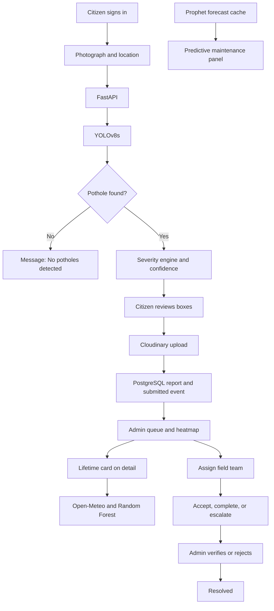
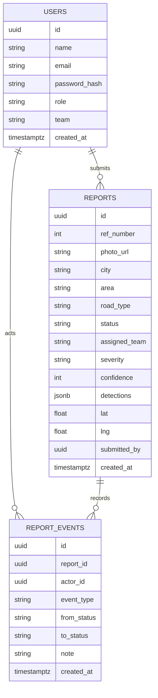
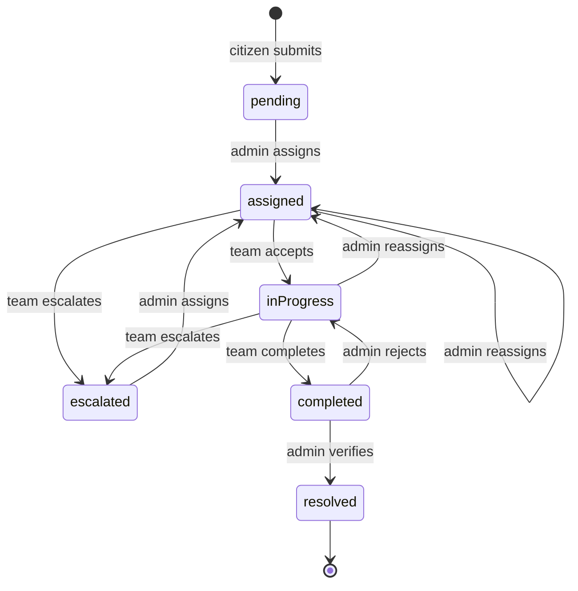

# RahScan

## AI-Powered Pothole Detection and Road Damage Reporting System

### Final Year Project Proposal

**(BSCS)**

| S# | Name | Registration / Roll / Section | Mobile | Email |
| --- | --- | --- | --- | --- |
| 1 | Haseeba Rani | Sp-2023/Bscs/142/A | 03452776619 | haseebarani40@gmail.com |
| 2 | Hafiz Muneeb Ul Hassan | Sp-2023/Bscs/143/A | 03114858783 | muneebulhassan112255@gmail.com |

**Supervised by:** Ms. Zainab Zafar

Department of Computer Science  
Lahore Garrison University

---

## Abstract

Road surfaces in Pakistan’s large cities deteriorate quickly under mixed traffic, monsoon rainfall, and delayed maintenance. Municipal response still depends on manual inspection and unstructured complaints. RahScan is a full-stack reporting system that connects citizens, a computer-vision detector, municipal administrators, and field repair teams.

A citizen registers, signs in, and submits a road photograph with a structured location. The FastAPI backend runs a YOLOv8s detector, draws the result as bounding boxes in the client, and labels each pothole Small, Medium, or Large from its share of the image. Confidence is retained with the report. Photographs are stored on Cloudinary. Report rows, status, and an audit trail are stored in PostgreSQL.

Administrators work from an Expo dashboard: summary statistics, a Leaflet heatmap, a filterable queue, and a report detail view. Opening a report requests a Random Forest repair-window estimate that combines severity, road class, and live weather from Open-Meteo. A separate Prophet module, fitted on a nationwide monthly history of Pakistani road segments, serves a 30-day maintenance forecast with priority and a budget in PKR. Field teams accept work, complete it with a photograph and a note, or return it for reassignment. An administrator verifies completion before a report becomes Resolved.

The client is one Expo application, delivered on the web through React Native Web and structured for iOS and Android. The server is Python, FastAPI, SQLAlchemy, and PostgreSQL.

---

## 1. Introduction

Road infrastructure carries daily mobility and a large share of urban economic activity. In cities such as Lahore, Karachi, Rawalpindi, and Faisalabad, heavy mixed traffic and seasonal rain open potholes faster than inspection teams can find them. Complaints arrive late, locations are incomplete, and repair crews are dispatched after damage is already obvious.

Camera-based detection is now practical on ordinary photographs. The YOLO family localizes many objects in one pass and is widely used for road-damage imagery [1], [2], [3]. Detection alone does not run a maintenance service. A usable system also needs an account for the person who submits the photograph, a stored location, a severity the office can sort, a record of who was assigned, and a forecast the office can use when it plans the next month.

RahScan is that service. Citizens authenticate and file reports. YOLOv8s localizes potholes. A severity engine converts each box into Small, Medium, or Large. PostgreSQL keeps the report and every later status change. Administrators supervise the queue on a map and in a table. A Random Forest model recommends a repair window for the worst pothole on a report, using current weather. Prophet forecasts report volume for road segments over the next 30 days. Field teams carry the repair from assignment to completion, and an administrator closes the report.

The system is self-contained. It does not require a connection to an existing government database. It is intended to run on ordinary server hardware, with detection executed on CPU.

---

## 2. Problem Statement

Pakistani cities do not keep one operational record that links a photograph of a pothole, its place on the map, its size in the frame, the team sent to repair it, and the evidence that the repair was finished. The consequences are familiar.

- Traffic police respond to crashes and do not hold a pavement inventory.
- Municipal departments schedule work from complaints whose locations and severity are uneven.
- Citizens have no personal list of what they reported or where that report stands.
- Offices cannot see which segments keep appearing in the monthly pattern of damage.
- A single missed or low-confidence photograph can be treated as if it were a confirmed hole.

RahScan addresses the operational gap: authenticated reporting, automatic localization and severity, a supervised repair workflow, a per-report repair window, and a segment-level 30-day forecast.

---

## 3. Literature Review

Automated road-damage detection has moved from specialized sensors to ordinary photographs. Asad et al. showed that a deep detector can find potholes from a standard camera without dedicated road-survey hardware [1]. Later YOLO studies reported strong precision and recall on street imagery, including YOLOv8 variants aimed at real-time monitoring [3], [4]. Those studies stop at the box. They do not file a citizen report, store a repair status, or brief an administrator.

A second line of work accepts photographs from the public. Salcedo et al. argued that crowdsourced reports improve maintenance priority only when severity is classified in a consistent way [5]. Many complaint desks still prioritize by how many people called, and they store weak locations. Li et al. combined crowdsourced images with an extended Mask R-CNN [6]. RahScan keeps the public photograph and adds a fixed severity rule so that two offices reading the same box reach the same label.

A third line of work forecasts pavement condition from weather, traffic, and history. Temperature, rainfall, and traffic load are repeatedly named as drivers of pothole growth [7]. Random Forest regression is a standard, inspectable model for tabular pavement features [8], [9]. Prophet was introduced for business time series with seasonality and trend changes, and it is practical when each series is short [10]. RahScan uses these two models for different questions. The forest recommends how soon one detected pothole should be repaired. Prophet estimates how many reports a road segment is likely to attract over the next month.

Public detection sets such as RDD2022 established multi-country benchmarks for road damage [11]. RahScan’s deployed detector is trained for a single class, pothole, on an annotated pothole collection together with smooth-road negatives, as specified in Section 5. The literature therefore motivates the pipeline. The system itself is the joining of detection, accounts, workflow, and the two forecasts.

---

## 4. Project Scope

RahScan is specified as one deployable application with three signed-in roles and two prediction modules.

The system provides:

- Citizen registration and sign-in, and separate sign-in for municipal administrators and field teams.
- A report form: photograph, city, area, street address, road class, optional GPS, landmark, and notes.
- Reverse geocoding from GPS through OpenStreetMap Nominatim, with Photon as the second source.
- YOLOv8s inference on the uploaded image, returning every pothole box up to 50 detections.
- Severity labels Small, Medium, and Large from box area, with a close-up cap and a dominant-hole promotion rule defined in Section 6.
- A confidence score for each box, stored on the report as a percentage.
- A clear outcome when the detector finds no pothole, without creating a report.
- Cloudinary storage of the report photograph and of the completion photograph, delivered over HTTPS as WebP.
- PostgreSQL records for users, reports, and report events.
- An administrator dashboard with totals, severity share, resolution rate, and weekly and monthly counts.
- A Leaflet heatmap of unresolved reports, centered on Pakistan, weighted by severity.
- A queue that filters by city, severity, status, and a 7-day or 30-day window, and that sorts by time or severity.
- Assignment of one of three field teams, with a due date and an optional note.
- A field-team queue: accept, complete with a photograph and a note, or escalate.
- Administrator verification, or rejection back to in-progress with a reason.
- An on-demand Random Forest repair window on the administrator’s report detail, using Open-Meteo weather.
- A Prophet 30-day segment forecast with priority, a risk window, and a PKR budget.
- An audit event for every submission and every status change.

The client is Expo with React Native and React Native Web. Wide screens use a sidebar. Narrow screens use a tab bar. The API is FastAPI. Detection runs on CPU from the weight file `newv8s.pt`.

---

## 5. Development Methodology

The work is organized as an iterative build: prepare the detection set, train and select YOLOv8s, implement the API and database, train the two planning models, and deliver the three portals in one Expo application.

### 5.1 Dataset acquisition and preparation

The detector is a single-class pothole model. Training images come from two public collections used together:

- The Annotated Potholes Dataset published by Chitholian, with Pascal VOC XML boxes on road photographs.
- The Road Surface Dataset published by Hemanthhari, from which smooth road images are taken as negatives. Each negative image receives an empty label file so the model also sees undamaged pavement.

XML boxes are converted to YOLO label files with one class, `pothole`. Both collections are shuffled with random seed 42 and divided 70 percent training, 10 percent validation, and 20 percent test (`train` ends at `0.70n`, `validation` ends at `0.80n`). Ultralytics augmentation is enabled for the training run. The recorded augmentation settings include mosaic, horizontal flip at 0.5, HSV jitter, translation, scale, and random erasing.

### 5.2 Model training

YOLOv8s is the detection architecture. It is initialized from the official `yolov8s.pt` checkpoint and fine-tuned on the set above [2]. Training runs on a Kaggle GPU notebook (NVIDIA Tesla T4) with this configuration:

| Setting | Value |
| --- | --- |
| Epochs | 50 |
| Image size | 640 |
| Batch size | 16 |
| Initial learning rate | 0.01 |
| Final learning-rate fraction | 0.01 |
| Patience | 15 |
| Optimizer | auto |
| Device | GPU 0 |
| Run name | `pothole_v1` |

Validation on the held-out validation split of this collection peaks at epoch 40:

| Metric | Value |
| --- | --- |
| Precision | 0.74276 |
| Recall | 0.67257 |
| mAP at IoU 0.50 | 0.75011 |
| mAP at IoU 0.50:0.95 | 0.44888 |

At epoch 50 the same split records precision 0.76537, recall 0.65863, mAP50 0.73176, and mAP50-95 0.44677. The best checkpoint is deployed as `backend/weights/newv8s.pt`.

Runtime inference uses a stricter and larger setting than training, chosen so small distant holes survive and faint artifacts do not:

| Runtime setting | Value |
| --- | --- |
| Device | CPU |
| Confidence floor | 0.35 |
| IoU | 0.50 |
| Image size | 1280 |
| Maximum detections | 50 |

Phone photographs are rotated with their EXIF orientation before width and height are read, so box area matches the picture the citizen sees.

### 5.3 Severity classification and confidence

Severity is a rule on the detector’s boxes. It is not a second network. For a box `(x1, y1, x2, y2)` on an image of width `W` and height `H`:

```
area% = ((x2 - x1) * (y2 - y1)) / (W * H) * 100
```

The area is rounded to two decimal places.

| Area share | Label |
| --- | --- |
| Less than 5% | Small |
| From 5% through 15% inclusive | Medium |
| Greater than 15% | Large |

Two adjustments follow, because a single close photograph would otherwise mark almost every hole as Large, and because one clearly dominant hole in a multi-hole frame should not stay Medium only because the cut is 15 percent.

- **Close-up cap.** When the image contains one box, and that box is at least 20 percent of the width or of the height, or its area is greater than 15 percent, a Large label is recorded as Medium.
- **Dominant-hole promotion.** When the image contains several boxes, the largest box is raised to Large if its area is at least 12 percent, its area is at least twice the next box, its confidence is at least 0.50, and it is not already Large.

Each box confidence is rounded to two decimal places in the detection response. The client stores confidence as an integer percentage. The report’s primary confidence is the percentage of the highest-severity box, breaking ties by area. If the detector returns no box, the response is HTTP 200 with the message “No potholes detected.” and an empty list. No report row is created.

### 5.4 Backend and database

The API is FastAPI. Persistence is PostgreSQL through SQLAlchemy and psycopg, with TLS required on the database connection. Three tables carry the operational data: `users`, `reports`, and `report_events`. Detection boxes for a report are stored as JSON on the report row, and the primary box is also stored in numeric columns. Photographs are not stored as bytea. The report stores the Cloudinary HTTPS URL and public id.

Authentication is email and password. Passwords are hashed with bcrypt. A successful login returns an HS256 JSON Web Token that expires seven days after it is issued. Routes that read or write reports require the matching role: citizen, admin, or team.

On startup the process loads the YOLO weights, the lifetime forest, and the maintenance forecast table. If a weight file or a forecast file is missing, that feature answers HTTP 503 and the rest of the API stays up.

### 5.5 Pothole lifetime module

The lifetime module answers a planning question: given this photograph’s severity, the road class, and today’s weather, how many days should the office allow before repair. The number is a recommended repair window. It is clamped between 2 and 60 days. It is computed when an administrator opens the report, for the worst box on that report, and it is shown on the detail screen.

The regressor is a scikit-learn `RandomForestRegressor` with 200 trees and `random_state` 42 [9]. It is trained on 2,500 synthetic rows, seed 42, because a labeled history of “days until this hole became critical” does not exist at project start. The label generator is:

```
days = 38
     - 9 * severity
     - 0.12 * min(area%, 20)
     - 5 * road_class
     - 10 * (rain_probability / 100)
     - season_cut
     - temperature_penalty
     + Normal(0, 2.5)
```

Integer codes are severity Small=0, Medium=1, Large=2, and road class Simple Road=0, Service Road=1, Highway=2. Season cuts, in days, are Winter 0, Spring 1, Summer 2, Monsoon 6, and Autumn 1.5. The temperature penalty is 5 days at or above 40°C, 3 days at or above 35°C, 4 days at or below 5°C when rain probability is at least 40, and 2 days at or below 8°C. The result is rounded and clamped to the range 2–60. The training split is 80/20 with `random_state` 42.

At request time the feature vector is:

1. Severity
2. Bounding-box area percent, capped at 20
3. Road type (Highway, Service Road, or Simple Road; the client’s Local Road is Simple Road)
4. Traffic density, derived only from road type: Highway = High, Service Road = Medium, Simple Road = Low
5. Rainfall probability
6. Temperature in Celsius
7. Season

Weather is read from Open-Meteo. The location string is geocoded with preference for Pakistan, then the forecast endpoint returns the current temperature and the precipitation probability of the current hour in Asia/Karachi. The HTTP timeout is 8 seconds. If geocoding or the forecast fails, the module still returns a window, using rainfall probability 30, temperature 28.0°C, and the season of the current month in Asia/Karachi. The response marks `source` as `open-meteo` or `fallback`.

The season calendar is March–April Spring, May–June Summer, July–September Monsoon, October–November Autumn, and December–February Winter.

Urgency bands on the returned day count are:

| Days | Band |
| --- | --- |
| Fewer than 7 | Critical |
| 7 to 14 | High |
| 15 to 30 | Moderate |
| More than 30 | Routine |

The response also includes a calendar deadline in Asia/Karachi and a factor line listing severity, road class, rain, temperature, and season. If the stored confidence is below 50 percent, the detail screen tells the administrator that prediction reliability is low.

### 5.6 Predictive maintenance module

Lifetime scores one report. Maintenance scores road segments for the coming month. The history is a constructed monthly series for Pakistani cities, twelve months from 1 September 2025 through 1 August 2026, one row per segment per month. The generator covers Punjab, Sindh, Khyber Pakhtunkhwa, Balochistan, Islamabad, Gilgit-Baltistan, and Azad Jammu and Kashmir, including Lahore, Karachi, Rawalpindi, and Faisalabad. The fitted table contains 488 segments.

Facebook Prophet fits one model per segment offline [10]. Seasonality flags for year, week, and day are off, because the series is monthly. The model uses 3 changepoints and `changepoint_prior_scale` 0.05. The forecast horizon is one month (`periods=1`, month-start frequency). The published count is the last `yhat`, rounded, and not below zero. Trend is increasing, decreasing, or stable. A change is stable when the absolute trend delta is at most 0.25 or the relative change is at most 0.05.

The API does not refit Prophet on each page view. Startup reads `maintenance_forecasts_v2.csv` into memory. Priority is assigned on the full table after sorting by predicted report count, descending:

- Urgent: the first 20 percent of segments, rounding upward
- Plan Repair: the next 50 percent, rounding upward
- Monitor: the remainder

A risk window is attached by a fixed rule on trend and on the ratio of predicted count to historical monthly average:

- Increasing trend and ratio at least 1.5: “High risk within 1-2 weeks”
- Increasing or stable trend and ratio at least 1.0: “Moderate risk within 3-4 weeks”
- Otherwise: “Low risk (30+ days)”

The budget in PKR is:

```
budget = 100,000 + (cost per report) * (predicted reports in 30 days)
```

| Road class | Cost per predicted report |
| --- | --- |
| Highway | 150,000 |
| Service Road | 90,000 |
| Simple Road | 60,000 |

The administrator’s Predictive screen lists these segments and can filter by province and city. It shows priority, risk window, expected reports, historical average, trend, and budget.

### 5.7 Client applications

One Expo project supplies the citizen portal, the municipal portal, and the field-team portal. React Navigation holds a root stack and three tab navigators. On a wide layout the tabs become a sidebar.

**Citizen.** Landing offers Get Started, Sign up, and a link to the municipal portal. After login the citizen has Home, Report, My Reports, Map, and Profile. Home leads to “Report a Pothole.” The report screen previews the photograph, requires city, area, and street address, and offers GPS. Analyze calls detection. The result screen numbers each box and shows its severity. Submit uploads the image and creates the report, then returns the citizen to My Reports.

**Administrator.** Email and password open Dashboard, Map, Reports, and Predictive. The queue warns on confidence below 50 percent and on a report that has no coordinates or a blank address. Detail shows the photograph, boxes, confidence, the lifetime card, and the assignment form.

**Field team.** Three teams exist: Road Maintenance, Emergency Repair, and Inspection. A team sees only its assigned reports, accepts work, marks it complete with a photograph and a note, or escalates it with a reason so the administrator can reassign it.

### 5.8 Repair workflow

A new report is `pending`. The legal transitions are:

| Action | Who | From | To |
| --- | --- | --- | --- |
| Assign or reassign | Administrator | pending, escalated, assigned, or in progress | assigned |
| Accept | Assigned team | assigned | in progress |
| Escalate | Assigned team | assigned or in progress | escalated, team cleared |
| Complete | Assigned team | in progress | completed |
| Verify | Administrator | completed | resolved |
| Reject | Administrator | completed | in progress |

Resolved has no outgoing transition. A later photograph of the same road is a new report. Every action writes a `report_events` row with the actor, the previous status, the new status, and any note or photograph. The citizen sees public labels: Submitted, Repair Assigned, In Progress, Repair done being verified, Under Review, and Resolved.

### 5.9 Evaluation

Detector quality is the validation table in Section 5.2, measured on the validation split of the training collection at image size 640. The lifetime trainer reports mean absolute error, root mean squared error, and R² on its 20 percent hold-out, and it prints feature importances. The maintenance trainer writes one forecast row per segment and a trend tally. The API maps a missing model to HTTP 503, an unreadable image to HTTP 400 with “Could not read the image.”, and an empty upload to HTTP 400 with “Empty image / missing file.”

---

## 6. System Architecture

RahScan is a three-tier application. The Expo client never opens PostgreSQL and never holds the weather or Cloudinary secrets. The API is the only writer of report rows.

```
Citizen application (Expo / React Native Web)
        |
Authentication (email, bcrypt, JWT)
        |
FastAPI backend
        |
YOLOv8s detection
        |
Severity engine
        |
PostgreSQL (users, reports, report events)
        |
Prediction modules (Random Forest, Prophet cache)
        |
Admin dashboard
        |
Field team workflow
```

Supporting services sit beside that column. Cloudinary stores images. Open-Meteo supplies weather for the lifetime call. Nominatim and Photon reverse-geocode GPS. Leaflet, loaded inside the map WebView, draws the heatmap.



The maintenance panel is fed by the cached forecast, not by refitting a model when a single report arrives.

### 6.1 Logical data model



Lifetime results and maintenance forecasts are computed products. The forest is a joblib file. The segment forecast is a CSV loaded at startup. Neither is a transactional table.

### 6.2 Report state model



---

## 7. Operating Environment

| Layer | Specification |
| --- | --- |
| Client | Expo SDK 57, React 19, React Native 0.86, React Native Web. Chrome is the development browser. The web client needs no plugin. |
| Maps | Leaflet 1.9.4 and leaflet.heat 0.2.0 inside a WebView. |
| API | FastAPI, Pydantic v2, Uvicorn. |
| Database | PostgreSQL through SQLAlchemy 2 and psycopg 3. |
| Detection | Ultralytics YOLOv8, PyTorch, Pillow. Weights: `newv8s.pt`. |
| Lifetime | scikit-learn Random Forest, joblib. |
| Maintenance | Prophet 1.1 or newer, pandas. Served from a CSV cache. |
| Images | Cloudinary, unsigned upload preset, folder `rahscan/reports`, format WebP. |
| Weather | Open-Meteo geocoding and forecast APIs. No client-side key. |
| Geocoding | Nominatim and Photon. |
| Auth | PyJWT HS256, bcrypt. |

Configuration lives in environment variables: database URL, JWT secret, Cloudinary cloud name and upload preset, CORS origins, and the passwords used to seed the demonstration accounts. The Open-Meteo service does not use an API key.

The heatmap opens at latitude 30.0, longitude 69.0, zoom 5. Heat intensity is 1 for Small, 2 for Medium, and 3 for Large. Resolved reports are omitted from the heat layer. A tap selects the nearest report’s area and lists that area’s reports.

---

## 8. Deliverables

1. A single-class YOLOv8s pothole detector, trained on the Chitholian annotated set and Hemanthhari smooth-road negatives, exported as `newv8s.pt`, with the validation metrics in Section 5.2.
2. A severity engine implementing the 5 percent and 15 percent bands, the close-up cap, and the dominant-hole promotion.
3. A FastAPI service with citizen, administrator, and team routes, PostgreSQL persistence, and JWT authentication.
4. A Random Forest lifetime model and an Open-Meteo weather adapter, exposed as `POST /api/predict/lifetime`.
5. A Prophet maintenance forecast for 488 segments, exposed as `GET /api/predictive-maintenance`, with priority, risk window, and PKR budget.
6. An Expo client: citizen reporting and map, administrator dashboard, heatmap, queue, and forecast, and a field-team queue.
7. An event history for submission, assignment, acceptance, completion, verification, rejection, and escalation.

---

## 9. External Interfaces

The client calls the API with `fetch`. JSON bodies use camelCase field names. Image detection is multipart form data, field name `file`. Authenticated calls send `Authorization: Bearer`.

Principal routes:

| Method and path | Role | Purpose |
| --- | --- | --- |
| `POST /auth/signup` | Public | Create a citizen. |
| `POST /auth/login` | Public | Issue a token. |
| `GET /auth/me` | Any signed-in user | Return name, email, role, and team. |
| `POST /api/detect` | Public | Run YOLOv8s and return boxes. |
| `POST /uploads/signature` | Citizen or team | Cloudinary upload parameters. |
| `POST /reports` | Citizen | Store a report. |
| `GET /reports/me` | Citizen | List the caller’s reports. |
| `GET /reports/locations` | Citizen | Unresolved points for the citizen map. |
| `GET /api/geocode/reverse` | Public | City, area, and address from coordinates. |
| `GET /admin/reports` | Admin | Full queue. |
| `POST /admin/reports/{id}/assign` | Admin | Assign a team and a deadline. |
| `POST /admin/reports/{id}/verify` | Admin | Resolve a completed report. |
| `POST /admin/reports/{id}/reject` | Admin | Return a completion for more work. |
| `POST /api/predict/lifetime` | Public | Repair window for one detection. |
| `GET /api/predictive-maintenance` | Public | Cached 30-day segment forecast. |
| `GET /team/reports` | Team | That team’s queue. |
| `POST /team/reports/{id}/accept` | Team | Start work. |
| `POST /team/reports/{id}/complete` | Team | File completion evidence. |
| `POST /team/reports/{id}/escalate` | Team | Hand the report back. |
| `GET /health` | Public | Database ping. |

A retired stub, `POST /ai/detect`, responds with HTTP 410 and directs callers to `POST /api/detect`.

---

## References

[1] M. H. Asad, S. Khaliq, M. H. Yousaf, M. O. Ullah, and A. Ahmad, “Pothole detection using deep learning: a real-time and AI-on-the-edge perspective,” *Advances in Civil Engineering*, vol. 2022, pp. 1–13, Apr. 2022, doi: 10.1155/2022/9221211.

[2] G. Jocher, A. Chaurasia, and J. Qiu, “Ultralytics YOLOv8,” Ultralytics, version 8.0.0, Jan. 2023. [Online]. Available: https://github.com/ultralytics/ultralytics

[3] R. Thakur, Bhumika, P. Kumar, and P. Thakur, “YOLOv8-based pothole detection: a real-time approach for road infrastructure monitoring,” *SSRN Electronic Journal*, Nov. 2024, doi: 10.2139/ssrn.5089189.

[4] N. Bhavana et al., “POT-YOLO: real-time road potholes detection using edge segmentation based YOLOv8 network,” *IEEE Sensors Journal*, vol. 24, no. 13, 2024, doi: 10.1109/JSEN.2024.3399215.

[5] E. Salcedo, M. Jaber, and J. Requena Carrión, “A novel road maintenance prioritisation system based on computer vision and crowdsourced reporting,” *Journal of Sensor and Actuator Networks*, vol. 11, no. 1, p. 15, Feb. 2022, doi: 10.3390/jsan11010015.

[6] L. Li, J. Liu, J. Xing, Z. Liu, K. Lin, and B. Du, “Road pothole detection based on crowdsourced data and extended Mask R-CNN,” *IEEE Transactions on Intelligent Transportation Systems*, 2024, doi: 10.1109/TITS.2024.3367891.

[7] S. Y. Lee, T. H. Le, and Y. M. Kim, “Prediction and detection of potholes in urban roads: machine learning and deep learning based image segmentation approaches,” *Development Engineering*, vol. 8, p. 100100, 2022, doi: 10.1016/j.deveng.2022.100100.

[8] S. Cano-Ortiz, P. Pascual-Muñoz, and D. Castro-Fresno, “Machine learning algorithms for monitoring pavement performance,” *Automation in Construction*, vol. 136, p. 104190, Apr. 2022, doi: 10.1016/j.autcon.2022.104190.

[9] F. Pedregosa et al., “Scikit-learn: machine learning in Python,” *Journal of Machine Learning Research*, vol. 12, pp. 2825–2830, 2011.

[10] S. J. Taylor and B. Letham, “Forecasting at scale,” *The American Statistician*, vol. 72, no. 1, pp. 37–45, Apr. 2018, doi: 10.1080/00031305.2017.1380080.

[11] D. Arya, H. Maeda, S. K. Ghosh, D. Toshniwal, and Y. Sekimoto, “RDD2022: a multi-national image dataset for automatic road damage detection,” *Geoscience Data Journal*, vol. 11, pp. 846–862, 2024, doi: 10.1002/gdj3.260.

[12] P. Zippenfenig, “Open-Meteo.com Weather API,” 2023. [Online]. Available: https://open-meteo.com/

[13] S. Ramírez, “FastAPI,” 2018. [Online]. Available: https://fastapi.tiangolo.com/

[14] V. Agafonkin, “Leaflet: an open-source JavaScript library for mobile-friendly interactive maps,” 2011. [Online]. Available: https://leafletjs.com/
