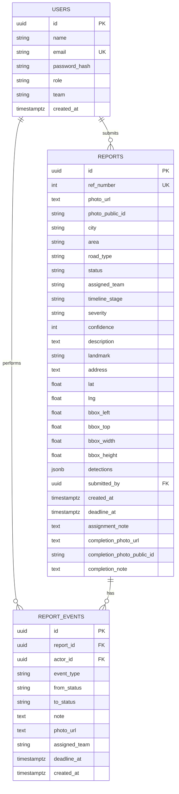
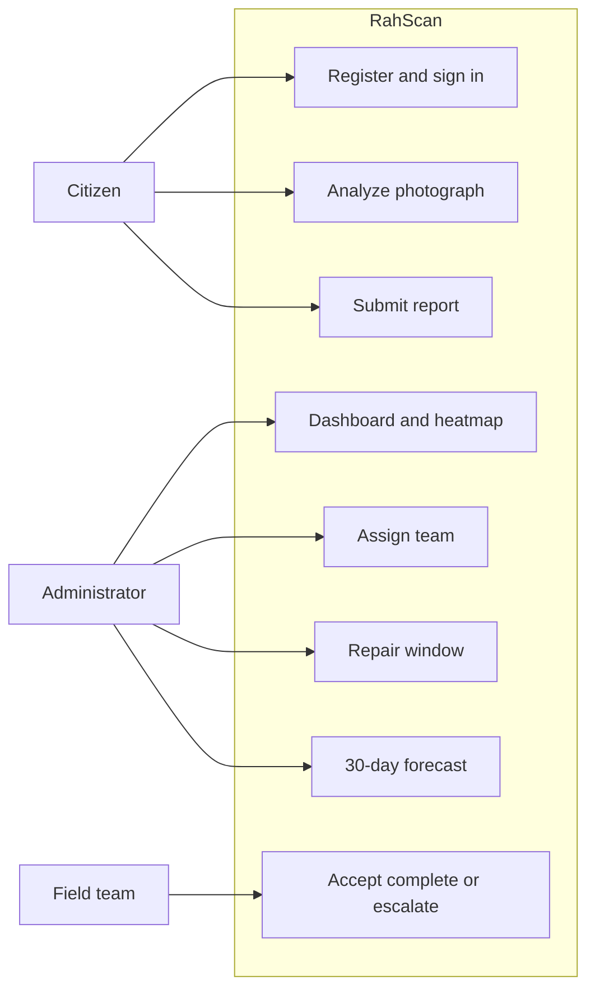
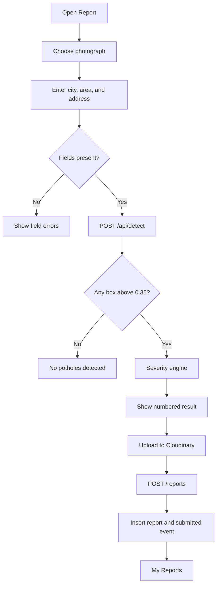
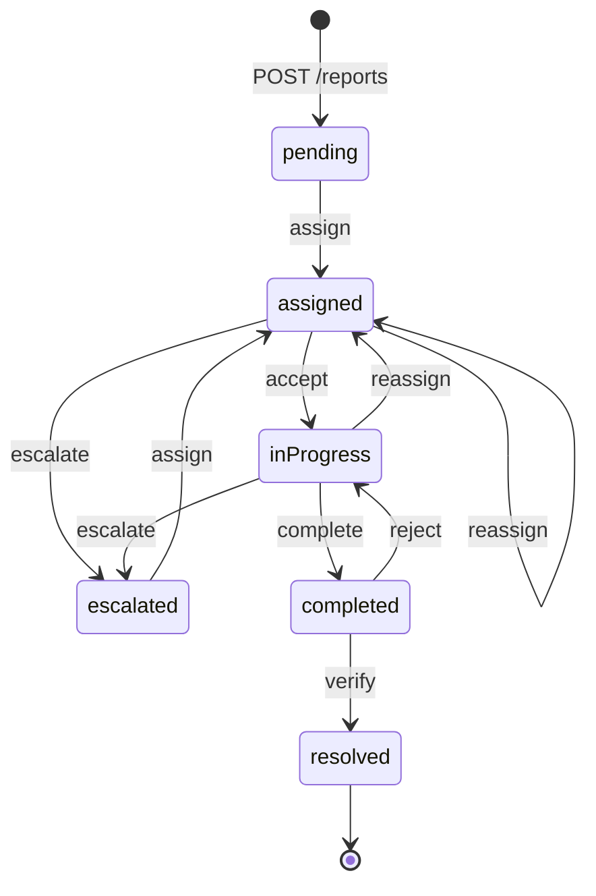
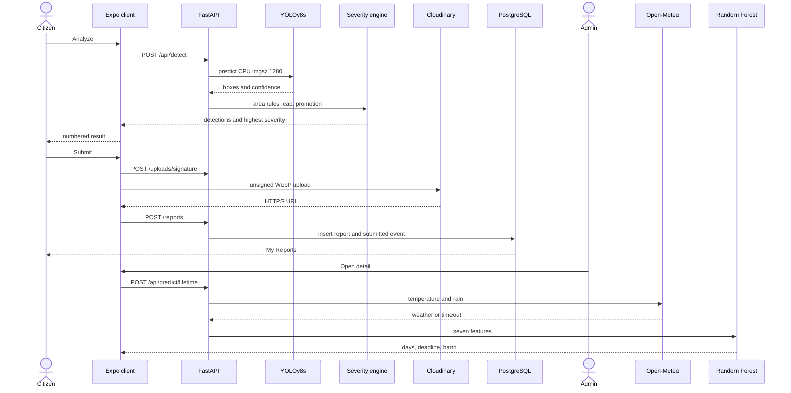
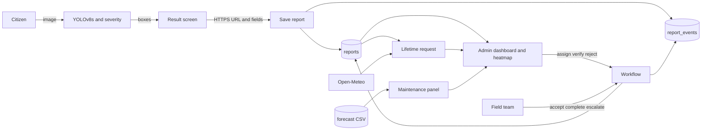

# Software Requirements Specification

## RahScan: AI-Powered Pothole Detection and Road Damage Reporting System

**(BSCS)**

| S# | Name | Registration / Roll / Section | Mobile | Email |
| --- | --- | --- | --- | --- |
| 1 | Haseeba Rani | Sp-2023/Bscs/142/A | 03452776619 | haseebarani40@gmail.com |
| 2 | Hafiz Muneeb Ul Hassan | Sp-2023/Bscs/143/A | 03114858783 | muneebulhassan112255@gmail.com |

**Supervised by:** Ms. Zainab Zafar

Department of Computer Science  
Lahore Garrison University

---

## Table of Contents

1. Introduction  
2. Overall Description  
3. External Interface Requirements  
4. System Features  
5. Other Nonfunctional Requirements  
6. Logical Data Model  
7. Application Programming Interface  
8. Behavioral Models  
References  

---

## 1. Introduction

Road surfaces in Pakistan’s major cities fail under mixed traffic and monsoon water, while inspection remains manual. RahScan is the web and mobile client, the detection service, and the municipal workflow that turn a citizen photograph into a tracked repair.

This Software Requirements Specification states the functional and nonfunctional requirements of RahScan as built for the Bachelor of Science in Computer Science final-year project at Lahore Garrison University. It is the common reference for the supervisor, the developers, and the examiners.

### 1.1 Purpose

The document specifies:

- authenticated citizen reporting
- YOLOv8s pothole detection and the severity engine
- PostgreSQL storage of users, reports, and audit events
- the administrator dashboard, heatmap, and queue
- the Random Forest repair-window module and Open-Meteo
- the Prophet 30-day maintenance forecast
- the field-team accept, complete, and escalate workflow

### 1.2 Document Conventions

The document follows the IEEE structure for a software requirements specification. Functional requirements use the identifier `REQ-n`. Business rules use `BR-n`. “The system” means RahScan. “The detection model” means the Ultralytics YOLOv8s checkpoint `newv8s.pt`, trained as a single-class pothole detector [2]. Requirements are written with “shall.” Diagrams in Section 8 are the architecture, data, and behavior of this system.

### 1.3 Intended Audience

- **Project supervisor (Ms. Zainab Zafar):** scope, requirements, and design.
- **Developers (Haseeba Rani and Hafiz Muneeb Ul Hassan):** Sections 3, 4, 6, and 7 are the implementation contract.
- **Testers:** Sections 4 and 5 define observable behavior.
- **Examiners:** Sections 1 through 8 in order.

### 1.4 Product Scope

RahScan serves urban road-damage reporting in Pakistan. A citizen creates an account, submits a photograph and a location, and receives detection boxes before the report is stored. An administrator sees every report on a heatmap and in a queue, assigns a field team, reads a repair-window estimate, and reads a 30-day segment forecast. The assigned team accepts the job, files completion evidence, or escalates it. The administrator verifies completion.

The product is a standalone Expo application and a FastAPI service. It does not integrate with a government asset system. Detection runs on CPU. Images are stored on Cloudinary. Weather is read from Open-Meteo. Map display uses Leaflet.

---

## 2. Overall Description

### 2.1 Product Perspective

RahScan has three portals on one client and one API.

1. **Citizen portal.** Registration, sign-in, report capture, detection review, personal report list, and a map of unresolved reports.
2. **Processing services.** YOLOv8s detection, the severity engine, Cloudinary upload, PostgreSQL writes, Open-Meteo, the Random Forest repair window, and the cached Prophet forecast.
3. **Staff portals.** The administrator dashboard and the field-team queue.

```
Citizen application (Expo / React Native Web)
        |
Authentication
        |
FastAPI backend
        |
YOLOv8s detection
        |
Severity engine
        |
PostgreSQL
        |
Prediction modules
        |
Admin dashboard
        |
Field team workflow
```

### 2.2 Product Functions

- Citizen registration and sign-in by email and password.
- Administrator and field-team sign-in, with role checks on staff routes.
- Photograph preview, required city, area, and street address, optional GPS, road class, landmark, and notes.
- Reverse geocoding of GPS coordinates.
- Multi-pothole YOLOv8s detection with confidence and severity.
- A no-pothole response that does not create a report.
- HTTPS WebP storage of photographs.
- Report persistence with a reference number and a submitted audit event.
- Dashboard totals, severity share, resolution rate, and weekly and monthly trends.
- Leaflet heatmap of unresolved reports.
- Filterable municipal queue and report detail.
- Warnings when confidence is below 50 percent or location coordinates are missing.
- Team assignment, acceptance, completion, escalation, verification, and rejection.
- On-demand repair window for the worst box on a report.
- Thirty-day segment forecast with priority, risk window, and budget.
- An append-only event row for each workflow action.

### 2.3 User Classes

| Class | Description | Technical expectation |
| --- | --- | --- |
| Citizen | Registers, submits photographs, reviews boxes, and follows personal reports. | A phone or a computer with a camera and an internet connection. |
| Administrator | Supervises the queue, the map, the forecast, and verification. | Comfort with a web dashboard. |
| Field team | One of Road Maintenance, Emergency Repair, or Inspection. Accepts, completes, or escalates assigned reports. | Comfort with a web or phone queue. |
| Supervisor and examiners | Review both the citizen portal and the staff portals. | Software engineering and applied machine learning. |

### 2.4 Operating Environment

- **Client.** Modern browsers through Expo web, and the iOS and Android projects defined in the Expo configuration. No browser plugin. Leaflet is loaded inside the map view from its distribution URL.
- **Server.** Python application served by Uvicorn and FastAPI. PostgreSQL is reached with SQLAlchemy and psycopg over TLS.
- **Training.** The YOLOv8s checkpoint is produced on a Kaggle GPU notebook and copied to the API host as `newv8s.pt`. Prophet models are fitted offline. The API loads the resulting forecast table.
- **Network.** Citizen upload, staff use, Cloudinary, Open-Meteo, and reverse geocoding require internet access.

### 2.5 Design and Implementation Constraints

- Detection shall run on CPU from the YOLOv8s weights, so the host does not depend on a GPU.
- The detection training set is the Chitholian Annotated Potholes Dataset plus smooth-road negatives from the Hemanthhari Road Surface Dataset, split 70/10/20 with seed 42.
- The lifetime model is trained on 2,500 synthetic rows because a labeled municipal history of deterioration time is not part of the system inputs.
- The maintenance history is a 12-month synthetic monthly panel of 488 Pakistani segments.
- The client stack is Expo, React Native, and React Native Web. The server stack is Python, FastAPI, and PostgreSQL. Maps use Leaflet.
- Libraries used by the running system are available at no license cost: Ultralytics, scikit-learn, Prophet, FastAPI, PostgreSQL, Leaflet, and the Expo SDK. Cloudinary is the image host. Open-Meteo is the weather host.

### 2.6 Assumptions and Dependencies

- Citizens can photograph a road and reach the API over the internet.
- Open-Meteo geocoding and forecast endpoints remain available. When they are not, the lifetime module uses the fallback values in REQ-33.
- The deployed weight file remains `backend/weights/newv8s.pt`.
- Cloudinary accepts uploads with the configured unsigned preset.
- Demonstration accounts for one citizen, one administrator, and three teams may be seeded. Their passwords are supplied through environment variables and stored only as bcrypt hashes.

---

## 3. External Interface Requirements

### 3.1 User Interfaces

The client is one Expo application. Wide layouts show a sidebar. Narrow layouts show a bottom tab bar. Copy is short English.

**Public landing**

- Wordmark and the line “Report Potholes. Fix Your City.”
- Get Started opens citizen sign-in.
- Sign up opens registration.
- Municipal Authority opens the staff sign-in, with an Admin / Field Team switch.

**Citizen portal**

- Home, with a Report a Pothole action and recent reports.
- Report form: image preview, city, area, road class (Highway, Service Road, Local Road), street address, Use Current Location, landmark, and notes.
- Analyze shows a spinner on the button while detection runs.
- Detection result: numbered boxes, a severity badge on each box, and Submit Report.
- My Reports and a per-report timeline.
- Map of unresolved report locations.
- Profile.

**Administrator portal**

- Dashboard: Total, Pending, In Progress, Awaiting verification, Resolved, severity bars, resolution rate, and a weekly or monthly chart.
- Map: heatmap, area chips, and an area card when a hotspot is tapped.
- Reports: search by reference number, filters for city, severity, status, and date window (all, 7 days, 30 days), and sort by newest, oldest, or severity.
- Report detail: photograph and boxes, confidence percentage, quality warnings, lifetime card, assignment form, and verify or reject when the report is completed.
- Predictive: province and city filters, and cards for Urgent, Plan Repair, and Monitor.

**Field-team portal**

- Queue limited to the signed-in team.
- Counts for assigned, in progress, completed, and overdue.
- Detail actions: accept, complete (photograph, public id, and note), and escalate (reason).

**Errors the citizen sees**

| Condition | Message |
| --- | --- |
| City, area, or street address empty | “Enter the city”, “Enter the area”, or “Enter the street address” |
| No photograph | “Add a photo of the road damage.” |
| Detector finds nothing | “No potholes detected.” plus the service message |
| Image bytes are not readable | “Could not read the image.” |
| Upload or network failure during analysis | “Could not analyze the photo” and the service detail |
| GPS denied, timed out (15 seconds), or unavailable | A location-unavailable message telling the user to type the address |

### 3.2 Hardware Interfaces

- The citizen camera or photo library is used only through the operating-system picker (`expo-image-picker`). The server receives image bytes and does not address the camera.
- The API process, PostgreSQL, and the weight file reside on the server. Inference device is CPU.
- Clients and the server require a network interface.

### 3.3 Software Interfaces

| Component | Role in RahScan |
| --- | --- |
| Ultralytics YOLOv8 | Loads `newv8s.pt` at startup. Input is an RGB image. Output is boxes, confidences, and the class pothole. |
| Pillow | Decodes the upload and applies EXIF orientation. |
| Cloudinary | Stores report and completion images as WebP under `rahscan/reports`. |
| PostgreSQL | System of record for users, reports, and events. |
| scikit-learn | `RandomForestRegressor` for the repair window [9]. |
| Prophet | Offline monthly forecast per segment [10]. |
| Open-Meteo | Geocoding and current temperature plus hourly precipitation probability [12]. |
| Nominatim and Photon | Reverse geocoding of citizen GPS. |
| Leaflet 1.9.4 and leaflet.heat 0.2.0 | Heatmap inside the map WebView [14]. |
| FastAPI | HTTP API [13]. |
| Expo, React Native, React Native Web | All three portals. |

### 3.4 Communications Interfaces

- The Expo client calls the API with `fetch`. JSON requests set `Content-Type: application/json`. Detection sends `multipart/form-data` with the file part named `file`.
- Authenticated requests send `Authorization: Bearer <token>`.
- The database connection string is configured with `sslmode=require`.
- Open-Meteo, Nominatim, Photon, and Cloudinary are called from the server or, for the unsigned image upload, from the client using parameters the server issued. The Cloudinary API secret is not sent to the client.

---

## 4. System Features

### 4.1 Identity and Access

#### 4.1.1 Description

Every operational action except detection, geocoding, lifetime, the maintenance list, and health is tied to a user. Citizens register themselves. Administrators and field teams are provisioned, including the seeded demonstration accounts. A token names the user id, email, and role.

#### 4.1.2 Stimulus and response

- The visitor opens Sign up, enters name, email, and a password of at least 6 characters, and receives a citizen session.
- The visitor opens Get Started and signs in with email and password.
- Staff open Municipal Authority, choose Admin or Field Team, and sign in. The client admits only the matching role to that portal.
- Sign out clears the local session and returns to the landing screen.
- A token older than seven days, or an unknown user id, is rejected with HTTP 401.

#### 4.1.3 Functional requirements

- **REQ-1 Citizen registration.** The system shall create a user with role `citizen` from name, email, and password. The email shall be stored in lower case. The system shall reject a missing `@` or `.` in the email, and it shall reject a duplicate email with HTTP 409.
- **REQ-2 Authentication.** The system shall issue a session when email and password match a stored bcrypt hash. The failure message shall be “Invalid email or password” for both unknown email and wrong password.
- **REQ-3 Role separation.** The system shall recognize the roles `citizen`, `admin`, and `team`. Team users shall carry one of `roadMaintenance`, `emergencyRepair`, or `inspection`. Citizen routes shall reject other roles. Administrator routes shall reject other roles. Team routes shall reject a user whose role is not `team` or whose team key is unknown.
- **REQ-4 Session token.** The system shall return an HS256 JSON Web Token whose `exp` is seven days after issue. The web client shall persist the session under the key `rahscan.session` and shall send it as a bearer token. On HTTP 401 from `GET /auth/me`, the client shall sign the user out.
- **REQ-5 Password storage.** The system shall store only a bcrypt hash produced with `bcrypt.gensalt()`. Passwords shorter than 6 characters shall be rejected. The system shall not store the plaintext password.

### 4.2 Citizen Reporting

#### 4.2.1 Description

A signed-in citizen files one photograph and a structured location. Detection runs before the report is stored, so the citizen can see the boxes and can stop if the image contains no pothole.

#### 4.2.2 Stimulus and response

- Home shows Report a Pothole.
- Choosing a photograph displays it on the form. Camera and library each request permission first.
- Use Current Location requests GPS with a 15-second timeout and high accuracy. Coordinates are reverse-geocoded into city, area, and address when the lookup returns them.
- Analyze with an empty city, area, or street address shows the field errors and does not call detection.
- Analyze with a photograph shows the button spinner, posts the image, and either opens the result screen or shows “No potholes detected.”
- Submit Report uploads the image and creates the report, then opens My Reports.
- The citizen map lists unresolved reports that have coordinates.

#### 4.2.3 Functional requirements

- **REQ-6 Signed-in home.** After citizen authentication the system shall present Home, Report, My Reports, Map, and Profile. The public landing shall not itself accept a report.
- **REQ-7 Photograph preview.** The system shall accept an image from the camera or the library at picker quality 0.8 and shall display the selected image before analysis.
- **REQ-8 Required location text.** The system shall require non-empty city, area, and street address on the form before analysis. The API shall reject an empty city with “City is required.”
- **REQ-9 GPS and reverse geocoding.** The system shall accept optional latitude and longitude. Given coordinates, the system shall query Nominatim and, when needed, Photon, with a 10-second timeout, and shall return city, area, and address strings. A typed address shall remain valid when GPS is absent.
- **REQ-10 Road class and notes.** The system shall require a road class of Highway, Service Road, or Local Road, defaulting to Local Road. Landmark and notes shall be optional.
- **REQ-11 Analysis indicator.** While `POST /api/detect` is in progress, the Analyze control shall show a busy indicator and shall ignore a second press.
- **REQ-12 Detection service.** The system shall expose `POST /api/detect` accepting one image file. The service shall decode the image with Pillow, apply EXIF transposition, and run YOLOv8s.
- **REQ-13 Multiple detections.** One inference shall return every box that passes the runtime thresholds, up to 50 boxes. Thresholds shall be confidence 0.35, IoU 0.50, and image size 1280, on CPU.
- **REQ-14 Severity.** The system shall compute box area as a percentage of the full frame, rounded to two decimal places, and shall label it Small below 5 percent, Medium from 5 percent through 15 percent inclusive, and Large above 15 percent. When the only box is a close-up (width or height at least 20 percent of the frame, or area greater than 15 percent), Large shall be stored as Medium. When several boxes are present, the largest shall be promoted to Large when its area is at least 12 percent, at least twice the next box, and its confidence is at least 0.50.
- **REQ-15 Confidence.** Each detection shall include a confidence in the closed interval from 0 to 1, rounded to two decimal places. The stored report confidence shall be the integer percentage of the primary box. The primary box shall be the highest severity, and among boxes of that severity the one with the greatest area.
- **REQ-16 No-pothole outcome.** When no box passes the confidence floor, the system shall return HTTP 200, an empty detection list, a null highest severity, and the message “No potholes detected.” The system shall not create a report for that outcome.
- **REQ-17 Result review.** The result screen shall show the photograph, a numbered outline for each box, and the severity of each box, together with the location summary. The citizen shall confirm with Submit Report.
- **REQ-18 Image storage.** On submit, the system shall upload the photograph to Cloudinary as WebP in the folder `rahscan/reports`, using the unsigned preset issued by `POST /uploads/signature`. The report shall store an HTTPS URL. A non-HTTPS `photoUri` shall be rejected.
- **REQ-19 Report creation.** `POST /reports` shall insert a row with status `pending`, team `unassigned`, timeline stage `submitted`, the caller as `submitted_by`, and the current UTC time. It shall write a `submitted` event in the same transaction. The response status shall be HTTP 201.
- **REQ-20 My reports.** The system shall list and fetch only reports whose `submitted_by` is the signed-in citizen, newest first. Each record shall include the public timeline.
- **REQ-21 Citizen map.** `GET /reports/locations` shall return latitude, longitude, severity, city, and area for reports that have coordinates and whose status is not `resolved`.

### 4.3 Administrative Supervision

#### 4.3.1 Description

Administrators see the full queue, a national heatmap, and the tools to assign and to close work. They do not move a report to in-progress or completed themselves. Those steps belong to the assigned team.

#### 4.3.2 Stimulus and response

- Correct staff credentials open the dashboard with the current counts, the heatmap, and the queue.
- Incorrect credentials show the authentication error.
- Filters recompute the visible queue on the client from the full administrator list.
- A heatmap tap selects the area of the nearest report and shows that area’s counts and reports.
- Assign, verify, and reject refresh the detail view after a successful call.

#### 4.3.3 Functional requirements

- **REQ-22 Dashboard statistics.** The system shall show the count of all reports, and the counts of pending, in progress, completed, and resolved, using the citizen-facing status grouping in which assigned and escalated count as pending. It shall show each severity as a count and as a percentage of all reports. Resolution rate shall be the percentage of reports whose status is `resolved`, rounded to the nearest integer, or 0 when there are no reports. Weekly trend shall be the last 7 local days. Monthly trend shall be the last 6 calendar months.
- **REQ-23 Queue filters.** The administrator queue shall filter by city, severity, status, and date window, where the date window is all reports, the last 7 days, or the last 30 days. It shall search by reference number and shall sort by newest, oldest, or severity rank.
- **REQ-24 Heatmap.** The system shall render a Leaflet heat layer of reports that are not resolved and that have coordinates. The initial view shall be latitude 30.0, longitude 69.0, zoom 5. Heat weight shall be 1, 2, and 3 for Small, Medium, and Large. Circle markers shall use green `#1B9A5B`, orange `#E08A1E`, and red `#E24B4A` for those severities. A tap shall open the area card for the nearest report’s city and area.
- **REQ-25 Report detail.** The administrator detail shall show the photograph and boxes, reference number, location, road class, severity, confidence percentage, status, assignment, deadline, and the event history.
- **REQ-26 Quality warnings.** The system shall show “Low confidence” when stored confidence is below 50, and “Incomplete location” when coordinates are absent or the address is blank. The report shall remain visible and assignable.
- **REQ-27 Assignment.** An administrator shall assign `roadMaintenance`, `emergencyRepair`, or `inspection`, with a due date at the end of a chosen local calendar day and an optional note. The action shall be legal from `pending`, `escalated`, `assigned`, and `inProgress`, and shall set status to `assigned`.
- **REQ-28 Verification and rejection.** From status `completed`, an administrator shall verify the report into `resolved`, or reject it into `inProgress` with a required reason. Resolved reports shall accept no further transition.

### 4.4 Lifetime Prediction

#### 4.4.1 Description

The lifetime module recommends a repair window, in days, for the worst pothole on a report. It runs when the administrator detail screen opens. It is a Random Forest regression over severity, capped box area, road class, traffic derived from that class, and live weather [9].

#### 4.4.2 Stimulus and response

- The detail screen requests `POST /api/predict/lifetime`.
- The service encodes features, calls Open-Meteo, and returns days, a deadline, a band, and a factor line.
- If the model file is absent, the service returns HTTP 503 and the card shows the error text.
- If weather cannot be fetched, the service still returns a window and sets `weather.source` to `fallback`.

#### 4.4.3 Functional requirements

- **REQ-29 When the window is produced.** The system shall compute the repair window when an administrator opens a report that has at least one detection. The input box shall be the primary box defined in REQ-15. The window shall not be written to a predictions table.
- **REQ-30 Feature vector.** The model input shall be, in order: severity, bounding-box percentage, road type, traffic density, rainfall probability, temperature in Celsius, and season. Client-supplied traffic density shall be ignored. Traffic density shall be High for Highway, Medium for Service Road, and Low for Local Road (encoded as Simple Road). Bounding-box percentage shall be capped at 20 before it enters the model.
- **REQ-31 Model.** The system shall use a scikit-learn `RandomForestRegressor` with 200 trees and `random_state` 42, loaded from `lifetime_model.pkl`, with the label encoding in `feature_encoders.json`.
- **REQ-32 Outputs.** The system shall return `days_until_critical` as an integer from 2 to 60 inclusive, `recommended_repair_deadline` as a calendar date in Asia/Karachi that many days ahead, and an urgency band: Critical below 7 days, High from 7 through 14, Moderate from 15 through 30, and Routine above 30. It shall also return a factor string of the form “Severity: … · Road class: … · Rain: …% · Temp: …°C · Season: …”. When report confidence is below 50, the card shall state that prediction reliability is low.
- **REQ-33 Weather.** The system shall geocode the location with Open-Meteo, preferring Pakistan, and shall read current `temperature_2m` and the current hour’s `precipitation_probability` in timezone Asia/Karachi, with an 8-second timeout. Season shall follow the Pakistan calendar: March–April Spring, May–June Summer, July–September Monsoon, October–November Autumn, December–February Winter. On failure the values shall be rainfall probability 30, temperature 28.0°C, and that season, with `source` equal to `fallback`.

Training labels for REQ-31 are the 2,500-row synthetic set, seed 42, defined by:

```
days = 38 - 9*severity - 0.12*min(area%, 20) - 5*road_class
     - 10*(rain/100) - season_cut - temperature_penalty
     + Normal(0, 2.5)
```

with the result rounded and clamped to 2–60. Season cuts are Winter 0, Spring 1, Summer 2, Monsoon 6, Autumn 1.5. Temperature penalties are 5 at or above 40°C, 3 at or above 35°C, 4 at or below 5°C with rain probability at least 40, and 2 at or below 8°C.

### 4.5 Predictive Maintenance

#### 4.5.1 Description

The maintenance module forecasts how many pothole reports a road segment is likely to receive in the next month, then ranks segments for a maintenance list. Prophet is fitted offline [10]. The API serves the cached table.

#### 4.5.2 Stimulus and response

- The Predictive screen calls `GET /api/predictive-maintenance`.
- The screen groups rows into Urgent, Plan Repair, and Monitor and shows the budget.
- Province and city filters narrow the list without recomputing priority on the subset.
- If the cache failed to load, the API returns HTTP 503.

#### 4.5.3 Functional requirements

- **REQ-34 History.** The forecast shall be based on a monthly panel of Pakistani road segments, twelve months from 1 September 2025 through 1 August 2026, produced by the maintenance data generator. The served table shall contain 488 segments.
- **REQ-35 Prophet forecast.** Each segment shall be fitted with Prophet, yearly, weekly, and daily seasonality disabled, 3 changepoints, and `changepoint_prior_scale` 0.05. The horizon shall be one month. `predicted_reports_next_30_days` shall be the last `yhat` rounded to an integer and bounded below by zero. Trend shall be increasing, decreasing, or stable, with stability when the absolute trend change is at most 0.25 or the relative change is at most 0.05. The API shall read the CSV cache and shall not fit Prophet during the request.
- **REQ-36 Priority and risk.** After sorting by predicted count descending, Urgent shall be the first `ceil(0.2 n)` segments, Plan Repair the next `ceil(0.5 n)`, and Monitor the rest. The risk window shall be “High risk within 1-2 weeks” when the trend is increasing and the predicted-to-historical ratio is at least 1.5; “Moderate risk within 3-4 weeks” when the trend is increasing or stable and the ratio is at least 1.0; otherwise “Low risk (30+ days)”.
- **REQ-37 Budget.** The estimated budget in PKR shall be `100000 + unit_cost * predicted_reports_next_30_days`, where the unit cost is 150000 for Highway, 90000 for Service Road, and 60000 for Simple Road.
- **REQ-38 Forecast panel.** The administrator Predictive screen shall list each returned segment with priority, risk window, place, expected reports, historical average per 30 days, trend, and budget, and shall filter by province and city.

### 4.6 Field Team Workflow

#### 4.6.1 Description

The team that was assigned a report is the only team that can accept it, complete it, or escalate it. Completion requires a photograph and a note. Escalation clears the team so an administrator can assign again.

#### 4.6.2 Functional requirements

- **REQ-39 Team queue.** A field user shall see statistics and reports for `assigned_team` equal to that user’s team. Statistics shall count assigned, in progress, completed, and overdue. A report is overdue when `deadline_at` is in the past and the status is neither `completed` nor `resolved`.
- **REQ-40 Accept.** The assigned team shall move a report from `assigned` to `inProgress`.
- **REQ-41 Complete.** The assigned team shall move a report from `inProgress` to `completed`, supplying an HTTPS completion photograph, its Cloudinary public id, and a non-empty note.
- **REQ-42 Escalate.** The assigned team shall move a report from `assigned` or `inProgress` to `escalated`, with a required reason, and shall set `assigned_team` to `unassigned`.

### 4.7 Records and Legal Transitions

- **REQ-43 Audit trail.** Each submission and each workflow action shall append a `report_events` row containing the report id, the actor, the event type, the previous status when one exists, the new status, an optional note, an optional photograph URL, the team, the deadline, and the event time. Event types shall be `submitted`, `assigned`, `accepted`, `completed`, `verified`, `rejected`, and `escalated`.
- **REQ-44 Reference numbers.** Each report shall receive a unique integer `ref_number` from the sequence `reports_ref_number_seq`. The queue shall display that number as the report reference.
- **REQ-45 Legal transitions.** The system shall allow only the transitions in the following table. Any other pair of action and current status shall fail with HTTP 409 and the detail “Illegal status transition.” A team action on another team’s report shall fail with HTTP 409 and “Report is not assigned to your team.” Updates shall be conditional on the expected current status so that two concurrent actions cannot both succeed.

| Action | Current status | Next status |
| --- | --- | --- |
| assign | pending, escalated, assigned, inProgress | assigned |
| accept | assigned | inProgress |
| escalate | assigned, inProgress | escalated |
| complete | inProgress | completed |
| verify | completed | resolved |
| reject | completed | inProgress |

Citizen-facing labels for events shall be: submitted → Submitted; assigned → Repair Assigned; accepted → In Progress; completed → Repair done, being verified; verified → Resolved; rejected → In Progress; escalated → Under Review.

### 4.8 Business Rules

- **BR-1.** Only an administrator or the assigned field team may change the status of a stored report. A citizen may create a report and may read that citizen’s own reports.
- **BR-2.** A report enters as `pending` and becomes `resolved` only by administrator verification of a `completed` report. `resolved` has no outgoing transition. A new photograph is a new report.
- **BR-3.** Analysis shall not start until city, area, and street address are present on the form. The photograph for a stored report shall be an HTTPS URL.
- **BR-4.** The repair window is requested for the primary detection on the report, including when that detection is Small. Other boxes remain visible on the photograph and are not each sent as a separate lifetime request.
- **BR-5.** Maintenance priority is the percentile rank of predicted monthly volume on the full 488-segment table. Filtering the dashboard does not reassign those ranks.
- **BR-6.** A report whose confidence is below 50 percent remains in the administrator queue and carries a low-confidence warning.
- **BR-7.** The system shall not email, text, or otherwise dispatch a crew. Assignment occurs only when an administrator calls the assign endpoint.
- **BR-8.** Detection boxes below confidence 0.35 are omitted from the response and from the stored JSON.
- **BR-9.** Completion and rejection notes required by REQ-28 and REQ-41 shall be non-empty after trimming.
- **BR-10.** A citizen token shall not call administrator or team mutation routes. An administrator token shall not call team mutation routes.

---

## 5. Other Nonfunctional Requirements

### 5.1 Performance and Capacity Characteristics

The requirements below state the processing design of the running services.

- **NFR-1.** Detection shall be a synchronous CPU call at image size 1280 with the thresholds in REQ-13.
- **NFR-2.** The maintenance list shall be served from the in-memory table built at process start.
- **NFR-3.** The lifetime request shall include at most one Open-Meteo geocoding sequence and one forecast request, each bounded by the 8-second client timeout, and shall return the fallback in REQ-33 when that budget is exceeded.
- **NFR-4.** Reverse geocoding shall be bounded by a 10-second timeout. GPS acquisition on the device shall be bounded by 15 seconds.
- **NFR-5.** Report lists shall return the caller’s authorized collection in one response, ordered by creation time descending for the citizen and administrator lists.

### 5.2 Safety

- **NFR-6.** A detection response with zero boxes shall state “No potholes detected.” and shall not create a report. The text is the detector outcome for that image.
- **NFR-7.** Confidence below 50 percent shall be visible to administrators on the queue and on the detail view before they rely on the repair window.
- **NFR-8.** Reports without coordinates, or with a blank address, shall be visibly marked incomplete on the administrator queue and detail.
- **NFR-9.** A report row and its submitted event shall be committed together. Closing the browser after a successful submit shall leave the row in PostgreSQL.
- **NFR-10.** Failure of Open-Meteo shall not fail detection, and shall not prevent the lifetime endpoint from returning a window.
- **NFR-11.** The maintenance panel shall present priority, risk, expected counts, and a budget. It shall not create assignments.

### 5.3 Security

- **NFR-12.** Staff and citizen features that read or write reports shall require a valid bearer token and the role in REQ-3.
- **NFR-13.** Passwords shall be verified and stored only as bcrypt hashes (REQ-5).
- **NFR-14.** Image bytes shall be rejected when Pillow cannot decode them. JSON bodies shall be validated with the published schemas before a row is written. Database access shall use bound parameters through SQLAlchemy.
- **NFR-15.** Database credentials, the JWT secret, and Cloudinary credentials shall be read from the server environment. The unsigned upload response shall include the cloud name and the preset name, and shall not include the Cloudinary API secret.
- **NFR-16.** The JWT lifetime shall be seven days from issue (REQ-4). Sign-out shall remove the client session immediately.
- **NFR-17.** CORS shall allow the configured web origins. Local development origins on localhost and 127.0.0.1 shall be permitted by the configured regular expression.

### 5.4 Software Quality Attributes

- **NFR-18.** Failure to load YOLO weights, the lifetime model, or the maintenance CSV shall be logged and shall surface as HTTP 503 on that feature. Process startup shall still complete.
- **NFR-19.** Unreadable images, empty uploads, illegal transitions, and validation errors shall return an HTTP error whose `detail` is a short string. The citizen client shall show that string.
- **NFR-20.** Backend responsibilities shall remain separated: `ai` for detection and severity, `ml` for lifetime and maintenance, `services` for weather, geocoding, and workflow, `routers` for HTTP, and `models` for tables.
- **NFR-21.** New report columns required after the first deployment shall be added with idempotent `ALTER TABLE ... ADD COLUMN IF NOT EXISTS` statements executed at startup.
- **NFR-22.** Python dependencies shall be declared in `backend/requirements.txt`. JavaScript dependencies shall be declared in `package.json`.
- **NFR-23.** Labels, buttons, and the error strings in Section 3.1 shall be everyday English.
- **NFR-24.** The layout shall present a sidebar when the viewport is wide and a tab bar when it is narrow, using the project breakpoint.

---

## 6. Logical Data Model

Operational state is three PostgreSQL tables. Detection boxes belonging to a report are a JSON array on that report. The lifetime artifact is a joblib model plus a JSON encoder file. The maintenance artifact is a CSV loaded into memory.



### 6.1 `users`

| Column | Type | Constraint |
| --- | --- | --- |
| id | UUID | Primary key |
| name | varchar(120) | Not null |
| email | varchar(255) | Not null, unique |
| password_hash | varchar(255) | Not null |
| role | varchar(20) | Not null, check in (`citizen`, `admin`, `team`) |
| team | varchar(40) | Null for citizens and administrators |
| created_at | timestamptz | Not null, default now |

### 6.2 `reports`

| Column | Type | Notes |
| --- | --- | --- |
| id | UUID | Primary key |
| ref_number | integer | Unique, default `nextval('reports_ref_number_seq')` |
| photo_url | text | Cloudinary HTTPS URL |
| photo_public_id | varchar(255) | Cloudinary public id |
| city | varchar(80) | Required |
| area | varchar(255) | Area or neighbourhood |
| road_type | varchar(40) | `highway`, `serviceRoad`, or `localRoad` |
| status | varchar(40) | See REQ-45 |
| assigned_team | varchar(40) | `unassigned` or a team key |
| timeline_stage | varchar(40) | `submitted`, `underReview`, `repairAssigned`, `inProgress`, or `resolved` |
| severity | varchar(20) | `small`, `medium`, or `large` |
| confidence | integer | Percentage points |
| description | text | Citizen notes |
| landmark | varchar(255) | Optional |
| address | text | Street address |
| lat, lng | float | Null when GPS was not provided |
| bbox_left, bbox_top, bbox_width, bbox_height | float | Primary box, percentages of the frame |
| detections | JSONB | All boxes, each with left, top, width, height, severity, and integer confidence |
| submitted_by | UUID | Foreign key to `users.id` |
| created_at | timestamptz | Insert time |
| deadline_at | timestamptz | Set on assignment |
| assignment_note | text | Optional instruction |
| completion_photo_url | text | HTTPS URL filed by the team |
| completion_photo_public_id | varchar(255) | |
| completion_note | text | Required at completion |

`timeline_stage` follows status: `resolved` stays `resolved`; `inProgress` and `completed` map to `inProgress`; `assigned` maps to `repairAssigned`; every earlier status maps to `underReview`. The initial insert uses `submitted`.

### 6.3 `report_events`

| Column | Type | Notes |
| --- | --- | --- |
| id | UUID | Primary key |
| report_id | UUID | Foreign key to `reports.id`, on delete cascade, indexed |
| actor_id | UUID | Foreign key to `users.id`, on delete set null |
| event_type | varchar(40) | REQ-43 |
| from_status | varchar(40) | Null on the submitted event |
| to_status | varchar(40) | Not null |
| note | text | Assignment note, completion note, rejection reason, or escalation reason |
| photo_url | text | Completion photograph when relevant |
| assigned_team | varchar(40) | Team at the time of the event |
| deadline_at | timestamptz | Deadline copied onto the event |
| created_at | timestamptz | Not null |

### 6.4 Files that are not transactional tables

| Artifact | Contents |
| --- | --- |
| `backend/weights/newv8s.pt` | YOLOv8s weights |
| `backend/app/ml/models/lifetime_model.pkl` | Fitted random forest |
| `backend/app/ml/models/feature_encoders.json` | Severity, road, traffic, and season integer maps |
| `backend/app/ml/data/synthetic_lifetime_data.csv` | 2,500 training rows |
| `backend/app/ml/data/synthetic_maintenance_data_v2.csv` | 488 segments × 12 months |
| `backend/app/ml/data/maintenance_forecasts_v2.csv` | One forecast row per segment |

Encoder integers: severity Small 0, Medium 1, Large 2; road Simple Road 0, Service Road 1, Highway 2; traffic Low 0, Medium 1, High 2; season Winter 0, Spring 1, Summer 2, Monsoon 3, Autumn 4.

---

## 7. Application Programming Interface

The service title is “RahScan API”, version 1.0.0. Successful JSON uses camelCase aliases. Unless noted, authentication is a bearer token.

### 7.1 Authentication

**`POST /auth/signup`**  
Body: `name`, `email`, `password`.  
Response: `name`, `email`, `role` (`citizen`), `token`, `team` null.  
Errors: 400 invalid email, 409 duplicate email.

**`POST /auth/login`** and **`POST /auth/admin/login`**  
Body: `email`, `password`.  
Response: the same session object, including `role` and `team`.  
The staff screen uses `role` to admit the user to the Admin or Field Team portal. Administrator and team route handlers enforce the role again.

**`GET /auth/me`**  
Response: `name`, `email`, `role`, `team`.

### 7.2 Detection and images

**`POST /api/detect`**  
Multipart field `file`. No token required.  
Response:

```
detections[]: bounding_box {x1, y1, x2, y2}, confidence, severity, area_percentage
highest_severity: Small | Medium | Large | null
message: string | null
```

Errors: 400 “Empty image / missing file.” or “Could not read the image.”; 503 when weights are not loaded; 500 “Pothole detection failed.”

**`POST /uploads/signature`**  
Citizen or team.  
Response: cloud name, timestamp, folder `rahscan/reports`, format `webp`, upload preset, `unsigned: true`.  
Error: 503 when `CLOUDINARY_CLOUD_NAME` is unset.

**`POST /ai/detect`**  
HTTP 410. Detail: “This dummy detector has been retired. Use POST /api/detect with an image.”

### 7.3 Reports

**`POST /reports`**  
Citizen. Body includes `photoUri`, `photoPublicId`, `city`, `area`, `roadType`, `address`, optional `coords`, `description`, `landmark`, `severity`, `confidence`, `boundingBox`, and `boundingBoxes`.  
Response: the citizen report, HTTP 201.

**`GET /reports/me`**  
Citizen. Array of that citizen’s reports.

**`GET /reports/{report_id}`**  
Citizen, and only the owner. Otherwise HTTP 404 “Report not found.”

**`GET /reports/locations`**  
Citizen. Array of `{lat, lng, severity, city, area}` for unresolved geocoded reports.

### 7.4 Administrator

All routes require role `admin`.

| Method and path | Body | Effect |
| --- | --- | --- |
| `GET /admin/reports` | — | Every report, newest first |
| `GET /admin/reports/{id}` | — | Detail, including events and overdue flag |
| `POST /admin/reports/{id}/assign` | `team`, `deadline`, optional `note` | REQ-27 |
| `POST /admin/reports/{id}/verify` | — | REQ-28 |
| `POST /admin/reports/{id}/reject` | `reason` | REQ-28 |

### 7.5 Field team

All routes require role `team` and a known team key. List and detail return only that team’s reports.

| Method and path | Body | Effect |
| --- | --- | --- |
| `GET /team/stats` | — | assigned, in_progress, completed, overdue |
| `GET /team/reports` | — | The team queue |
| `GET /team/reports/{id}` | — | One assigned report |
| `POST /team/reports/{id}/accept` | — | REQ-40 |
| `POST /team/reports/{id}/complete` | `photoUri`, `photoPublicId`, `note` | REQ-41 |
| `POST /team/reports/{id}/escalate` | `reason` | REQ-42 |

### 7.6 Prediction, weather, and geocoding

**`POST /api/predict/lifetime`**  
Body: `severity`, `boundingBoxPercentage` from 0 to 100, `roadType`, `trafficDensity`, `location`.  
Response: `daysUntilCritical`, `recommendedRepairDeadline`, `urgencyNote`, `priorityBand`, `contributingFactors`, `inputs`, `weather`.  
Errors: 503 when the model is unavailable; 500 with a short detail when encoding or inference fails.

**`GET /api/predictive-maintenance`**  
Query: optional `province`, `city`, `category`.  
Response: array of segment id, province, city, area, road type, predicted reports, historical average, trend, risk window, priority, category, and `budgetEstimatePkr`.  
Error: 503 when the cache is empty.

**`GET /api/weather/{location}`**  
Response: location, latitude, longitude, rainfall probability, temperature, season, source (`open-meteo` or `fallback`), and condition (`Clear`, `Cloudy`, or `Rainy`) when a weather code is present.

**`GET /api/geocode/reverse`**  
Query: `lat`, `lng`.  
Response: `city`, `area`, `address`.

**`GET /health`**  
Runs `SELECT 1`. Response: `{"ok": true}`.

---

## 8. Behavioral Models

### 8.1 Use cases

Actors are the Citizen, the Administrator, the Field Team, the YOLOv8s detector, Cloudinary, and Open-Meteo.

| Actor | Use cases |
| --- | --- |
| Citizen | Register, sign in, capture a photograph, enter or detect a location, analyze, review boxes, submit, read my reports, open the citizen map |
| Administrator | Sign in, read the dashboard, filter the queue, read the heatmap, open a report, read the repair window, assign a team, verify or reject, read the 30-day forecast |
| Field team | Sign in, read the team queue, accept, complete with evidence, escalate |
| YOLOv8s | Localize potholes, return confidence |
| Severity engine | Label Small, Medium, Large, apply the close-up cap and the dominant-hole rule |
| Cloudinary | Store the report image and the completion image |
| Open-Meteo | Provide temperature, rainfall probability, and the inputs of season |



### 8.2 Activity: from photograph to stored report



### 8.3 State machine

The state machine of a stored report is the table in REQ-45. Invalid input during analysis never creates a state. A photograph with no pothole never creates a state.



While a report is in any of those states, the administrator interface may also show the quality warnings of REQ-26. Those warnings are display flags. They are not statuses.

### 8.4 Sequence: analysis, submit, and repair window



The 30-day forecast is a separate request, `GET /api/predictive-maintenance`, served from memory. It does not run inside the citizen submit sequence.

### 8.5 Data flow



### 8.6 Component view

| Package | Components |
| --- | --- |
| Client | Landing, citizen tabs, administrator tabs, team tabs, detection result, report detail screens, Leaflet heatmap WebView |
| API gateway | FastAPI routers for auth, detect, uploads, reports, admin, team, predict, weather, geocode |
| Detection | `load_model`, `run_detection`, `classify_severity` |
| Lifetime | `predict_lifetime`, Open-Meteo adapter, random forest file |
| Maintenance | Offline Prophet trainer, CSV cache, `list_segments` |
| Data | SQLAlchemy models `User`, `Report`, `ReportEvent` |
| External | Cloudinary, Open-Meteo, Nominatim, Photon, Leaflet CDN |

### 8.7 Class responsibilities

The server is organized as modules and SQLAlchemy models rather than a one-class-per-diagram hierarchy. The responsibilities are:

| Unit | Responsibility |
| --- | --- |
| `User`, `Report`, `ReportEvent` | Table mapping and relationships |
| `run_detection` | Decode, EXIF, YOLO predict, severity adjustments, empty-result message |
| `classify_severity` | Area percentage and the close-up cap |
| `predict_lifetime` | Encode features, read weather, clamp the forest output, build the deadline and the factor line |
| `list_segments` | Filter the cached forecast |
| `assign_report`, `accept_report`, `complete_report`, `escalate_report`, `verify_report`, `reject_report` | Conditional status updates and event inserts |
| `hash_password`, `create_token`, `require_admin`, `require_citizen`, `require_team` | Credentials and route guards |

---

## References

[1] M. H. Asad, S. Khaliq, M. H. Yousaf, M. O. Ullah, and A. Ahmad, “Pothole detection using deep learning: a real-time and AI-on-the-edge perspective,” *Advances in Civil Engineering*, vol. 2022, pp. 1–13, Apr. 2022, doi: 10.1155/2022/9221211.

[2] G. Jocher, A. Chaurasia, and J. Qiu, “Ultralytics YOLOv8,” Ultralytics, version 8.0.0, Jan. 2023. [Online]. Available: https://github.com/ultralytics/ultralytics

[3] R. Thakur, Bhumika, P. Kumar, and P. Thakur, “YOLOv8-based pothole detection: a real-time approach for road infrastructure monitoring,” *SSRN Electronic Journal*, Nov. 2024, doi: 10.2139/ssrn.5089189.

[4] E. Salcedo, M. Jaber, and J. Requena Carrión, “A novel road maintenance prioritisation system based on computer vision and crowdsourced reporting,” *Journal of Sensor and Actuator Networks*, vol. 11, no. 1, p. 15, Feb. 2022, doi: 10.3390/jsan11010015.

[5] S. Y. Lee, T. H. Le, and Y. M. Kim, “Prediction and detection of potholes in urban roads: machine learning and deep learning based image segmentation approaches,” *Development Engineering*, vol. 8, p. 100100, 2022, doi: 10.1016/j.deveng.2022.100100.

[6] S. Cano-Ortiz, P. Pascual-Muñoz, and D. Castro-Fresno, “Machine learning algorithms for monitoring pavement performance,” *Automation in Construction*, vol. 136, p. 104190, Apr. 2022, doi: 10.1016/j.autcon.2022.104190.

[7] D. Arya, H. Maeda, S. K. Ghosh, D. Toshniwal, and Y. Sekimoto, “RDD2022: a multi-national image dataset for automatic road damage detection,” *Geoscience Data Journal*, vol. 11, pp. 846–862, 2024, doi: 10.1002/gdj3.260.

[8] L. Li, J. Liu, J. Xing, Z. Liu, K. Lin, and B. Du, “Road pothole detection based on crowdsourced data and extended Mask R-CNN,” *IEEE Transactions on Intelligent Transportation Systems*, 2024, doi: 10.1109/TITS.2024.3367891.

[9] F. Pedregosa et al., “Scikit-learn: machine learning in Python,” *Journal of Machine Learning Research*, vol. 12, pp. 2825–2830, 2011.

[10] S. J. Taylor and B. Letham, “Forecasting at scale,” *The American Statistician*, vol. 72, no. 1, pp. 37–45, Apr. 2018, doi: 10.1080/00031305.2017.1380080.

[11] IEEE, *IEEE Std 830-1998, IEEE Recommended Practice for Software Requirements Specifications*. New York, NY, USA: IEEE, 1998.

[12] P. Zippenfenig, “Open-Meteo.com Weather API,” 2023. [Online]. Available: https://open-meteo.com/

[13] S. Ramírez, “FastAPI,” 2018. [Online]. Available: https://fastapi.tiangolo.com/

[14] V. Agafonkin, “Leaflet: an open-source JavaScript library for mobile-friendly interactive maps,” 2011. [Online]. Available: https://leafletjs.com/
