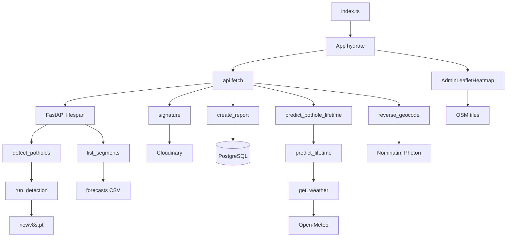

# Poori architecture: client se database tak

## 1. 30-second summary

RahScan ek Expo app hai. Web aur phone dono isi codebase se chalte hain. `index.ts` `registerRootComponent` se `App` kholta hai. `App` session dekh kar citizen, admin, ya team portal pe bhejta hai.

API FastAPI hai. Object `app` file `backend/app/main.py` mein hai. Start par `lifespan` teen cheezein load karti hai: YOLO weights, lifetime model, aur maintenance CSV. Reports PostgreSQL mein jaati hain. Photos Cloudinary par jaati hain. Weather Open-Meteo se aata hai. Map Leaflet hai, web par iframe aur phone par WebView.

Analogy: yeh ek daak-khana hai. Counter app hai. Sorting office API hai. Record room database hai. Photo alag dukaan (Cloudinary) mein rehti hai, sirf link record room mein likha jata hai.

## 2. Files and what each does

Noise skip kiya: `node_modules/`, `.git/`, `dist/`, `.expo/`, Gradle caches, `ios/Pods/`, aur `__pycache__/`.

### Root

- `App.tsx` — `App` boot route set karti hai: `Landing`, `UserTabs`, `AdminTabs`, ya `TeamTabs`.
- `index.ts` — `registerRootComponent(App)`.
- `package.json` — Expo scripts aur frontend libraries.
- `app.json` — app name RahScan, camera, photo, location permissions, Android cleartext, iOS local networking.
- `tsconfig.json` — TypeScript config. Behavior yahan se nahi aata.
- `AGENTS.md`, `CLAUDE.md` — Expo docs version note. App runtime nahi.
- `LICENSE` — licence file. App isay import nahi karti.
- `.gitignore` — `backend/.env`, `*.pt`, `backend/data/kaggle/`, `ios/`, `android/` ignore.
- `.env` — root par file maujood hai. Values nahi parhi. Unverified ke is file ko app padhti hai. API `backend/.env` padhti hai (`Settings` in `backend/app/config.py`).

### `.agents/`, `.claude/`, `.cursor/`

- `.agents/rules/` — folder hai. Andar koi file nahi mili.
- `.claude/settings.json` — Claude settings. App runtime nahi.
- `.cursor/skills/kaggle-train/SKILL.md` — Kaggle train skill. API isay call nahi karti.
- `.cursor/skills/run-rahscan/SKILL.md` — file khali hai.

### `android/` aur `ios/`

Dono generated native projects hain. `.gitignore` inhen ignore karti hai, lekin working tree mein maujood hain.

- `android/` — Gradle project. `android/app/build.gradle`, package `com.rahscan.app` `app.json` mein hai.
- `android/app/debug.keystore` — debug signing file. Isey khola nahi.
- `ios/` — Xcode project `ios/RahScan/`. `AppDelegate.swift` native entry hai. Expo `ios` script isi tree ko use karti hai.
- `ios/Pods/` — CocoaPods. Har pod ka line nahi.

### `assets/`

- `assets/icon.png`, `favicon.png`, splash aur android icons — `app.json` inhen point karti hai.
- `assets/rahscan-logo.png`, `rahscan-mark.png`, signup skyline images — UI brand assets. Screen-by-screen use yahan verify nahi kiya, siwaye `BrandMark` jo mark dikhata hai (`src/components/BrandMark.tsx`).

### `src/`

- `src/api/` — backend calls.
- `src/api/config.ts` — `API_URL`. Web `http://localhost:8000`. Android emulator `http://10.0.2.2:8000`. Phone `EXPO_PUBLIC_API_URL`, warna hardcoded LAN URL.
- `src/api/client.ts` — `api`. `fetch`, bearer token, JSON.
- `src/api/detect.ts` — `detectPotholes`, `mapYoloToDraft`, `xyxyToPercent`.
- `src/api/cloudinary.ts` — `uploadReportPhoto`.
- `src/api/photoForm.ts` — `appendPhoto`. `expo-file-system` `File`.
- `src/api/predict.ts` — `fetchLifetimePrediction`, `fetchPredictiveMaintenance`.
- `src/api/geocode.ts` — `reverseGeocode`.
- `src/data/sessionStore.ts` — `sessionStore.hydrate`, `signIn`, `signOut`. Web key `rahscan.session`.
- `src/data/reportStore.ts` — `reportStore.refresh`, `submit`, assign, verify, team actions.
- `src/data/adminInsights.ts` — `resolutionRate`, `trendSeries`, `severityShare`.
- `src/models/report.ts` — labels, `isLowConfidence`, `trafficDensityFromRoadType`. `predictLifetime`, `predictiveSegments`, `mockDetect` live path par call nahi hote (`docs/implementation_vs_spec.md`).
- `src/navigation.ts` — route types.
- `src/screens/LandingScreen.tsx` — `LandingScreen`.
- `src/screens/LoginScreen.tsx` — `LoginScreen`. `POST /auth/login`.
- `src/screens/SignupScreen.tsx` — `SignupScreen`. `POST /auth/signup`.
- `src/screens/AdminLoginScreen.tsx` — staff login. Bhi `POST /auth/login`, phir role check.
- `src/screens/UserTabs.tsx` — Home, Report, My Reports, Map, Profile.
- `src/screens/HomeScreen.tsx` — citizen home.
- `src/screens/ReportScreen.tsx` — `analyze`. Photo aur location.
- `src/screens/DetectionResultScreen.tsx` — `submit`.
- `src/screens/MyReportsScreen.tsx` — apni reports.
- `src/screens/UserReportDetailScreen.tsx` — citizen detail.
- `src/screens/UserMapScreen.tsx` — `GET /reports/locations`.
- `src/screens/ProfileScreen.tsx` — profile.
- `src/screens/AdminTabs.tsx` — Dashboard, Reports, Map, Predictive.
- `src/screens/AdminDashboardScreen.tsx` — counts aur charts.
- `src/screens/AdminReportsScreen.tsx` — filter aur sort client par.
- `src/screens/AdminReportDetailScreen.tsx` — assign, verify, reject. Lifetime card yahan mount hoti hai.
- `src/screens/AdminMapScreen.tsx` — heatmap click se area card.
- `src/screens/AdminPredictiveScreen.tsx` — forecast list.
- `src/screens/TeamTabs.tsx` — team queue shell.
- `src/screens/TeamQueueScreen.tsx` — team list.
- `src/screens/TeamReportDetailScreen.tsx` — accept, complete, escalate.
- `src/components/AdminLeafletHeatmap.tsx` — `AdminLeafletHeatmap`, `buildMapHtml`.
- `src/components/LocationPickerMap.tsx` — `LocationPickerMap`. Pin map.
- `src/components/PhotoWithBoundingBox.tsx` — boxes photo par.
- `src/components/LifetimePredictionCard.tsx` — `worstPotholeIndex`, phir prediction.
- `src/components/Buttons.tsx`, `TextField.tsx`, `SeverityBadge.tsx`, `StatusBadge.tsx`, `ReportCard.tsx`, `FilterChip.tsx`, `FilterSelect.tsx`, `TrendChart.tsx`, `ShareCharts.tsx`, `BrandMark.tsx`, `RoadGraphic.tsx` — UI parts.
- `src/layout/` — `AuthBackdrop`, `AuthSplit`, `AppSidebar`, `AdminShell`, `TeamShell`, `ScreenContainer`, `useBreakpoint`, `webStyles`.
- `src/theme.ts` — colors.

### `backend/`

- `backend/requirements.txt` — Python libraries. Python version pin nahi.
- `backend/.env.example` — env **names**. Values khali.
- `backend/seed.py` — `seed_if_empty`. Demo users. Sample reports nahi.
- `backend/app/main.py` — `lifespan`, `health`, routers.
- `backend/app/config.py` — `Settings`, `get_settings`.
- `backend/app/db.py` — `get_engine`, `get_db`, `ping_db`, `ensure_schema`.
- `backend/app/models.py` — `User`, `Report`, `ReportEvent`.
- `backend/app/schemas.py` — request aur response models. `report_to_out`.
- `backend/app/auth.py` — `hash_password`, `create_token`, `require_citizen`, `require_admin`, `require_team`.
- `backend/app/routers/auth.py` — `signup`, `login`, `admin_login`, `me`.
- `backend/app/routers/detect.py` — `detect_potholes`. `POST /api/detect`.
- `backend/app/routers/ai.py` — `detect`. `POST /ai/detect` HTTP 410.
- `backend/app/routers/reports.py` — `create_report`, `my_reports`, `list_locations`, `get_report`.
- `backend/app/routers/admin.py` — `list_reports`, `assign_report_route`, `verify_report_route`, `reject_report_route`.
- `backend/app/routers/team.py` — `accept_report_route`, `complete_report_route`, `escalate_report_route`.
- `backend/app/routers/uploads.py` — `signature`.
- `backend/app/routers/predict.py` — `predict_pothole_lifetime`, `predictive_maintenance`.
- `backend/app/routers/weather.py` — `weather`.
- `backend/app/routers/geocode.py` — `reverse_geocode`.
- `backend/app/ai/model.py` — `load_model`, `get_model`. File `backend/weights/newv8s.pt`.
- `backend/app/ai/detect.py` — `run_detection`, `_promote_largest_hole`.
- `backend/app/ai/utils.py` — `severity_from_area`, `classify_severity`.
- `backend/app/services/workflow.py` — `TRANSITIONS`, `assign_report`, `record_submitted`.
- `backend/app/services/weather_service.py` — `get_weather`, `_fetch_forecast`.
- `backend/app/services/geocode_service.py` — `reverse_geocode`.
- `backend/app/ml/lifetime.py` — `predict_lifetime`, `load_lifetime_model`.
- `backend/app/ml/train_lifetime_model.py` — `train_model`. Offline.
- `backend/app/ml/generate_training_data.py` — `_days_until_critical`. Synthetic labels.
- `backend/app/ml/maintenance.py` — `load_maintenance`, `list_segments`, `_assign_categories`.
- `backend/app/ml/train_maintenance_model.py` — `forecast_segment`. Prophet offline.
- `backend/app/ml/generate_maintenance_data_v2.py` — `generate_rows`. Synthetic months.
- `backend/app/ml/generate_maintenance_data.py` — purani city-level generator. `save_forecasts` v2 CSV likhti hai aur `LEGACY_FORECASTS_PATH` par overwrite refuse karti hai. `forecast_segment` sirf ek segment ka dict return karti hai.
- `backend/app/ml/models/lifetime_model.pkl` — fitted forest. `load_lifetime_model` isay kholta hai.
- `backend/app/ml/models/feature_encoders.json` — label numbers.
- `backend/app/ml/data/synthetic_lifetime_data.csv` — 2501 lines (header + 2500). `N_ROWS = 2500`.
- `backend/app/ml/data/synthetic_maintenance_data_v2.csv` — 5857 lines. Header plus 5856 data rows. `(5857-1)/12 = 488` segments.
- `backend/app/ml/data/maintenance_forecasts_v2.csv` — 489 lines. Header plus 488 segment rows.
- `backend/weights/newv8s.pt` — 22,501,034 bytes. SHA-256 note 04 mein hai. `*.pt` gitignore hai.
- `backend/test_images/` — test photos. Gitignore. Runtime load nahi.

### `backend/data/kaggle/`

Yeh training experiments hain. `load_model` in folders ko nahi kholta. Sirf `newv8s.pt` load hota hai. Folder gitignore hai.

- `pothole-detector-meta/model_metadata.json` — base `YOLOv8s`, datasets `chitholian/annotated-potholes-dataset` aur `hemanthhari/road-surface-dataset`.
- `pothole-detector-meta/args.yaml`, `results.csv` — us training run ki settings aur metrics. `docs/implementation_vs_spec.md` inhen cite karti hai.
- `newv8strainingonpotholes/` — notebook `newv8strainingonpotholes.ipynb`. Loaded checkpoint isi line se juda hai (`implementation_vs_spec.md`).
- `newv8ntrainingonpotholes/` — YOLOv8n output tree. `load_model` isay nahi kholta.
- `rdd-baseline/` — notebook `rahscan-rdd-2022-yolov8-baseline.ipynb`. Runtime model nahi.
- `annotated-potholes-dataset/` — local JPG samples.
- `pothole-detection-yolov8/`, `v8sreftraining/`, `yolov8straining/`, `yolov8s-large-public-pothole/`, `real-world-pothole-v8sref-v8sme-comparison/` — alag notebooks. App inhen import nahi karti.
- `gtsrb-vgg16-classification/` — alag classification notebook. Detection path nahi.
- `merged-meta/`, `yaml-check/`, `samples/`, `pothole-class-check/` — YAML aur sample images. Runtime load nahi.

### `docs/` aur `teal-ui-screens/`

- `docs/RahScan SRS Final Draft.pdf` — purani SRS. `implementation_vs_spec.md` isi se compare karti hai.
- `docs/FYP_Proposal_newFinal.pdf` — proposal. Wahi comparison file.
- `docs/RahScan_Updated_SRS.md` — “as built” SRS. REQ numbers yahan dubara likhe gaye hain.
- `docs/RahScan_Updated_Proposal.md` — updated proposal markdown.
- `docs/implementation_vs_spec.md` — code versus purani spec.
- `docs/yolov8-detect-test-report.md` — purane checkpoint ka manual test. Report khud kehti hai numbers current nahi.
- `docs/defense/` — yeh notes, `build_html.py`.
- `teal-ui-screens/` — UI PNGs. `SCREENS.txt` khali hai. App inhen load nahi karti.

### Local run

Repo mein koi README nahi. API start ka exact command kisi script mein nahi. **Unverified** exact uvicorn line.

Jo repo likhti hai:

1. Frontend, repo root se: `npm start` ya `npm run web`. Dono `expo start --web` hain, Chrome path ke sath (`package.json` scripts).
2. Android: `npm run android` (`expo run:android`).
3. iOS: `npm run ios` (`expo run:ios`).
4. Web client `http://localhost:8000` call karti hai (`API_URL` in `src/api/config.ts`).
5. `docs/yolov8-detect-test-report.md` kehti hai uvicorn `--reload` ke baghair port 8000 par chala. Woh purane test ka note hai. Aaj ka command string file mein nahi. **Unverified**.
6. API object `app` hai `backend/app/main.py` mein. `uvicorn` `backend/requirements.txt` mein hai. Process ka module path repo script nahi karti. **Unverified**.
7. Demo users: `backend/` se `seed.py` chalao. `if __name__` `ensure_schema` phir `seed_if_empty` bulata hai. Import `from app import db` hai, is liye working directory `backend/` honi chahiye. Shell one-liner README mein nahi. **Unverified** ke team yeh exact argv use karti hai.
8. Offline ML, docstrings `backend/` se:
   - `python -m app.ml.generate_training_data`
   - `python -m app.ml.train_lifetime_model`
   - `python -m app.ml.generate_maintenance_data_v2`
   - `python -m app.ml.train_maintenance_model`
9. Pehli dafa `pip install` ya venv banana kisi project README mein nahi. Test report ek Mac par conda-forge Python 3.13.15 likhti hai. Project pin nahi. **Unverified** required Python.

Env **names** (`backend/.env.example` aur `Settings`). Values copy nahi ki:

- `DATABASE_URL` — `get_engine` khali hone par error deta hai.
- `JWT_SECRET` — khali ho to code default `change-me` (`Settings` in `config.py`).
- `CLOUDINARY_CLOUD_NAME` — khali ho to `signature` HTTP 503.
- `CLOUDINARY_API_KEY`, `CLOUDINARY_API_SECRET` — `Settings` padhti hai. Unsigned upload client ko secret nahi deta (`signature`).
- `CLOUDINARY_UPLOAD_PRESET`, `CLOUDINARY_UNSIGNED_PRESET` — preset names. Example default preset strings hain, secrets nahi.
- `CORS_ORIGINS` — `lifespan` nahi, `app.add_middleware` `cors_origin_list` use karti hai.
- `DEMO_CITIZEN_PASSWORD`, `ADMIN_PASSWORD` — `seed_if_empty`.
- `TEAM_PASSWORD` — `Settings.team_password`. `.env.example` mein yeh name nahi.
- `EXPO_PUBLIC_API_URL` — sirf physical phone (`config.ts`). Example file mein nahi.

Seed emails code mein hain: `demo@rahscan.local`, `admin@rahscan.local`, `road@rahscan.local`, `emergency@rahscan.local`, `inspection@rahscan.local` (`seed.py`). Passwords yahan nahi likhe.

`users` aur `reports` ka pehla `CREATE TABLE` repo mein nahi. `ensure_schema` un tables ko `ALTER` karti hai aur `report_events` banati hai. Pehli table creation **Unverified**.

## 3. Data flow

Analogy: Leaflet map app ke andar ek chhoti website hai. Web usay iframe mein rakhta hai. Phone usay WebView mein rakhta hai. Dono `buildMapHtml` ka HTML dete hain.

### Start

1. `index.ts` `registerRootComponent` `App` register karta hai.
2. `App` `sessionStore.hydrate` chalati hai. Token ho to `GET /auth/me` (`hydrate`). 401 par `signOut`. Role se `UserTabs`, `AdminTabs`, ya `TeamTabs`.
3. API process start: `lifespan` order `ensure_schema`, `load_model`, `load_lifetime_model`, `load_maintenance`. Phir server requests leti hai.
4. `GET /health` `ping_db` (`SELECT 1`) karke `{"ok": true}` deta hai.

### Citizen report

1. `ReportScreen` `analyze` city, area, aur street address maangti hai. Khali ho to “Enter the city”, “Enter the area”, “Enter the street address”.
2. GPS optional hai. `requestLocation` `Location.getCurrentPositionAsync` bulati hai, sirf `accuracy: Location.Accuracy.Balanced`. Is call mein timeout argument nahi. `docs/implementation_vs_spec.md` REQ-4 `timeout: 15000` likhti hai. Current `ReportScreen.tsx` se woh number nahi milta. Coordinates `applyCoords` `reverseGeocode` (`src/api/geocode.ts`) ko deti hai: `GET /api/geocode/reverse`.
3. Router `reverse_geocode` (`geocode.py`) service `reverse_geocode` (`geocode_service.py`) bulata hai. Pehle Nominatim `https://nominatim.openstreetmap.org/reverse`, warna Photon `https://photon.komoot.io/reverse`. Timeout 10 s.
4. Photo `detectPotholes` multipart `POST /api/detect` bhejti hai. Token ho to `api` bearer lagati hai. Detect route par auth dependency nahi (`detect_potholes`).
5. `detect_potholes` bytes padhta hai aur `run_detection` bulata hai.
6. `run_detection` Pillow se image kholta hai, `ImageOps.exif_transpose`, phir `get_model().predict`. Boxes `classify_severity` se label hote hain.
7. Koi box nahi to message `No potholes detected.` Report save nahi hoti (`analyze`).
8. Boxes hon to `mapYoloToDraft` percent boxes banata hai. Confidence `Math.round(confidence * 100)`. Screen `DetectionResult`.
9. `DetectionResultScreen` `submit` pehle `uploadReportPhoto`.
10. `uploadReportPhoto` `POST /uploads/signature` (`signature`, `require_citizen_or_team`). Phir browser seedha `https://api.cloudinary.com/v1_1/{cloudName}/image/upload`. Unsigned preset. Folder name server `rahscan/reports` bhejta hai, lekin unsigned branch client folder/format fields tabhi bhejta hai jab `unsigned` false ho (`uploadReportPhoto`). Delivery format constant `UPLOAD_FORMAT = "webp"` response mein hai.
11. `reportStore.submit` `POST /reports`. `create_report` `require_citizen`. HTTPS `photoUri` warna 400. City khali ho to 400. Row `status="pending"`. `record_submitted` event likhta hai. Commit.

### Admin, team, map

1. `reportStore.refresh` admin ke liye `GET /admin/reports` (`list_reports`). Citizen `GET /reports/me` (`my_reports`). Team `GET /team/reports`.
2. Dashboard `resolutionRate` aur `trendSeries` isi list par (`adminInsights.ts`). Server aggregate route nahi.
3. `AdminMapScreen` wahi reports map ko deta hai. `AdminLeafletHeatmap` web par iframe (`WebLeafletHeatmap`), native par `WebView` (`NativeLeafletHeatmap`). Tiles `https://tile.openstreetmap.org/{z}/{x}/{y}.png`.
4. `UserMapScreen` `GET /reports/locations` (`list_locations`). Citizen token. Saare unresolved points, sirf apne nahi.
5. `AdminReportDetailScreen` `LifetimePredictionCard` mount karti hai. Card `fetchLifetimePrediction` se `POST /api/predict/lifetime`.
6. `predict_pothole_lifetime` `predict_lifetime` bulata hai. Woh `get_weather` se Open-Meteo, phir forest. Result database mein save nahi hota.
7. `AdminPredictiveScreen` `fetchPredictiveMaintenance` se `GET /api/predictive-maintenance`. `predictive_maintenance` `list_segments`. Yeh CSV cache hai. Live `reports` rows input nahi.
8. Assign: `POST /admin/reports/{id}/assign` → `assign_report`. Verify aur reject admin routes. Team `accept_report`, `complete_report`, `escalate_report` (`workflow.py`).

## 4. Key logic

### Detection

`run_detection` predict arguments: `device="cpu"`, `conf=0.35`, `iou=0.5`, `imgsz=1280`, `max_det=50`. Confidence `round(..., 2)`.

`severity_from_area`:

- `percentage < 5` → Small
- `percentage <= 15` → Medium
- warna Large

Area = box area / image area × 100, do decimals (`_span_and_area`).

Ek hi hole ho to `cap_closeup=True`. `CLOSEUP_SPAN_PCT = 20.0` ya area `> 15` ho aur label Large ho to Medium (`classify_severity`).

Kai holes: `_promote_largest_hole`. Largest area `>= 12`, next se `>= 2` guna, confidence `>= 0.5`, abhi Large na ho, to Large.

Analogy: model aankh hai, box lagati hai. Ruler alag hai. Ruler box ka area percent dekhta hai. Qareebi photo ko Large rehne nahi deta.

### Auth aur low confidence

`create_token`: HS256, `exp` 7 days. Password `LoginRequest` / `SignupRequest` `min_length=6`. Hash `bcrypt.hashpw` + `bcrypt.gensalt` (`hash_password`).

`LOW_CONFIDENCE_THRESHOLD = 50` (`report.ts`). `isLowConfidence` stored percent `< 50`. Detect floor 0.35 hai, is liye 35 se 49 tak DB tak aa sakte hain, 0.35 se neeche nahi.

### Lifetime

`FEATURE_ORDER`: severity, bounding_box_percentage, road_type, traffic_density, rainfall_probability, temperature_celsius, season.

Encoders (`feature_encoders.json`): Small 0, Medium 1, Large 2. Simple Road 0, Service Road 1, Highway 2. Traffic Low 0, Medium 1, High 2. Season Winter 0 through Autumn 4.

`traffic_density_from_road_type`: Highway High, Service Road Medium, Simple Road Low. Client traffic ignore (`predict_lifetime`). Local road alias Simple Road (`_ROAD_ALIASES`).

`BBOX_CAP_PCT = 20.0` predict se pehle.

Forest `train_model`: `RandomForestRegressor(n_estimators=200, random_state=42, n_jobs=-1)`, `test_size=0.2`, `random_state=42`.

API formula dobara nahi chalti. Forest number deta hai, phir `days = max(2, min(60, round(raw)))`. Deadline Asia/Karachi date + days.

`_priority_band`: `< 7` Critical, `<= 14` High, `<= 30` Moderate, else Routine.

Synthetic label jo training ne seekha (`_days_until_critical`, `N_ROWS = 2500`, `SEED = 42`):

`38 - severity*9 - min(bbox,20)*0.12 - road_type*5 - (rain/100)*10 - season_cut - temperature_penalty + N(0, 2.5)`, phir clamp 2–60.

Season cuts: Winter 0, Spring 1, Summer 2, Monsoon 6, Autumn 1.5. Temp penalty: `>= 40` → 5, `>= 35` → 3, `<= 5` aur rain `>= 40` → 4, `<= 8` → 2.

Analogy: yeh “itne din mein road tootegi” nahi. Yeh “itne din ke andar repair dekh lo” wala window hai. Code docstring bhi SLA kehta hai (`lifetime.py`).

### Weather

`_GEOCODE_URL` `https://geocoding-api.open-meteo.com/v1/search`. `_FORECAST_URL` `https://api.open-meteo.com/v1/forecast`. Timeout `_TIMEOUT = 8.0`. Timezone `Asia/Karachi`.

Forecast params: `current=temperature_2m,weather_code`, `hourly=precipitation_probability`, `forecast_days=1`.

Fail: rain `_FALLBACK_RAIN = 30`, temp `_FALLBACK_TEMP = 28.0`, season `_season_now`, `source: "fallback"`. Months: Mar–Apr Spring, May–Jun Summer, Jul–Sep Monsoon, Oct–Nov Autumn, Dec–Feb Winter.

### Maintenance

`forecast_segment`: har `segment_id` par alag `Prophet(yearly_seasonality=False, weekly_seasonality=False, daily_seasonality=False, n_changepoints=3, changepoint_prior_scale=0.05)`. `periods=1`, `freq="MS"`. `predicted = max(0, round(yhat))`.

Trend: `REL_STABLE = 0.05`, `ABS_EPS = 0.25` (`_trend_direction`).

Request par Prophet fit nahi hota. `load_maintenance` CSV padhti hai.

`_assign_categories`: sort by predicted count desc. Urgent pehle `ceil(0.2 * n)`. Plan Repair agle `ceil(0.5 * n)`. Baaqi Monitor.

`derive_risk_window`: increasing aur ratio `>= 1.5` → “High risk within 1-2 weeks”. Increasing ya stable aur ratio `>= 1.0` → “Moderate risk within 3-4 weeks”. Warna “Low risk (30+ days)”.

Budget `_budget_estimate_pkr`: `100_000 + per_report * predicted`. Highway 150_000, Service Road 90_000, Simple Road 60_000 PKR. Severity is formula mein nahi.

History window `generate_maintenance_data_v2.py`: `N_MONTHS = 12`, end `2026-08-01`, `SEED = 42`. Segment id `SEG-{index:04d}`.

### Map aur dashboard

Heat: Small 1, Medium 2, Large 3. `radius: 28`, `blur: 22`, `max: 3`, `minOpacity: 0.35`. Center `[30.0, 69.0]`, zoom 5. Leaflet 1.9.4, leaflet.heat 0.2.0, unpkg. Circle colors `#1B9A5B`, `#E08A1E`, `#E24B4A`. Gradient set nahi, default heat palette.

`resolutionRate`: `round(resolved / total * 100)`. Weekly last 7 days. Monthly last 6 calendar months (`bucketsFor`).

`cities` array `Lahore`, `Karachi`, `Rawalpindi` (`report.ts`) map filter nahi karta (`implementation_vs_spec.md` REQ-25).

Workflow `TRANSITIONS`: assign → `assigned`, accept → `inProgress`, complete → `completed`, verify → `resolved`, reject → `inProgress`, escalate → `escalated`. Resolved se koi transition nahi.

## 5. Why this technology

Repo khud choice ki lambi wajah nahi likhti. Jo wajah neeche seedhi hai, woh student ki di hui wajah hai. Jo student ne nahi kahi, us par **(inferred)** hai. Jo code se confirm nahi, us par **Unverified** hai.

| Technology | Code mein kaam | Wajah |
| --- | --- | --- |
| Expo SDK ~57, React Native 0.86, React 19, react-native-web | `package.json`, `App`, screens | Ek codebase web + mobile. |
| React Navigation 7 | `App` stack, `UserTabs` / `AdminTabs` tabs | Screens ke beech move. Wajah repo mein nahi. **(inferred)** navigation library Expo apps mein common hai. |
| expo-image-picker, expo-location, expo-file-system | `ReportScreen` `pick` / GPS, `appendPhoto` | Photo, GPS, file bytes. Wajah **Unverified**. |
| react-native-webview | `NativeLeafletHeatmap`, `NativeLocationPicker` | Phone par Leaflet HTML. Expo Go aur web dono chalte hain. |
| Leaflet 1.9.4 + leaflet.heat 0.2.0 | `buildMapHtml` | Web iframe, phone WebView. Expo Go aur web dono chalte hain. |
| OpenStreetMap tiles | tile URL `buildMapHtml` | Map pictures. Wajah **Unverified**. |
| FastAPI, Pydantic, uvicorn | `app`, schemas, `requirements.txt` | JSON API. Uvicorn exact start **Unverified**. FastAPI wajah **(inferred)** Python models same process mein chalte hain. |
| SQLAlchemy 2 + psycopg | `get_engine`, `User` / `Report` | PostgreSQL. URL `DATABASE_URL`, `sslmode=require`. |
| Neon | naam `backend/app` mein nahi | Free tier, server manage nahi. Host Neon hai ya nahi, `.env` nahi parha. **Unverified**. |
| Cloudinary | `signature`, `uploadReportPhoto` | Photo HTTPS URL. Free tier, server manage nahi. |
| Ultralytics YOLO | `load_model` | `newv8s.pt`. Wajah **(inferred)** boxes chahiye thin. Variant s kyun, application comment nahi. **Unverified**. |
| Pillow | `run_detection` | Image decode aur EXIF. Wajah **Unverified**. |
| Rule severity | `severity_from_area` | Proposal jaisa rule-based. |
| scikit-learn Random Forest + joblib | `train_model`, `load_lifetime_model` | Repair window. Wajah **(inferred)** tabular features par regressor. |
| Prophet | `forecast_segment` only | Har segment ka time-series forecast. Request par fit nahi, CSV hai. |
| Synthetic CSVs | `generate_rows`, `_days_until_critical` | Historical data nahi thi. |
| Open-Meteo | `get_weather` | API key nahi. Saare Pakistan ke liye chalti hai. |
| Nominatim + Photon | `reverse_geocode` | GPS se city/area. Wajah **Unverified**. |
| PyJWT + bcrypt | `create_token`, `hash_password` | Login. Wajah **Unverified**. |
| pandas | `load_maintenance`, trainers | CSV. Wajah **Unverified**. |
| httpx | `get_weather`, `reverse_geocode` | Outbound HTTP. Wajah **Unverified**. |
| react-native-svg | `TrendChart`, `ShareCharts` | Charts. Wajah **Unverified**. |

`expo-linear-gradient` `package.json` mein hai. Koi screen import nahi karti. Stack table mein nahi.

## 6. Alternatives and why not

- Alag React.js website aur alag mobile app. Code ek Expo app hai (`package.json`, `app.json`). Ek codebase web + mobile.
- OpenWeatherMap. Purani SRS yeh kehti hai (`implementation_vs_spec.md` REQ-37). Code `get_weather` Open-Meteo bulata hai. API key nahi, aur yeh saare Pakistan ke liye chalti hai.
- Photos server disk par. Diagrams `image_path` kehte thay (`implementation_vs_spec.md` images row). Code Cloudinary URL rakhta hai (`create_report`). Free tier, apna file server nahi.
- Google Maps ya native map SDK. Code Leaflet HTML hai (`buildMapHtml`). Expo Go aur web dono chalte hain.
- Severity ko model class banana. Code percent rules hain (`severity_from_area`). Proposal rule-based thi.
- Ek hi Prophet saare Pakistan par. Code `forecast_segment` har `segment_id` par alag model fit karta hai. Time-series forecast har segment ka hai.
- Asli municipal history. Code synthetic CSV padhta hai (`load_maintenance`). Historical data nahi thi.
- YOLOv8n as the loaded file. `LOCAL_WEIGHTS` `newv8s.pt` hai. n notebook tree maujood hai, `load_model` usay nahi kholta. s behtar kyun hai, yeh `model.py` nahi likhta. **Unverified**.
- Lifetime row har report ke sath save. `predict_lifetime` return karta hai, `create_report` prediction column nahi likhta. Save na karne ki wajah **Unverified**.

## 7. Honest limitations

`docs/RahScan_Updated_SRS.md` kehti hai yeh document system **as built** hai. Uske REQ numbers code se milte julte hain (maslan Updated SRS REQ-1 registration hai, REQ-12 YOLOv8s aur `POST /api/detect`).

`docs/implementation_vs_spec.md` code ko **purani** `docs/RahScan SRS Final Draft.pdf` aur proposal PDF se compare karti hai. Neeche wahi farq hain. Naya farq invent nahi kiya.

1. Detector YOLOv8s hai, `load_model` → `newv8s.pt`. Metadata datasets Chitholian potholes aur Hemanthhari smooth roads hain. Purani SRS YOLOv8n, RDD2022, aur 500–700 Pakistan images kehti hai. RDD notebook alag hai aur load nahi hota. Best saved validation mAP50 **0.75011** us public split par hai, 0.80 se neeche, Pakistani held-out test nahi (`implementation_vs_spec.md` REQ-9, REQ-10, REQ-14).
2. Citizen account zaroori hai. `signup`, `create_report` `require_citizen`. Purani REQ-1 bina login ke form kehti hai. Updated SRS REQ-1 ab registration kehti hai.
3. Status sirf Pending → In Progress → Resolved nahi. `TRANSITIONS` mein `assigned`, `completed`, `escalated`, aur reject wapas `inProgress`. Team role extra hai.
4. Lifetime har save par table mein nahi jati. Admin detail par `predict_lifetime`. Traffic road class se aati hai. Box cap 20%. Weather Open-Meteo. Fallback rain 30 aur 28°C. Card `weather.source` nahi dikhati (`LifetimePredictionCard`). Purani SRS OpenWeatherMap aur stored prediction kehti hai.
5. Maintenance live `reports` nahi padhti. `load_maintenance` 488 synthetic segments. Urgent percentile hai, 7 / 8–20 / 20+ days nahi. Budget mein severity nahi. UI “synthetic” nahi likhti (REQ-45, BR-8).
6. Purane paths `POST /upload`, `GET /heatmap`, `PUT /reports/{id}/status`, `GET /maintenance-forecast` `main.py` mein nahi. Asal routes section 3 mein hain.
7. Tables teen hain: `users`, `reports`, `report_events` (`models.py`). Purane ER mein detections, lifetime_predictions, road_segments, maintenance_forecasts alag tables thin. Boxes JSONB hain. Forecast CSV hai.
8. Session 7 din (`create_token`). Purani SRS 30 minute idle logout kehti hai. Idle timer `sessionStore` mein nahi.
9. `POST /api/detect`, `POST /api/predict/lifetime`, `GET /api/predictive-maintenance`, `GET /api/weather/{location}`, `GET /api/geocode/reverse` token nahi maangte (`detect_potholes`, `predict.py`, `weather`, `reverse_geocode`).
10. List APIs saari rows deti hain. `limit` nahi (`list_reports`).
11. Automated `pytest` suite `implementation_vs_spec.md` ke mutabiq repo mein nahi. Is note ne woh search dobara nahi chalayi. Claim comparison file se hai.
12. 5 second detect, 3 second inference, 95% uptime, browser certificate: repo mein measurement nahi. **Unverified** (`implementation_vs_spec.md`).
13. `docs/yolov8-detect-test-report.md` purane yolov8n / best.pt numbers rakhti hai aur kehti hai woh current nahi. Un numbers ko aaj ka mAP mat bolo.
14. Weights aur Kaggle tree gitignore hain. Fresh clone par `newv8s.pt` tabhi hai jab file alag se ho. Missing file par `load_model` 503 chhodta hai.
15. `users` / `reports` ka original SQL repo mein nahi. **Unverified** pehli migration.
16. Neon hostname code mein nahi. **Unverified** ke `DATABASE_URL` Neon hi hai.
17. JWT default `change-me` agar `JWT_SECRET` khali ho (`Settings`).
18. `GET /reports/locations` har unresolved point deti hai, sirf caller ke nahi (`list_locations`).
19. `implementation_vs_spec.md` REQ-4 GPS `timeout: 15000` likhti hai. `requestLocation` ab sirf `Accuracy.Balanced` bhejti hai. Timeout code mein nahi. Comparison file aur code yahan disagree karte hain.

## 8. Likely viva questions

**App start kahan se hoti hai?** `index.ts` `registerRootComponent`, phir `App`. Session `sessionStore.hydrate`.

**API kaun si file hai?** `backend/app/main.py` function `lifespan` aur object `app`.

**Photo detect aur save alag kyun hain?** `analyze` sirf `POST /api/detect`. Save `submit` → Cloudinary → `create_report`. No pothole par row nahi banti.

**Model kaun sa hai?** `load_model` `backend/weights/newv8s.pt`. Metadata base YOLOv8s. n file load nahi hoti.

**Small / Medium / Large?** `severity_from_area`: under 5, 5 se 15, upar 15. Phir close-up cap aur 12% promotion (`classify_severity`, `_promote_largest_hole`).

**Confidence DB mein kya hai?** Float do decimal detect par. Report par integer percent (`mapYoloToDraft`).

**Lifetime kab chalti hai?** Jab admin detail `LifetimePredictionCard` `fetchLifetimePrediction` karti hai. Formula training label hai. API forest + clamp 2–60 (`predict_lifetime`).

**Prophet request par kyun nahi chalti?** `forecast_segment` offline hai. API `list_segments` CSV se jawab deti hai. `maintenance.py` docstring kehti hai startup sirf CSV padhti hai. Dashboard wait na kare, yeh wajah **(inferred)** hai. Docstring yeh speed reason nahi likhti.

**Urgent kaise banta hai?** Count ke hisaab se top 20% (`_assign_categories`), dinon ke cuts se nahi.

**Data synthetic kyun?** Historical data nahi thi. UI par label nahi. Yeh limit hai.

**Map library?** Leaflet `buildMapHtml`. Web `iframe`. Phone `WebView`. Expo Go aur web dono chalte hain.

**Database Neon kyun?** Code sirf PostgreSQL `DATABASE_URL` kehta hai. Free tier, server manage nahi. Host **Unverified**.

**Purani SRS se sab se bara farq?** Account zaroori hai, model YOLOv8s hai, workflow lamba hai, forecast CSV hai. Detail section 7. Updated SRS in built choices ko naye REQ numbers se likhti hai.
