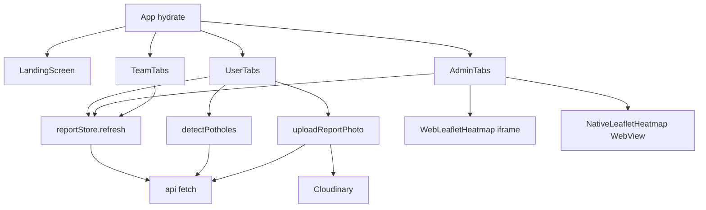

# Frontend: boot, navigation, screens, aur web vs phone

## 1. 30-second summary

App `index.ts` se start hoti hai. `registerRootComponent` `App` kholta hai. `App` pehle `sessionStore.hydrate` karti hai. Token na ho to `Landing`. Role `admin` ho to `AdminTabs`. Role `team` ho to `TeamTabs`. Baqi `UserTabs`.

Teen portals hain. Citizen ke paanch tabs hain. Admin ke char. Team ka ek queue tab hai. Detail screens root stack par hain, tabs ke andar nahi.

API calls `api` (`src/api/client.ts`) se jaati hain. Report lists `reportStore` mein rehti hain. Session web par `localStorage` key `rahscan.session` mein rehti hai. Phone par yahi session sirf memory mein rehti hai.

Analogy: building ki seedhi root stack hai. Har role ka apna corridor hai. Corridor ke kamre tabs hain. Wristband session hai. Wristband ka role batata hai kaun sa corridor khulega.

## 2. Files and what each does

### Boot aur navigation

- `index.ts` — `registerRootComponent(App)`. Comment kehta hai Expo Go aur native build dono ke liye environment set hota hai.
- `App.tsx` — `App`, `BootSplash`. `createNativeStackNavigator<RootStackParamList>`. `initialRoute` null ho to splash. Warna `NavigationContainer`.
- `src/navigation.ts` — `RootStackParamList`, `UserTabParamList`, `AdminTabParamList`, `TeamTabParamList`. Sirf types. Runtime logic nahi.
- `src/screens/UserTabs.tsx` — `UserTabs`. `createBottomTabNavigator`. Tabs: `Home`, `Report`, `MyReports`, `Map`, `Profile`.
- `src/screens/AdminTabs.tsx` — `AdminTabs`. Tabs: `Dashboard`, `Reports`, `Map`, `Predictive`. `signOut` yahan hai.
- `src/screens/TeamTabs.tsx` — `TeamTabs`. Sirf tab `Queue`. `signOut` yahan hai.
- `src/layout/useBreakpoint.ts` — `useBreakpoint`. `WIDE_BREAKPOINT = 900`. `isWide` jab width `>= 900`. `SIDEBAR_WIDTH = 248`. `CONTENT_MAX_WIDTH = 1080`.
- `src/layout/AppSidebar.tsx` — `AppSidebar`. Lists `citizenSidebarItems`, `adminSidebarItems`, `teamSidebarItems`. Wide layout par bottom tabs ki jagah yeh sidebar hai.

Root stack screens `App` mein, isi order mein: `Landing`, `Login`, `Signup`, `UserTabs`, `DetectionResult`, `UserReportDetail`, `AdminLogin`, `AdminTabs`, `AdminReportDetail`, `TeamTabs`, `TeamReportDetail`.

`UserTabs`, `AdminTabs`, `TeamTabs` par `headerShown: false` aur `gestureEnabled: false`. Auth screens `authScreenOptions`: khali title, transparent header, tint `colors.teal`.

### Session aur stores

- `src/data/sessionStore.ts` — class `SessionStore`. Export `sessionStore`, hook `useSession`. Roles `citizen`, `admin`, `team`.
- `src/data/reportStore.ts` — class `ReportStore`. Export `reportStore`. Hooks `useReports`, `useMyReports`, `useTeamReports`, `useTeamStats`, `useReportsHydrated`. `markFormReset`, `consumeFormReset`.
- `src/data/adminInsights.ts` — dashboard math. Store nahi. `resolutionRate`, `trendSeries`, `severityShare`, `statusShare`, `roadShare`, `cityShare`, `areaShare`.
- `src/models/report.ts` — types, labels, `isLowConfidence`, `trafficDensityFromRoadType`, `overlayBoxesForReport`. `predictLifetime`, `predictiveSegments`, `mockDetect` screens import nahi karti. Live path in teen functions ko call nahi karti.

`DEMO_CITIZEN_EMAIL` `reportStore.ts` mein `'demo@rahscan.local'` hai. Koi screen is constant ko import nahi karti.

### API layer `src/api/`

- `config.ts` — `API_URL`.
- `client.ts` — `api`, class `ApiError`, `detailMessage`.
- `detect.ts` — `detectPotholes`, `mapYoloToDraft`, `xyxyToPercent`, `pickHighestDetection`.
- `photoForm.ts` — `appendPhoto`.
- `cloudinary.ts` — `uploadReportPhoto`.
- `geocode.ts` — `reverseGeocode`.
- `predict.ts` — `fetchLifetimePrediction`, `fetchPredictiveMaintenance`, `boundingBoxPercentage`, `lifetimePredictBody`, `locationForLifetime`.

### Screens, purpose, aur kaun si API

Har row ka direct call hai. Jo screen store hook use karti hai, woh bhi likha hai, kyunki hook `refresh` chala sakti hai.

| Screen | Kaam | API |
| --- | --- | --- |
| `LandingScreen` | Get Started, Sign up, Municipal Authority | Koi call nahi. `navigate` `Login`, `Signup`, `AdminLogin`. |
| `LoginScreen` `submit` | Citizen login | `POST /auth/login`. Role `citizen` ho to `signIn`, `reportStore.refresh`, `replace('UserTabs')`. |
| `SignupScreen` `submit` | Naya citizen | `POST /auth/signup`. Phir `signIn`, `refresh`, `replace('UserTabs')`. |
| `AdminLoginScreen` `submit` | Admin ya team portal | Wahi `POST /auth/login`. Portal chip role se match ho to `AdminTabs` ya `TeamTabs`. |
| `UserTabs` | Citizen shell | Khud API nahi. |
| `HomeScreen` | Welcome aur recent 3 | `useMyReports` → `useReports` → `refresh`. Citizen path `GET /reports/me`. |
| `ReportScreen` `analyze` | Photo, GPS, pin, detect | `reverseGeocode` → `GET /api/geocode/reverse`. `detectPotholes` → `POST /api/detect`. |
| `DetectionResultScreen` `submit` | Boxes dikhao, report bhejo | `uploadReportPhoto` → `POST /uploads/signature`, phir Cloudinary. `reportStore.submit` → `POST /reports`. |
| `MyReportsScreen` | Filter aur sort | Extra call nahi. `useMyReports` list par client filter. |
| `UserMapScreen` | Public road map | `api` `GET /reports/locations`. |
| `UserReportDetailScreen` | Apni report, timeline | Extra call nahi. `useReports` list se `reportId`. |
| `ProfileScreen` | Naam, email, report count, sign out | Extra call nahi. `useMyReports`. `signOut` local hai. |
| `AdminTabs` | Admin shell | Khud API nahi. |
| `AdminDashboardScreen` | Counts aur charts | Extra call nahi. `useReports` admin path `GET /admin/reports`. Math `adminInsights.ts`. |
| `AdminReportsScreen` | Search, filter, sort | Extra call nahi. Wahi list, client par. |
| `AdminReportDetailScreen` | Assign, verify, reject, activity | `loadAdminDetail` `GET /admin/reports/{id}`. `assignReport` `POST .../assign`. `verifyReport` `POST .../verify`. `rejectReport` `POST .../reject`. |
| `AdminMapScreen` | Heatmap aur area card | Extra call nahi. `useReports`. Click `AdminReportDetail`. |
| `AdminPredictiveScreen` | Forecast list | `fetchPredictiveMaintenance` → `GET /api/predictive-maintenance`. |
| `TeamTabs` | Team shell | Khud API nahi. |
| `TeamQueueScreen` | Assigned queue | `useTeamReports` → `GET /team/reports` aur `GET /team/stats`. |
| `TeamReportDetailScreen` | Accept, complete, escalate | `loadTeamReport` `GET /team/reports/{id}`. `acceptTeam` `POST .../accept`. `completeTeam` pehle `uploadReportPhoto`, phir `POST .../complete`. `escalateTeam` `POST .../escalate`. Maps link `Linking.openURL`, RahScan API nahi. |

`LifetimePredictionCard` screen file nahi hai. `AdminReportDetailScreen` isay mount karti hai. Card `fetchLifetimePrediction` se `POST /api/predict/lifetime` karti hai.

### Shared components

- `Buttons.tsx` — `PrimaryButton`, `TealButton`, `OutlineButton`, `GhostOutlineButton`.
- `TextField.tsx` — `TextField`. Web par `webInputNoOutline`.
- `FilterChip.tsx` — `FilterChip`.
- `FilterSelect.tsx` — `FilterSelect`.
- `SeverityBadge.tsx` — `SeverityBadge`.
- `StatusBadge.tsx` — `StatusBadge`, `OverdueBadge`.
- `ReportCard.tsx` — `ReportCard`.
- `PhotoWithBoundingBox.tsx` — `PhotoWithBoundingBox`. Boxes percent se photo par.
- `BrandMark.tsx` — `BrandMark`. Image `assets/rahscan-mark.png`.
- `TrendChart.tsx` — `TrendChart`. `react-native-svg`.
- `ShareCharts.tsx` — `DonutChart`, `RingGauge`, `ShareBars`, `CompositionBar`.
- `AdminLeafletHeatmap.tsx` — `AdminLeafletHeatmap`, `buildMapHtml`, `WebLeafletHeatmap`, `NativeLeafletHeatmap`.
- `LocationPickerMap.tsx` — `LocationPickerMap`, `WebLocationPicker`, `NativeLocationPicker`.
- `LifetimePredictionCard.tsx` — `LifetimePredictionCard`, `worstPotholeIndex`.
- `RoadGraphic.tsx` — `RoadGraphic`. Koi screen import nahi karti.

### Layout aur theme

- `src/theme.ts` — `colors`, `radii`, `shadows`. Teal `#0F3A43`. Cream `#F3F5F7`. Severity green `#1B9A5B`, orange `#E08A1E`, red `#E24B4A`.
- `AuthBackdrop.tsx` — `AuthBackdrop`. Background `assets/signup-skyline.jpg`. `useAuthTopInset`.
- `AuthSplit.tsx` — `AuthSplit`. Login aur signup. Wide par do columns. `width >= 1180` spacious.
- `AuthCard.tsx` — `AuthCard`. Admin login card.
- `ScreenContainer.tsx` — `ScreenContainer`. Wide par max width `1080`.
- `AdminShell.tsx` — `AdminShell`. Detail screen par wide sidebar. Narrow par children seedha.
- `TeamShell.tsx` — `TeamShell`. Team detail ke liye wahi pattern.
- `webStyles.ts` — `webCursor`, `webNoOutline`, `webInputNoOutline`. Web par autofill CSS inject.

`app.json` name RahScan, package `com.rahscan.app`. Camera, photo, location strings. Android `usesCleartextTraffic: true`. iOS `NSAllowsLocalNetworking: true`. `userInterfaceStyle: "light"`.

`package.json`: Expo `~57.0.15`, React `19.2.3`, React Native `0.86.2`, `react-native-web`, React Navigation 7, `react-native-webview`. `expo-linear-gradient` dependency hai. Koi `src` file import nahi karti.

## 3. Data flow

### Boot

1. `index.ts` `registerRootComponent(App)`.
2. `App` `useEffect` `sessionStore.hydrate` bulati hai.
3. `hydrate` stored session dekhti hai. Token ho to `fetch` `GET ${API_URL}/auth/me`, header `Authorization: Bearer`.
4. Status `401` par `signOut`, return `null`. `App` phir `Landing`.
5. Response theek ho to name, email, role, team update. Token wahi rehta hai. `signIn`.
6. Token ho to `App` `reportStore.refresh` chalati hai. Error swallow (`catch(() => undefined)`).
7. `session.role === 'admin'` → `AdminTabs`. `=== 'team'` → `TeamTabs`. Warna `UserTabs`.
8. `initialRoute` set hone se pehle `BootSplash`. Text `Scan` aur `ActivityIndicator`.

### Login se portal

1. `LandingScreen` teen buttons.
2. `LoginScreen.submit` email aur password check karti hai. Phir `api` `POST /auth/login`.
3. `session.role !== 'citizen'` ho to `signIn` nahi hota. Message municipal login ka hai.
4. Citizen ho to `sessionStore.signIn`, `reportStore.refresh`, `navigation.replace('UserTabs')`.
5. `SignupScreen.submit` `POST /auth/signup`. Client role check nahi karti. Seedha `UserTabs`.
6. `AdminLoginScreen` pehle chip: `portal` state `'admin'` ya `'team'`. Phir wahi `POST /auth/login`.
7. Chip `admin` aur role admin nahi, to `signIn` nahi. Chip `team` aur role team nahi, to `signIn` nahi.
8. Match par `navigation.replace(session.role === 'team' ? 'TeamTabs' : 'AdminTabs')`.

### Lists

`reportStore.refresh` session role se path choose karti hai.

- `team`: `GET /team/reports` aur `GET /team/stats` `Promise.all`. `parseTeamReport`.
- `admin`: `GET /admin/reports`. `parseReport`.
- warna: `GET /reports/me`.

`useReports` citizen aur admin ke liye refresh karti hai. Team par return. `useTeamReports` sirf team par refresh karti hai.

`useMyReports` us list ko email se filter karti hai. `submittedBy` aur session email, dono `trim` + `toLowerCase`.

### Report banana

1. `ReportScreen.pick` camera ya gallery. `quality: 0.8`.
2. Wide web (`Platform.OS === 'web' && isWide`) par `openPhotoSource` seedha `pick('gallery')`. Sheet nahi khulti.
3. `requestLocation` `Location.requestForegroundPermissionsAsync`, phir `getCurrentPositionAsync` with `accuracy: Location.Accuracy.Balanced`. Timeout argument nahi.
4. `applyCoords` `reverseGeocode(lat, lng)`.
5. Pin `LocationPickerMap`. Click `applyCoords`.
6. `analyze` city, area, address khali na hon. Photo ho. `detectPotholes`. `mapYoloToDraft`. Detection null ho to “No potholes detected.” Navigate nahi.
7. Boxes hon to `navigation.navigate('DetectionResult', { draft })`.
8. `DetectionResultScreen.submit` `uploadReportPhoto`, phir `reportStore.submit`, `markFormReset`, `reset` `UserTabs` screen `MyReports`.

### Admin aur team actions

1. `AdminReportDetailScreen` mount par `loadAdminDetail`.
2. `assign` `endOfLocalDateInputIso`. Date kharab ho to error. Warna `assignReport`.
3. `verify` sirf UI tab jab `status === 'completed'` (`canReview`).
4. `reject` reason trim khali ho to error.
5. `LifetimePredictionCard` alag se lifetime POST karti hai. Report save is call par depend nahi karti.
6. `TeamReportDetailScreen` `loadTeamReport`. `accept` jab status `assigned`. `complete` photo aur note dono. `escalate` reason. Escalate ke baad `navigate('TeamTabs', { screen: 'Queue' })`.
7. `replaceTeam` report hata deti hai agar `assignedTeam === 'unassigned'` ho, ya session team se match na ho.

### Map HTML

Analogy: Leaflet ek chhoti website hai. Web us website ko `iframe` mein rakhta hai. Phone usi HTML ko `WebView` mein rakhta hai. Dono `buildMapHtml` ka string dete hain.

`Platform.OS === 'web'` par `AdminLeafletHeatmap` `WebLeafletHeatmap` return karti hai. Warna `NativeLeafletHeatmap`. `LocationPickerMap` wahi split karti hai: `WebLocationPicker` ya `NativeLocationPicker`.

Web points `iframe.contentWindow.__rahscanSetPoints` se jaate hain. Click `window.parent.postMessage`. Parent sirf apne iframe ka `contentWindow` accept karta hai.

Phone points `WebView.injectJavaScript` se `window.__rahscanSetPoints` bulata hai. Click `onMessage` `event.nativeEvent.data`.

`UserMapScreen` `interactive={false}` deti hai. `showCircles` tab true hota hai (`showCircles = !interactive`). Admin map `interactive` default `true` rakhti hai, is liye click `onSelectReport` chal sakta hai.

## 4. Key logic

### API URL

`API_URL` (`config.ts`):

- `Platform.OS === 'web'` → `http://localhost:8000`
- Android emulator (`isAndroidEmulator`) → `http://10.0.2.2:8000`
- Warna `process.env.EXPO_PUBLIC_API_URL`, khali ho to `http://172.20.10.2:8000`

Emulator check `Platform.OS === 'android'` aur model/fingerprint strings: `sdk_gphone`, `Emulator`, `Android SDK built for`, `generic`, `emulator`.

`api` URL `${API_URL}${path}` banati hai. Path `/auth/login` jaisa hai, `/api` prefix har route par nahi. Detect, geocode, predict, aur predictive routes `/api/...` hain. Auth, reports, admin, team, uploads `/api` ke baghair hain. Yeh strings screens aur `src/api` mein hain.

`api` `FormData` par `Content-Type` khud set nahi karti. JSON body par `application/json`. Token ho to `Bearer`. Error body ka `detail` string, ya pehli item ka `msg`. `ApiError` status rakhti hai. HTTP `204` par `undefined`.

### Session

`STORAGE_KEY = 'rahscan.session'`. `canUseStorage` sirf `Platform.OS === 'web'` aur `localStorage`. `isSession` name, email, role, aur non-empty token maangti hai. Team `undefined`, `null`, ya string ho sakta hai. `normalizeSession` team ko string ya `null` banati hai.

`hydrate` network fail (`catch`) par stored session return karti hai. Status `401` ke ilawa non-OK par bhi stored session return karti hai. Sirf `401` logout hai.

`signIn` memory aur web `localStorage` likhta hai. `signOut` dono clear karta hai. Phone par `writePersisted` seedha return karti hai. App kill ke baad phone session code mein save nahi hoti.

Sign out yahi teen calls karti hai: `sessionStore.signOut`, `reportStore.clear`, stack `reset` route `Landing`. Yeh `ProfileScreen`, `AdminTabs`, `TeamTabs`, `AdminShell`, aur `TeamShell` mein hai.

Login client checks: email mein `@` aur `.`. Password length `< 6` reject. Signup name khali reject. Confirm password match. Yeh UI checks hain. Server rules alag file mein hain (`01_architecture.md`).

### Report list filters

`HomeScreen` `reports.slice(0, 3)`.

`MyReportsScreen` status filter `toUserStatus`. Date sort `newest` / `oldest`. Severity sort `severityRank`.

`AdminReportsScreen` reference id `normalizeReferenceId`. City, severity, status. Range `7d` ya `30d`: `Date.now() - 7 * 24 * 60 * 60 * 1000` aur 30 din wahi formula. Sort `newest`, `oldest`, `severity`.

`AdminMapScreen` heat se `status === 'resolved'` hataati hai. Bina `coords` point nahi banta. Cluster key `` `${city}|${area}` ``. Area card unresolved pehle (`sortAreaReports`).

`TeamQueueScreen` filter `assigned`, `inProgress`, `completed`, `resolved`. Overdue pehle, phir nayi date. Counts `useTeamStats` se: `assigned`, `inProgress`, `completed`, `overdue`.

`AdminPredictiveScreen` `PAGE_SIZE = 10`. Province codes `Punjab`, `Sindh`, `KPK`, `Balochistan`. Territories `ICT`, `GB`, `AJK`. Filter client par. API dubara province ke sath nahi jaati.

### Detect mapping

`pickHighestDetection` pehle `highest_severity` wale boxes, warna saare. Un mein sab se bari `area_percentage`.

`xyxyToPercent` pixel box ko image width/height se 0–100 percent. Width ya height `<= 0` ho to zero box.

`mapYoloToDraft` confidence `Math.round(confidence * 100)`. `highest_severity` null ya detections khali hon to `null`.

`boundingBoxPercentage` (`predict.ts`): `(width * height) / 100`, phir clamp 0 se 100. Yahi lifetime body mein jata hai. `trafficDensityFromRoadType`: highway `high`, service road `medium`, baqi `low`. `locationForLifetime`: `area, city`, warna city, area, address, warna string `Pakistan`.

`LOW_CONFIDENCE_THRESHOLD = 50`. `isLowConfidence` stored percent `< 50`. Admin detail flag “Low detection confidence”. Card text “Prediction reliability: Low”.

`worstPotholeIndex` pehle report `boundingBox` se overlay match, 1-based. Match na ho to sab se unchi `severityRank`.

### Map numbers

Heat `SEVERITY_WEIGHT`: small `1`, medium `2`, large `3`.

`buildMapHtml` (`AdminLeafletHeatmap.tsx`): Leaflet `1.9.4`, leaflet.heat `0.2.0`, unpkg. Center `[30.0, 69.0]`, zoom `5`. Tiles `https://tile.openstreetmap.org/{z}/{x}/{y}.png`, `maxZoom: 19`. Heat `radius: 28`. Points hon to `fitBounds` `pad(0.25)`, `maxZoom: 14`. Khali ho to wapas center zoom 5. Empty text `No located reports`.

Picker `LocationPickerMap.tsx`: default `LAHORE = { lat: 31.5204, lng: 74.3587 }`, zoom `12`. Pin pan zoom `Math.max(map.getZoom(), 15)`. Click bounds lat `-90` se `90`, lng `-180` se `180`.

Heatmap wrap height `360`. `fillHeight` height `560`. Picker height `280`.

### Layout numbers

Tab bar height `70`, padding bottom `10`, top `8`, label font `11`. Wide par tab bar `display: 'none', height: 0` aur `tabBar` render `null`. Sidebar `248` px.

Stack animation `slide_from_right`. Nav background `transparent`.

`assignable` set: `pending`, `escalated`, `assigned`, `inProgress`. Default team chip `roadMaintenance` jab report `unassigned` ho.

`LocalDateField`: web par `input type="date"`. Phone par `TextField` placeholder `YYYY-MM-DD`.

Image picker permission fail messages `ReportScreen` aur `TeamReportDetailScreen` mein hain. Team complete `quality: 0.8`.

## 5. Why this technology

Repo lambi wajah nahi likhti. Jo neeche seedhi line hai, woh student ki di hui wajah hai. Jo student ne nahi kahi, us par **(inferred)** hai.

| Technology | Code | Wajah |
| --- | --- | --- |
| Expo SDK ~57, React Native 0.86, React 19, react-native-web | `package.json`, `App`, screens | Ek codebase web + mobile. |
| React Navigation 7, native stack, bottom tabs | `App`, `UserTabs`, `AdminTabs`, `TeamTabs` | Screens ke beech move. Wajah repo mein nahi. **(inferred)** Expo apps mein yahi navigation common hai. |
| `useSyncExternalStore` + class store | `sessionStore`, `reportStore` | Login aur lists bina Redux ke. Wajah **(inferred)** do chhoti stores hain. |
| `fetch` in `api` | `client.ts` | JSON API. Axios nahi. Wajah **(inferred)** web aur RN dono `fetch` dete hain. |
| `expo-image-picker`, `expo-location`, `expo-file-system` | `ReportScreen` `pick`, `requestLocation`, `appendPhoto` | Photo, GPS, phone file. Wajah **Unverified**. |
| `react-native-webview` + iframe | `NativeLeafletHeatmap`, `WebLeafletHeatmap` | Leaflet HTML. Expo Go aur web dono chalte hain. |
| Leaflet 1.9.4 + leaflet.heat 0.2.0 | `buildMapHtml` | Heatmap. Expo Go aur web dono chalte hain. |
| OpenStreetMap tiles | tile URL `buildMapHtml` | Map pictures. Wajah **Unverified**. |
| `react-native-svg` | `TrendChart`, `ShareCharts` | Dashboard charts. Wajah **Unverified**. |
| `localStorage` | `writePersisted` | Web session. Phone par yahi API nahi chalti. Wajah phone par skip **Unverified**. |

`index.ts` comment Expo Go aur native build dono kehta hai. Leaflet wali wajah student ki hai: Expo Go aur web dono chalain.

## 6. Alternatives and why not

- Alag React website aur alag phone app. Code ek Expo app hai (`package.json`, `app.json`). Ek codebase web + mobile.
- Flutter. Woh bhi ek codebase de sakta hai. Yeh repo TypeScript screens hain aur `react-native-web` se browser chalti hai. Flutter choose na karne ki lambi wajah repo mein nahi. **(inferred)** web + phone isi JS codebase se nikalte hain.
- Expo ke baghair sirf React Native CLI. `index.ts` Expo `registerRootComponent` use karti hai. Scripts `expo start` hain. Expo Go path Leaflet WebView wali wajah se juda hai.
- Google Maps native SDK ya `react-native-maps`. Map `buildMapHtml` Leaflet HTML hai. Expo Go aur web dono chalte hain.
- Redux ya React Query. Lists `reportStore.refresh` aur screens ke local `useState` hain. Extra library `package.json` mein nahi. Chhota store kyun kaafi hai, yeh **(inferred)** hai.
- Axios. `api` `fetch` use karti hai. Wajah **(inferred)** extra client ki zaroorat nahi.
- Phone par `AsyncStorage` ya SecureStore. `sessionStore` sirf web `localStorage` likhta hai. Phone par persist na hone ki wajah **Unverified**.
- Native date picker. `LocalDateField` web par `input type="date"` hai. Phone par text `YYYY-MM-DD`. Native picker na hone ki wajah **Unverified**.

## 7. Honest limitations

1. Role check boot aur login par hai (`App`, `LoginScreen.submit`, `AdminLoginScreen.submit`). Stack screens par alag route guard component nahi. Citizen screens `AdminTabs` navigate nahi karti. Deep link se koi role bypass kare, yeh **Unverified**.
2. Phone session restart par nahi rehti. `canUseStorage` web-only hai. `AsyncStorage` import nahi.
3. `hydrate` sirf HTTP `401` par logout karti hai. Network error par purana token reh sakta hai.
4. `SignupScreen` response ka role nahi dekhti. Seedha `UserTabs`. Server hamesha citizen bhejta hai ya nahi, yeh frontend file se **Unverified**.
5. `useMyReports` email match karti hai. `GET /reports/me` ke baad bhi `submittedBy` alag ho to card gayab ho sakti hai.
6. Dashboard aur admin report filters poori list par client par chalte hain (`adminInsights.ts`, `AdminReportsScreen`). Server aggregate route frontend call nahi karti.
7. `UserMapScreen` `GET /reports/locations` jaisa response dikhati hai. Frontend caller ki apni reports tak filter nahi karti.
8. `predictLifetime`, `predictiveSegments`, `mockDetect` (`report.ts`) kisi screen se call nahi hote. Live lifetime `fetchLifetimePrediction` hai. Live forecast `fetchPredictiveMaintenance` hai.
9. `RoadGraphic` aur `expo-linear-gradient` app screens use nahi karti.
10. `DEMO_CITIZEN_EMAIL` export hai, koi screen use nahi karti.
11. Wide web report camera sheet skip karti hai (`openPhotoSource`).
12. Phone due date free text hai (`LocalDateField`). Galat string `endOfLocalDateInputIso` null de to assign ruk jata hai.
13. `gestureEnabled: false` tab shells par hai. Android hardware back ka handler `App.tsx` mein nahi. Back press ka result **Unverified**.
14. `API_URL` fallback `http://172.20.10.2:8000` code mein hardcoded hai. Yeh kisi aur network par galat ho sakta hai. Phone ko `EXPO_PUBLIC_API_URL` chahiye (`config.ts` comment).
15. Maps tiles aur Leaflet scripts unpkg / OpenStreetMap se aate hain (`buildMapHtml`). Offline map **Unverified**.
16. Team maps `https://www.google.com/maps/search/` kholta hai (`mapsUrl`). Yeh RahScan map component nahi hai.

## 8. Likely viva questions

**App start kahan se hoti hai?** `index.ts` `registerRootComponent`. Phir `App`. Splash tab tak jab tak `hydrate` route na de.

**Teen portals kaun se hain?** `UserTabs` citizen. `AdminTabs` admin. `TeamTabs` team. Route `App` role se choose karti hai.

**Citizen tabs?** `Home`, `Report`, `MyReports`, `Map`, `Profile` (`UserTabs`).

**Admin tabs?** `Dashboard`, `Reports`, `Map`, `Predictive` (`AdminTabs`).

**Team ke kitne tabs?** Ek, `Queue` (`TeamTabs`).

**Wide screen par tabs kahan gaye?** `useBreakpoint` width `>= 900`. `AppSidebar`. Tab bar `null`.

**Login galat role ko andar kyun nahi aane deta?** `LoginScreen` non-citizen par `signIn` nahi karti. `AdminLoginScreen` chip aur `session.role` match na ho to `signIn` nahi karti.

**Token kahan rehta hai?** Web `localStorage` key `rahscan.session` (`writePersisted`). Phone par memory. Restart par phone login dobara.

**API base URL?** `API_URL`. Web `localhost:8000`. Android emulator `10.0.2.2:8000`. Phone `EXPO_PUBLIC_API_URL` ya `172.20.10.2:8000`.

**Bearer kaun lagata hai?** `api` (`client.ts`) aur `hydrate` ka `fetch`. Dono `sessionStore` token.

**Report detect aur submit alag kyun?** `analyze` sirf `POST /api/detect`. Save `submit`: Cloudinary, phir `POST /reports`.

**Map web aur phone par alag kyun dikhti hai?** Same HTML. Web `iframe` (`WebLeafletHeatmap`). Phone `WebView` (`NativeLeafletHeatmap`). Expo Go aur web dono chalte hain.

**Heatmap numbers?** Small 1, Medium 2, Large 3. Center `30, 69`, zoom 5. Leaflet 1.9.4.

**Dashboard server se totals kyun nahi maangta?** `AdminDashboardScreen` `useReports` list par `resolutionRate` aur `trendSeries` chalati hai. Alag stats route frontend mein nahi.

**Lifetime card kab call karti hai?** Jab admin detail `LifetimePredictionCard` mount ho. `POST /api/predict/lifetime`. Local `predictLifetime` use nahi hoti.

**Expo kyun?** Ek codebase web + mobile.
