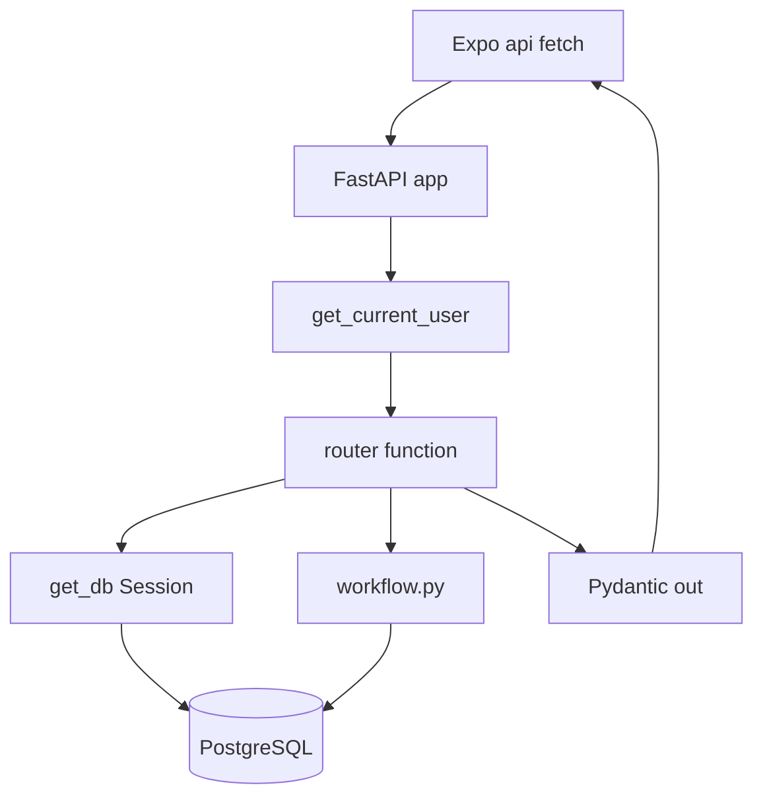

# Backend: FastAPI, PostgreSQL, aur request ka rasta

## 1. 30-second summary

API `backend/app/main.py` mein object `app` hai. Title `RahScan API`, version `1.0.0`. Start par `lifespan` schema touch karti hai, phir YOLO, lifetime model, aur maintenance CSV load karti hai.

Request pehle router function tak aati hai. Role chahiye ho to `auth.py` token check karti hai. Database chahiye ho to `get_db` ek SQLAlchemy `Session` deti hai. Route `commit` karti hai. Jawab Pydantic model hota hai. `CamelModel` wali responses camelCase hain. Detect, weather, geocode, aur predictive maintenance snake_case hain.

Teen tables app use karti hai: `users`, `reports`, `report_events`. Detect, weather, geocode, aur lifetime prediction in tables mein row nahi likhte.

Analogy: route counter hai. `Depends` darwaze ka guard hai. `Session` record room ka drawer hai. `commit` drawer band karta hai. Schema wahi paper hai jo counter wapas customer ko deta hai.

## 2. Files and what each does

`backend/app/__init__.py`, `routers/__init__.py`, `services/__init__.py`, `ai/__init__.py`, `ml/__init__.py` khali hain.

### `main.py`, `config.py`, `db.py`

- `main.py` — `lifespan`, object `app`, `health`. Routers yahan prefix ke sath lagte hain.
- `config.py` — class `Settings`, `get_settings`. File `backend/.env` (`BACKEND_DIR / ".env"`). Extra env keys ignore.
- `db.py` — `Base`, `get_engine`, `get_db`, `ping_db`, `ensure_schema`.

`Settings` fields: `database_url`, `jwt_secret` default `change-me`, Cloudinary names, `cors_origins`, `demo_citizen_password`, `admin_password`, `team_password`. Password values is note mein copy nahi. `cors_origin_list` comma split. `sqlalchemy_url` `postgresql://` ko ek dafa `postgresql+psycopg://` banati hai.

`get_engine` khali `database_url` par `RuntimeError` `DATABASE_URL is not set`. Engine `pool_pre_ping=True`, `pool_recycle=300`, `connect_args` `sslmode=require` aur `prepare_threshold=None`. `SessionLocal` `autoflush=False`, `autocommit=False`.

`get_db` session `yield` karti hai aur `finally` `close`. `rollback` call code mein nahi.

`ping_db` `SELECT 1`.

`ensure_schema` pehli `CREATE TABLE` `users` aur `reports` ke liye nahi chalati. Docstring kehti hai columns baad mein add hue. Woh yeh karti hai:

- `reports.detections` JSONB, `reports.ref_number` INTEGER.
- Purane null `ref_number` ko `ROW_NUMBER()` se `created_at`, `id` order mein bharti hai.
- Sequence `reports_ref_number_seq`. `setval` max `ref_number` par. Column default `nextval`. `NOT NULL`. Unique index `ix_reports_ref_number`.
- `users.team` VARCHAR(40). Constraint `users_role_check`: role `citizen`, `admin`, ya `team`.
- Report workflow columns: `deadline_at`, `assignment_note`, `completion_photo_url`, `completion_photo_public_id`, `completion_note`.
- `CREATE TABLE IF NOT EXISTS report_events`, phir har column `ADD COLUMN IF NOT EXISTS`. Index `ix_report_events_report_id`.

`lifespan` order: `ensure_schema`, `load_model`, `load_lifetime_model`, `load_maintenance`.

CORS `CORSMiddleware`: `allow_origins` settings list, regex `https?://(localhost|127\.0\.0\.1)(:\d+)?`, `allow_credentials=True`, methods aur headers `*`.

### `models.py`

- `User` table `users`.
- `Report` table `reports`.
- `ReportEvent` table `report_events`.

Columns section 4 mein hain.

### `schemas.py`

`CamelModel` `alias_generator=to_camel`, `populate_by_name=True`, `serialize_by_alias=True`. Python `photo_uri`, JSON `photoUri`. `YoloDetectResponse`, `WeatherOut`, `ReverseGeocodeOut`, aur `PredictiveMaintenanceSegment` `BaseModel` hain, `CamelModel` nahi. Unke JSON keys snake_case rehti hain, jaise `bounding_box` aur `segment_id`.

Requests: `SignupRequest`, `LoginRequest`, `ReportCreate`, `AssignRequest`, `CompleteRequest`, `ReasonRequest`, `LifetimePredictRequest`.

Responses: `AuthUser`, `MeResponse`, `CitizenReportOut`, `AdminReportOut`, `AdminReportDetail`, `TeamReportOut`, `TeamStatsOut`, `ReportLocationOut`, `YoloDetectResponse`, `WeatherOut`, `ReverseGeocodeOut`, `LifetimePredictResponse`, `PredictiveMaintenanceSegment`, `UploadSignature`.

Mappers: `user_to_auth`, `report_to_out`, `citizen_report_to_out`, `admin_report_to_out`, `admin_report_to_detail`, `team_report_to_out`, `format_reference_id`.

`_overlay_city_area` khali city ya area ko reverse geocode se bharti hai. DB update nahi.

### `auth.py`

- `hash_password` — `bcrypt.hashpw` + `bcrypt.gensalt`.
- `verify_password` — `bcrypt.checkpw`. `ValueError` par `False`.
- `create_token` — PyJWT `HS256`. Payload `sub`, `email`, `role`, `exp` 7 din. Team payload mein nahi.
- `decode_token` — galat token par HTTP 401 `Invalid token`.
- `get_current_user` — `HTTPBearer(auto_error=False)`. Scheme `bearer` na ho to 401 `Not authenticated`. `sub` se `db.get(User)`. User na ho to 401.
- `require_citizen` — role `citizen`, warna 403 `Citizen access required`.
- `require_admin` — role `admin`, warna 403 `Admin access required`.
- `require_team` — role `team` aur `user.team` `TEAM_KEYS` mein, warna 403 `Team access required`.
- `require_citizen_or_team` — role `citizen` ya `team`, warna 403.

Token ka `role` dubara nahi padha jata. Guard database wali `User.role` dekhta hai (`get_current_user` phir `require_*`).

### Routers

Prefix `main.py` `include_router` se aata hai.

- `routers/auth.py` prefix `/auth` — `signup`, `login`, `admin_login`, `me`, helper `_authenticate`.
- `routers/reports.py` prefix `/reports` — `create_report`, `my_reports`, `list_locations`, `get_report`.
- `routers/admin.py` prefix `/admin` — `list_reports`, `get_report`, `assign_report_route`, `verify_report_route`, `reject_report_route`, helper `_load_detail`.
- `routers/team.py` prefix `/team` — `stats`, `list_reports`, `get_report`, `accept_report_route`, `complete_report_route`, `escalate_report_route`, helper `_team_or_404`.
- `routers/uploads.py` prefix `/uploads` — `signature`.
- `routers/detect.py` prefix `/api` — `detect_potholes`.
- `routers/ai.py` prefix `/ai` — `detect`. HTTP 410.
- `routers/predict.py` prefix `/api` — `predictive_maintenance`, `predict_pothole_lifetime`.
- `routers/weather.py` prefix `/api` — `weather`.
- `routers/geocode.py` prefix `/api` — `reverse_geocode`.

### Services

- `services/workflow.py` — `TRANSITIONS`, `record_submitted`, `assign_report`, `verify_report`, `reject_report`, `accept_report`, `complete_report`, `escalate_report`, `team_stats`, `public_timeline`, `is_overdue`.
- `services/weather_service.py` — `get_weather`. Open-Meteo. DB nahi.
- `services/geocode_service.py` — `reverse_geocode`. Nominatim, phir Photon. DB nahi.

### `ai/` aur `ml/` (is note ka detail nahi, routers inhen call karti hain)

- `ai/model.py` — `load_model`, `get_model`. File `backend/weights/newv8s.pt`.
- `ai/detect.py` — `run_detection`.
- `ai/utils.py` — `severity_from_area`, `classify_severity`.
- `ml/lifetime.py` — `load_lifetime_model`, `predict_lifetime`.
- `ml/maintenance.py` — `load_maintenance`, `list_segments`.
- `ml/train_lifetime_model.py`, `ml/generate_training_data.py`, `ml/train_maintenance_model.py`, `ml/generate_maintenance_data_v2.py`, `ml/generate_maintenance_data.py` — offline scripts. `lifespan` inhen call nahi karti.

`backend/seed.py` `app` package ke bahar hai. `seed_if_empty` demo users likhti hai. Sample reports nahi. Naam `seed_if_empty` hai. `_ensure_demo_user` maujood user ko update bhi karti hai.

### Endpoint table

Role column woh guard hai jo function ke `Depends` par lagi hai. "Koi nahi" ka matlab token code nahi maangta.

| Method | Path | Role | Function | Kaam |
| --- | --- | --- | --- | --- |
| GET | `/health` | Koi nahi | `health` | `ping_db`. Body `{"ok": true}`. |
| POST | `/api/detect` | Koi nahi | `detect_potholes` | Image file. `run_detection`. Boxes JSON. DB write nahi. |
| POST | `/api/predict/lifetime` | Koi nahi | `predict_pothole_lifetime` | `predict_lifetime`. DB write nahi. |
| GET | `/api/predictive-maintenance` | Koi nahi | `predictive_maintenance` | `list_segments`. Optional query `province`, `city`, `category`. |
| GET | `/api/weather/{location}` | Koi nahi | `weather` | `get_weather`. |
| GET | `/api/geocode/reverse` | Koi nahi | `reverse_geocode` | Query `lat`, `lng`. |
| POST | `/ai/detect` | Koi nahi | `detect` | HTTP 410. Message `POST /api/detect` use karo. |
| POST | `/auth/signup` | Koi nahi | `signup` | Citizen user. Token `AuthUser`. |
| POST | `/auth/login` | Koi nahi | `login` | Email + password. Koi bhi role. Token. |
| POST | `/auth/admin/login` | Koi nahi | `admin_login` | `_authenticate` phir token. Role check nahi. |
| GET | `/auth/me` | Koi bhi login | `me` | Name, email, role, team. Token response mein nahi. |
| POST | `/reports` | Citizen | `create_report` | HTTP 201. Status `pending`. |
| GET | `/reports/me` | Citizen | `my_reports` | Sirf `submitted_by` caller. |
| GET | `/reports/locations` | Citizen | `list_locations` | Har unresolved point jisme lat/lng ho. Sirf apne nahi. |
| GET | `/reports/{report_id}` | Citizen | `get_report` | Apni report. Warna 404. |
| GET | `/admin/reports` | Admin | `list_reports` | Saari reports, nayi pehle. |
| GET | `/admin/reports/{report_id}` | Admin | `get_report` | Detail + events. |
| POST | `/admin/reports/{report_id}/assign` | Admin | `assign_report_route` | `assign_report`, phir `commit`. |
| POST | `/admin/reports/{report_id}/verify` | Admin | `verify_report_route` | `verify_report`, phir `commit`. |
| POST | `/admin/reports/{report_id}/reject` | Admin | `reject_report_route` | `reject_report`, phir `commit`. |
| GET | `/team/stats` | Team | `stats` | `team_stats`. |
| GET | `/team/reports` | Team | `list_reports` | `assigned_team == user.team`. |
| GET | `/team/reports/{report_id}` | Team | `get_report` | Doosri team par 409. |
| POST | `/team/reports/{report_id}/accept` | Team | `accept_report_route` | `accept_report`, phir `commit`. |
| POST | `/team/reports/{report_id}/complete` | Team | `complete_report_route` | `complete_report`, phir `commit`. |
| POST | `/team/reports/{report_id}/escalate` | Team | `escalate_report_route` | `escalate_report`, phir `commit`. |
| POST | `/uploads/signature` | Citizen ya team | `signature` | Unsigned Cloudinary preset. Admin 403. |

`/reports/me` aur `/reports/locations` code mein `/{report_id}` se pehle declared hain (`reports.py`).

Current Expo app `POST /auth/admin/login` call nahi karti. Sirf `auth.py` mein route hai. Staff login `POST /auth/login` hai (`src/screens/AdminLoginScreen.tsx` `submit`).

## 3. Data flow

### Login, DB tak aur wapas

1. Body `LoginRequest`. Password `min_length=6`. JSON `email`, `password`.
2. `login` `_authenticate` bulati hai.
3. `select(User).where(User.email == email.strip().lower())`.
4. User na ho, ya `verify_password` fail, to 401 `Invalid email or password`.
5. `create_token`. `user_to_auth`. Response `AuthUser`: name, email, role, token, team.

`signup` email lower karti hai. `@` aur `.` dono hon. Duplicate par 409 `An account with this email already exists`. `User.role` hamesha `"citizen"`. `hash_password`. `commit`. `refresh`. Token.

`me` user pehle se `get_current_user` se aata hai. Dobara password query nahi.

### Report create, DB tak aur wapas

1. `require_citizen` token aur role.
2. `ReportCreate`. `photo_uri` ho aur `https://` se start na ho to 400 `photoUri must be an HTTPS Cloudinary URL`.
3. `city.strip()` khali ho to 400 `City is required`.
4. `bounding_boxes` khali hon to ek box `bounding_box` se banta hai. Primary `boxes[0]`.
5. `Report` row: `status="pending"`, `assigned_team="unassigned"`, `timeline_stage="submitted"`, `created_at` UTC now. `submitted_by=user.id`.
6. `db.add`, `db.flush` taake `id` mil jaye. `ref_number` database default `nextval` se aata hai (`models.py` `server_default`).
7. `record_submitted` event `event_type="submitted"`, `to_status="pending"`, `assigned_team="unassigned"`.
8. `db.commit`, `db.refresh`. `citizen_report_to_out`.
9. `format_reference_id` string `RS-{n:04d}` hai. `1` ka matlab `RS-0001`.
10. `submitted_by` response mein email hai, UUID nahi (`report_to_out`).

### Assign, verify, reject, team

1. Admin route `require_admin`, phir workflow function, phir `db.commit`, phir `_load_detail`.
2. `assign_report` team `TEAM_KEYS` mein ho: `roadMaintenance`, `emergencyRepair`, `inspection`. Deadline UTC. Note blank ho to `None`. Completion photo columns clear.
3. `verify_report` tabhi jab status `completed` ho (`TRANSITIONS`). Naya status `resolved`.
4. `reject_report` reason zaroori. Event par purani completion photo URL. Columns clear. Status `inProgress`.
5. Team route `require_team`. `accept_report` expected team caller ki team. Status `assigned` se `inProgress`.
6. `complete_report` photo `https://`, `photoPublicId`, note. Status `completed`.
7. `escalate_report` reason. `assigned_team` `"unassigned"`. Status `escalated`.
8. `_apply` pehle `TRANSITIONS` dekhti hai. Phir `_cas_update`: `UPDATE` sirf tab jab `id` aur current `status` match karein. Team action par `assigned_team` bhi match. Koi row update na ho to 409 `Illegal status transition`. Phir `ReportEvent`.
9. `escalate_report_route` commit ke baad `db.get`. `_team_or_404` nahi, kyunki team ab `unassigned` hai.

### Jo DB nahi chhute

1. `detect_potholes` bytes `run_detection` ko deti hai. `InvalidImageError` 400. `ModelUnavailableError` 503. `InferenceError` 500.
2. `weather` `get_weather`. Hamesha dict. Fail par rain `30`, temp `28.0`, `source` `fallback`.
3. `reverse_geocode` query lat `-90` se `90`, lng `-180` se `180`. Service pehle Nominatim, fail par Photon. Dono fail to 502.
4. `predict_pothole_lifetime` model missing ho to 503. `predict_lifetime` number return karti hai. `reports` row update code mein nahi.
5. `predictive_maintenance` `list_segments`. Cache `None` ho to 503. Filter AND. Category subset par priority dubara calculate nahi (`list_segments` docstring).
6. `signature` `cloudinary_cloud_name` khali ho to 503. Warna `unsigned=True`. `api_key` aur `signature` schema default `""` rehte hain. Folder `rahscan/reports`. Format `webp`.

## 4. Key logic

### Tables aur columns

Yeh `models.py` ka shape hai. `users` aur `reports` ka original `CREATE TABLE` repo mein nahi. **Unverified** ke live table har model column pehle din se rakhti ho. `ensure_schema` jo columns khud add karti hai, woh upar likhe hain.

`users`:

| Column | Model | Notes |
| --- | --- | --- |
| `id` | UUID PK, default `uuid4` | Seed fixed UUIDs use karti hai. |
| `name` | `String(120)` NOT NULL | |
| `email` | `String(255)` unique, NOT NULL | Unique model par hai. `ensure_schema` yeh UNIQUE nahi banati. Live constraint **Unverified**. Signup khud duplicate `select` karti hai. |
| `password_hash` | `String(255)` NOT NULL | bcrypt string. |
| `role` | `String(20)` NOT NULL | Check `citizen`, `admin`, `team`. |
| `team` | `String(40)` null | Team users: `roadMaintenance`, `emergencyRepair`, `inspection`. |
| `created_at` | timestamptz, server `now()` | |

`reports`:

| Column | Model | Notes |
| --- | --- | --- |
| `id` | UUID PK | |
| `ref_number` | INTEGER unique NOT NULL | Sequence `reports_ref_number_seq`. |
| `photo_url` | TEXT null | JSON `photoUri`. |
| `photo_public_id` | `String(255)` null | |
| `city` | `String(80)` NOT NULL | |
| `area` | `String(255)` NOT NULL | |
| `road_type` | `String(40)` NOT NULL | `highway`, `serviceRoad`, `localRoad`. |
| `status` | `String(40)` NOT NULL | `pending`, `assigned`, `inProgress`, `completed`, `escalated`, `resolved`. |
| `assigned_team` | `String(40)` NOT NULL | `unassigned` ya teen team keys. |
| `timeline_stage` | `String(40)` NOT NULL | `timeline_stage_for`. |
| `severity` | `String(20)` NOT NULL | `small`, `medium`, `large`. |
| `confidence` | INTEGER NOT NULL | Client integer percent. |
| `description` | TEXT null | |
| `landmark` | `String(255)` null | |
| `address` | TEXT NOT NULL, default `""` | |
| `lat`, `lng` | FLOAT null | |
| `bbox_left`, `bbox_top`, `bbox_width`, `bbox_height` | FLOAT NOT NULL | Primary box, percent. |
| `detections` | JSONB null | Saare boxes. |
| `submitted_by` | UUID FK `users.id` NOT NULL | Model FK. `ensure_schema` yeh FK nahi banati. Live FK **Unverified**. |
| `created_at` | timestamptz NOT NULL | App UTC now likhti hai. Server default model par nahi. |
| `deadline_at` | timestamptz null | |
| `assignment_note` | TEXT null | |
| `completion_photo_url` | TEXT null | |
| `completion_photo_public_id` | `String(255)` null | |
| `completion_note` | TEXT null | |

`report_events` (`ensure_schema` `CREATE TABLE` aur `models.py`):

| Column | Type | Notes |
| --- | --- | --- |
| `id` | UUID PK | |
| `report_id` | UUID NOT NULL | FK `reports(id)` `ON DELETE CASCADE` create SQL mein. Index `ix_report_events_report_id`. |
| `actor_id` | UUID null | FK `users(id)` `ON DELETE SET NULL` create SQL mein. |
| `event_type` | VARCHAR(40) NOT NULL | `submitted`, `assigned`, `accepted`, `completed`, `verified`, `rejected`, `escalated`. |
| `from_status` | VARCHAR(40) null | Submit par `None`. |
| `to_status` | VARCHAR(40) NOT NULL | |
| `note` | TEXT null | |
| `photo_url` | TEXT null | Reject par purani completion photo. |
| `assigned_team` | VARCHAR(40) null | |
| `deadline_at` | timestamptz null | |
| `created_at` | timestamptz NOT NULL default `NOW()` | |

Agar `report_events` pehle se bina FK bani ho, baad wale `ADD COLUMN` FK add nahi karte. **Unverified** purani table ka shape.

### Auth numbers

`LoginRequest` aur `SignupRequest` password `min_length=6`.

`create_token` `timedelta(days=7)`, algorithm `HS256`. Secret `Settings.jwt_secret`. Khali env par default `change-me`.

`bcrypt.gensalt` extra rounds argument nahi deta. Library default. Round count is file mein likha nahi. **Unverified** exact cost.

### Workflow

`TRANSITIONS` (`workflow.py`):

| Action | Abhi status | Naya status |
| --- | --- | --- |
| assign | `pending`, `escalated`, `assigned`, `inProgress` | `assigned` |
| accept | `assigned` | `inProgress` |
| escalate | `assigned` ya `inProgress` | `escalated` |
| complete | `inProgress` | `completed` |
| verify | `completed` | `resolved` |
| reject | `completed` | `inProgress` |

`resolved` se koi action nahi.

`timeline_stage_for`: `resolved` → `resolved`. `inProgress` ya `completed` → `inProgress`. `assigned` → `repairAssigned`. Warna `underReview`.

`is_overdue`: `deadline_at` past ho, aur status `completed` ya `resolved` na ho.

`team_stats` char counts. Overdue assigned aur in-progress ke sath overlap kar sakta hai (docstring).

`PUBLIC_EVENT_LABELS`: submitted `Submitted`, assigned `Repair Assigned`, accepted `In Progress`, completed `Repair done, being verified`, verified `Resolved`, rejected `In Progress`, escalated `Under Review`. Citizen note sirf `completed` event par (`_public_note`).

`latest_rejection_reason` sirf tab jab sab se naya event `rejected` ho.

Geocode cache key `round(lat, 5)`, `round(lng, 5)` (`_cached_reverse_geocode`). Process memory. DB mein save nahi.

`_GEOCODE` timeout `10.0` s. Nominatim `zoom` `18`. Weather timeout `8.0`. Fallback rain `30`, temp `28.0`.

Lifetime request path: bbox cap `BBOX_CAP_PCT = 20.0`. Days `max(2, min(60, round(raw)))`. Band: `< 7` Critical, `<= 14` High, `<= 30` Moderate, else Routine (`_priority_band`). Client `traffic_density` ignore (`predict_lifetime` comment).

Severity rules `severity_from_area`: `< 5` Small, `<= 15` Medium, warna Large. Detect chapter ka detail `ai/utils.py` mein hai.

Seed emails: `demo@rahscan.local`, `admin@rahscan.local`, `road@rahscan.local`, `emergency@rahscan.local`, `inspection@rahscan.local`.

## 5. Why this technology

Repo lambi wajah nahi likhti. Seedhi wajah student ki hai. Jo student ne nahi kahi, us par **(inferred)** hai. Jo code confirm nahi karta, **Unverified**.

| Technology | Code | Wajah |
| --- | --- | --- |
| FastAPI | `app` in `main.py` | JSON API. Python detection aur ML isi process mein (`lifespan` `load_model`, `load_lifetime_model`). Wajah **(inferred)**. |
| Pydantic v2, pydantic-settings | `schemas.py`, `Settings` | Body check aur `.env`. Wajah **Unverified**. |
| uvicorn | `backend/requirements.txt` | Server process. Exact start command repo script nahi karti. **Unverified**. |
| SQLAlchemy 2 + psycopg | `get_engine`, `User`, `Report` | PostgreSQL. URL `DATABASE_URL`. |
| Neon | naam `backend/app` mein nahi | Free tier, server manage nahi. `sslmode=require` code mein hai. Host Neon hai ya nahi, `.env` nahi parha. **Unverified**. |
| Cloudinary | `signature` | Photo HTTPS URL. Free tier, server manage nahi. Upload unsigned preset. |
| PyJWT + bcrypt | `create_token`, `hash_password` | Login token aur password hash. Wajah **Unverified**. |
| httpx | `get_weather`, `reverse_geocode` | Bahar ki HTTP. Wajah **Unverified**. |

## 6. Alternatives and why not

- Django ya Flask. Code FastAPI `app` hai. Python models `lifespan` mein load hote hain. Django choose na hone ki lambi wajah repo mein nahi. **(inferred)** ek hi process API aur model dono chalati hai.
- Node ya Express. Detection `ultralytics` aur lifetime `scikit-learn` Python hain (`requirements.txt`). Alag Node API un models ko isi process mein load nahi karti.
- SQLite ya MySQL. Engine PostgreSQL URL maangta hai (`sqlalchemy_url`, `psycopg`). `detections` JSONB hai (`ensure_schema`). JSONB PostgreSQL type hai.
- Apna Postgres server. Student ki wajah Neon hai: free tier, server manage nahi. Code sirf `DATABASE_URL` kehta hai. Host **Unverified**.
- MongoDB. Tables `users`, `reports`, `report_events` relational hain. Reports user se FK model mein hai. Events report se CASCADE create SQL mein hai.
- Photos isi Postgres row mein bytes. `create_report` HTTPS `photo_url` rakhti hai. File Cloudinary par hai. Free tier, apna file server nahi.
- Session cookie. Client `Authorization: Bearer` bhejta hai (`get_current_user`). Cookie code nahi padhta.

## 7. Honest limitations

1. `users` aur `reports` ka pehla `CREATE TABLE` repo mein nahi. `ensure_schema` un par `ALTER` karti hai. Tables na hon to yeh start fail ho sakta hai. **Unverified** pehli migration.
2. `User.email` unique aur `reports.submitted_by` FK model par hain. `ensure_schema` inhen nahi banati. Live constraint **Unverified**.
3. JWT default `change-me` agar `JWT_SECRET` khali ho (`Settings`).
4. Token 7 din (`create_token`). Idle logout timer `auth.py` mein nahi.
5. `POST /api/detect`, `POST /api/predict/lifetime`, `GET /api/predictive-maintenance`, `GET /api/weather/{location}`, `GET /api/geocode/reverse`, `GET /health` token nahi maangte.
6. `admin_login` role check nahi karti. Koi valid user token le sakta hai. Current app yeh path call nahi karti.
7. Lists par `limit` nahi (`list_reports`, `my_reports`).
8. `GET /reports/locations` saare unresolved points deti hai, sirf caller ke nahi.
9. Lifetime aur forecast result `reports` mein save nahi hota (`predict_pothole_lifetime`, `list_segments`).
10. `signature` hamesha `unsigned=True`. HMAC `signature` field bharti nahi. Comment kehta hai signed upload secret mismatch par 401 de sakta hai.
11. Geocode overlay sirf response par hai (`_overlay_city_area`). Khali city DB mein khali rehti hai.
12. `_cas_update` race par 409 deta hai. User ko retry button ka alag contract nahi.
13. `seed_if_empty` demo users ki password hash har run par dubara likhti hai (`_ensure_demo_user`).
14. Neon hostname code mein nahi. **Unverified** ke `DATABASE_URL` Neon hi hai.
15. `get_db` `rollback` nahi bulati. Sirf `close`.
16. Process memory caches: geocode `_GEOCODE_CACHE` (`schemas.py`), weather `_GEOCODE_CACHE` (`weather_service.py`), maintenance `_segments` (`load_maintenance`). Yeh module dicts hain. Restart par khali. Do processes ek cache share nahi karti.

## 8. Likely viva questions

**API kaun si file hai?** `backend/app/main.py`. Object `app`. Start `lifespan`.

**Request DB tak kaise jati hai?** Router function, `Depends` se user aur `get_db`, SQLAlchemy `Session`, `commit`, phir Pydantic response. Example `create_report`.

**Token mein kya hai?** `create_token`: `sub` user id, `email`, `role`, `exp` 7 din, `HS256`. Team token mein nahi. Guard DB user padhta hai.

**Password kahan hai?** `users.password_hash`. `hash_password` bcrypt. Login `verify_password`. Plain password column nahi.

**Teen tables?** `users`, `reports`, `report_events` (`models.py`).

**Nayi report ka status?** `create_report` `pending`, team `unassigned`, stage `submitted`. Event `record_submitted`.

**Reference id?** `format_reference_id`. `RS-` aur `ref_number` chaar digits. Sequence `reports_ref_number_seq`.

**Team galat report kholay to?** `_team_or_404` HTTP 409 `Report is not assigned to your team`.

**Status jump?** `TRANSITIONS`. Galat jump 409 `Illegal status transition`. Update tabhi jab status abhi bhi wahi ho (`_cas_update`).

**Kaun se routes khule hain?** Detect, lifetime, predictive, weather, geocode, health, signup, login. Table section 2.

**FastAPI kyun?** Python model isi process mein load hota hai. Yeh wajah **(inferred)** hai.

**Postgres Neon kyun?** Code PostgreSQL `DATABASE_URL` aur `sslmode=require` kehta hai. Free tier, server manage nahi. Host **Unverified**.

**Photo DB mein kyun nahi?** `photo_url` HTTPS string hai. File Cloudinary. `signature` preset deta hai. Free tier, apna file server nahi.
