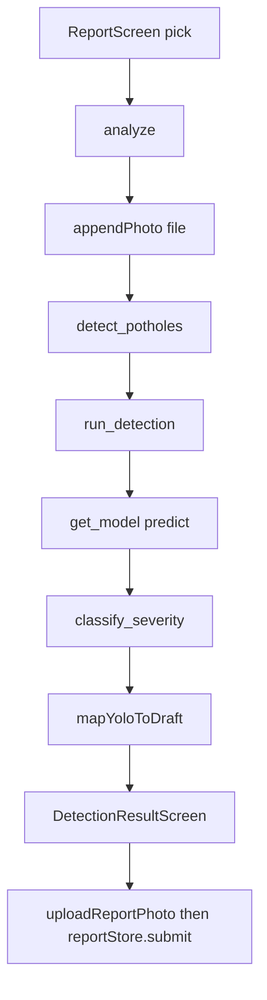

# Detection: photo se box, severity, aur training

## 1. 30-second summary

Citizen `ReportScreen` par photo uthata hai. `analyze` sirf image `POST /api/detect` bhejti hai. Location is call mein nahi jati.

API `detect_potholes` bytes `run_detection` ko deti hai. `load_model` pehle hi `backend/weights/newv8s.pt` load kar chuki hoti hai. `predict` CPU par boxes deta hai. Severity model ki class nahi. `severity_from_area` box ka area percent dekhti hai. Phir close-up cap ya promotion.

Koi box na ho to report save nahi hoti. Boxes hon to `DetectionResultScreen` unhen dikhati hai. `submit` alag hai: Cloudinary, phir `POST /reports`.

Analogy: model aankh hai, box lagati hai. Ruler alag hai. Ruler box ka hissa photo mein napta hai. Qareebi akeli photo ko Large rehne nahi deta.

## 2. Files and what each does

### App

- `src/screens/ReportScreen.tsx` — `pick`, `analyze`. Camera ya gallery. `quality: 0.8`.
- `src/api/photoForm.ts` — `appendPhoto`. Form field name `file`.
- `src/api/detect.ts` — `detectPotholes`, `mapYoloToDraft`, `xyxyToPercent`, `pickHighestDetection`.
- `src/api/client.ts` — `api`. Detect path `/api/detect`.
- `src/models/report.ts` — `toSeverity`. `Small` ko `small` banata hai.
- `src/screens/DetectionResultScreen.tsx` — `DetectionResultScreen`, `submit`.
- `src/components/PhotoWithBoundingBox.tsx` — `PhotoWithBoundingBox`. Percent boxes photo par.
- `src/api/cloudinary.ts` — `uploadReportPhoto`. Submit par, detect par nahi.
- `src/data/reportStore.ts` — `submit`. `POST /reports`.

### API

- `backend/app/main.py` — `lifespan` `load_model` bulati hai. Router prefix `/api`.
- `backend/app/routers/detect.py` — `detect_potholes`. Token dependency nahi.
- `backend/app/ai/model.py` — `load_model`, `get_model`. Path `LOCAL_WEIGHTS` = `backend/weights/newv8s.pt`.
- `backend/app/ai/detect.py` — `run_detection`, `_promote_largest_hole`.
- `backend/app/ai/utils.py` — `_span_and_area`, `severity_from_area`, `is_closeup_photo`, `classify_severity`.
- `backend/app/schemas.py` — `YoloDetectResponse`. Keys snake_case: `bounding_box`, `area_percentage`, `highest_severity`.
- `backend/app/routers/ai.py` — purana `POST /ai/detect`. HTTP 410.

### Training files (runtime inhen load nahi karti, siwaye weights copy ke)

- `backend/data/kaggle/newv8strainingonpotholes/newv8strainingonpotholes.ipynb` — dataset banata hai aur `YOLO("yolov8s.pt").train(...)`.
- `backend/data/kaggle/newv8strainingonpotholes/kernel-metadata.json` — `enable_gpu: true`, `machine_shape` `NvidiaTeslaT4`. Datasets wahi do Kaggle slugs.
- `backend/data/kaggle/newv8strainingonpotholes/output/pothole_training/pothole_v1/args.yaml` — us run ki saved settings.
- `backend/data/kaggle/newv8strainingonpotholes/output/pothole_training/pothole_v1/results.csv` — 50 epoch rows.
- `backend/data/kaggle/pothole-detector-meta/results.csv` aur `args.yaml` — yahi bytes. Dono `results.csv` files identical hain.
- `backend/data/kaggle/pothole-detector-meta/model_metadata.json` — `base_architecture` `YOLOv8s`, `num_classes` 1, class `pothole`.
- `backend/data/kaggle/newv8strainingonpotholes/output/pothole_training/exports/pothole_detector_best.pt` — notebook `best.pt` ki copy.

`load_model` in notebooks ko nahi kholta. Sirf `newv8s.pt`.

## 3. Data flow

1. `ReportScreen.pick` permission mangti hai. Camera `launchCameraAsync` ya gallery `launchImageLibraryAsync`. Dono `quality: 0.8`. Gallery `mediaTypes: ['images']`.
2. Wide web (`Platform.OS === 'web' && isWide`) par `openPhotoSource` seedha gallery. Sheet nahi.
3. `analyze` city, area, aur street address maangti hai. Khali ho to “Enter the city”, “Enter the area”, “Enter the street address”. Photo na ho to “Add a photo of the road damage.” Detect call nahi hoti.
4. `detectPotholes` `FormData` banati hai. `appendPhoto` web, `blob:`, `data:`, ya `http` par `fetch` blob. Phone file par `expo-file-system` `File`. Field name `file`.
5. `api` `POST /api/detect`. Session token ho to bearer lagta hai. Route token check nahi karti (`detect_potholes`).
6. File missing ya empty bytes: 400 `Empty image / missing file.`
7. `run_detection` Pillow `Image.open`. `ImageOps.exif_transpose`, phir `convert("RGB")`. Decode fail: `InvalidImageError` → 400 `Could not read the image.`
8. `get_model()` `None` ho to `ModelUnavailableError` → 503 `Pothole weights are not loaded.`
9. `model.predict` fail ho to `InferenceError` → 500 `Pothole detection failed.`
10. Har box `classify_severity(..., cap_closeup=False)`. Confidence `round(..., 2)`.
11. Zero boxes: `message` `No potholes detected.`, `highest_severity` `None`.
12. Ek box: dubara `classify_severity` with `cap_closeup=True`.
13. Do ya zyada: `_promote_largest_hole`.
14. `highest_severity` sab se uncha rank. Small 1, Medium 2, Large 3 (`_SEVERITY_RANK`).
15. `mapYoloToDraft` null agar severity null ho ya list khali. Screen “No potholes detected.” dikhati hai. `DetectionResult` navigate nahi. Database row nahi.
16. Warna `pickHighestDetection` us severity ke boxes mein sab se bari `area_percentage`. `Image.getSize` se percent boxes. Confidence `Math.round(confidence * 100)`. `toSeverity`.
17. `navigation.navigate('DetectionResult', { draft })`.
18. Screen boxes `left` se sort karke `PhotoWithBoundingBox` par dikhati hai.
19. `submit` `uploadReportPhoto`, phir `reportStore.submit`, `markFormReset`, reset `UserTabs` / `MyReports`.

`create_report` (`reports.py`) severity aur confidence body se likhta hai. Primary box columns `bounding_boxes[0]` se aate hain. Screen submit se pehle boxes `left` se sort karti hai. Is liye saved `bbox_*` leftmost box ho sakta hai, jabke `severity` chosen box ki ho. Saare boxes `detections` JSON mein rehte hain.

## 4. Key logic

### Predict arguments

`run_detection` `model.predict`:

| Argument | Value |
| --- | --- |
| `device` | `"cpu"` |
| `conf` | `0.35` |
| `iou` | `0.5` |
| `imgsz` | `1280` |
| `max_det` | `50` |
| `verbose` | `False` |

`0.35` se neeche ka box list mein aata hi nahi. Comment kehta hai bari `imgsz` door ke chhote hole ke liye hai, aur `conf` faint artifacts ko UI aur database se door rakhta hai.

Code class id nahi padhta. Jo box `predict` de, woh pothole maana jata hai. Metadata ek class kehti hai: `pothole`.

### Area aur severity

`_span_and_area`:

`area_pct = box_width * box_height / (image_width * image_height) * 100`, phir `round(..., 2)`.

`severity_from_area`:

| Area | Label |
| --- | --- |
| `< 5` | Small |
| `<= 15` | Medium |
| `> 15` | Large |

Yeh rule hai, doosra network nahi. Proposal jaisa rule-based severity.

### Close-up cap

Sirf jab detections ki length `1` ho. `cap_closeup=True`.

`is_closeup_photo` true jab width percent `>= 20` (`CLOSEUP_SPAN_PCT`), ya height percent `>= 20`, ya area `> 15` (`CLOSEUP_AREA_PCT`).

Cap tab label badalta hai jab yeh true ho aur label pehle se Large ho. Naya label Medium. Area number wahi rehta hai.

Area `> 15` hi Large hai, aur wahi close-up area test hai. Is liye akeli photo ka Large hamesha Medium ho jata hai. Ek box wali report Large nahi rehti.

`20%` width ya height wale box ka area `15` ya kam ho to label Medium ya Small rehta hai. Cap unhen Large nahi banata.

### Promotion

`_promote_largest_hole` sirf do ya zyada boxes par. Sab se bari area, doosri se compare.

Saari shartein:

- bari area `>= 12` (`_PROMOTE_MIN_AREA_PCT`)
- bari area `>=` doosri area `* 2` (`_PROMOTE_RATIO`)
- bari box pehle se Large na ho
- bari box ki confidence `>= 0.5` (`_PROMOTE_MIN_CONFIDENCE`)

Tab us box ki severity `Large`. Match `x1, y1, x2, y2` se. Area change nahi. Comment kehta hai dono gates ke baghair lagbhag har multi-box photo Large ho jati.

`0.35` se `0.49` wala box report ho sakta hai. Woh promotion se Large nahi banta.

### Client numbers

API confidence do decimal, `0.35` se `1.00` tak practical floor. `mapYoloToDraft` use `* 100` karke round karti hai. `0.36` → `36`.

`LOW_CONFIDENCE_THRESHOLD = 50` (`report.ts`). Detect ke baad 35 se 49 DB tak aa sakte hain. Admin flag “Low detection confidence” hai. Yeh detect ke andar ka cut nahi.

`toSeverity` unknown string ko `medium` kar deti hai.

### Training run

Notebook cell dataset:

- Pothole XML: `chitholian/annotated-potholes-dataset`, folder `annotated-images`.
- `convert_xml_to_yolo` sirf name `pothole`. Class index `0`. Center format YOLO label.
- `random.seed(42)`, phir shuffle. `train_end = int(0.70 * n)`, `val_end = int(0.80 * n)`. Beech wala hissa val. Baqi test.
- Smooth roads: `hemanthhari/road-surface-dataset`, `Group_6_water_smooth`. Seed `42`. Pehle `665` images (`smooth_images[:665]`). Wahi 70 / 10 / 20 split.
- Smooth label file khali likhi jati hai. Comment `# empty label`.

Kitni XML files thin, cell output notebook mein save nahi. Exact image count **Unverified**.

`data.yaml` names `{0: "pothole"}`. Train call:

`YOLO("yolov8s.pt")`, `epochs=50`, `imgsz=640`, `batch=16`, `patience=15`, `lr0=0.01`, `lrf=0.01`, `device=0`, `name="pothole_v1"`.

`args.yaml` wahi run hai: `model: yolov8s.pt`, `pretrained: true`, `optimizer: auto`, `seed: 0` (yeh Ultralytics seed hai, dataset shuffle seed `42` alag hai), `workers: 8`, `amp: true`. Augment: `mosaic: 1.0`, `fliplr: 0.5`, `hsv_h: 0.015`, `hsv_s: 0.7`, `hsv_v: 0.4`, `translate: 0.1`, `scale: 0.5`, `erasing: 0.4`, `close_mosaic: 10`. Train-time `iou: 0.7`. Yeh runtime `iou=0.5` nahi hai.

Kernel `machine_shape` `NvidiaTeslaT4`.

`results.csv` 50 rows. Columns `metrics/precision(B)`, `metrics/recall(B)`, `metrics/mAP50(B)`, `metrics/mAP50-95(B)`. Yeh validation split hai (`args.yaml` `split: val`). Test folder ka number is CSV mein nahi.

| Epoch | Precision | Recall | mAP50 | mAP50-95 |
| --- | --- | --- | --- | --- |
| 40 (sab se uncha mAP50) | 0.74276 | 0.67257 | 0.75011 | 0.44888 |
| 50 (aakhri) | 0.76537 | 0.65863 | 0.73176 | 0.44677 |

F1 column is CSV mein nahi. Notebook F1 curve banata hai. Us cell ka output save nahi. F1 number **Unverified**.

Loaded file `newv8s.pt` aur export `pothole_detector_best.pt` same size `22501034` bytes. SHA-256 dono:

`40dd78295f8029697089bb352ecadbfe4851ff6a71dd08e9b0180f0ccfdd8214`

Notebook `best.pt` ko export copy karta hai. `best.pt` kis epoch ka snapshot hai, file ke andar likha nahi. Sab se uncha mAP50 epoch 40 par hai. Exact epoch **Unverified**.

Metadata `confidence_threshold` `0.3` aur `input_size` `640`. API `conf=0.35` aur `imgsz=1280` use karti hai. Metadata wala `0.3` runtime cut nahi.

### Precision, recall, mAP

Analogy: ek imtihan. Precision: jitne boxes model ne lagaye, un mein se kitne asli pothole the. Galat box kam ho to precision upar. Recall: jitne asli potholes the, un mein se kitne model ne pakde. Chhuta hua hole recall giraata hai.

IoU overlap hai. Predicted box aur asli box ka shared area, dono ke union se divide. mAP50 ka matlab: overlap `0.50` ya zyada ho to box sahi gina jaye, phir average precision. `0.75011` is validation split ka score hai, 0 se 1. Yeh “75% Pakistani roads” nahi.

mAP50-95 wahi hisaab IoU `0.50` se `0.95` tak ka average hai. Box ko hole par zyada tight hona parta hai. Is liye `0.44888` chhota hai.

## 5. Why this technology

| Choice | Code | Wajah |
| --- | --- | --- |
| Ultralytics YOLOv8s | `YOLO("yolov8s.pt")` notebook, `load_model` `newv8s.pt` | Boxes chahiye thin. Pretrained `yolov8s.pt` se fine-tune. Variant s kyun, `model.py` nahi likhta. **(inferred)** ke boxes wala detector chahiye tha. s behtar kyun **Unverified**. |
| Rule severity | `severity_from_area` | Proposal jaisa rule-based. Model class sirf `pothole` hai. |
| CPU `imgsz=1280`, `conf=0.35` | `run_detection` | Comment: door ke chhote hole, aur faint artifacts UI tak na aayein. CPU kyun, comment nahi. **(inferred)** API host par GPU assume nahi. |
| Kaggle Tesla T4 | `kernel-metadata.json` | Training machine file yahi kehti hai. Colab is kernel metadata mein nahi. |

## 6. Alternatives and why not

- Severity ko teesri YOLO class banana. Metadata `num_classes` 1 hai, naam `pothole`. Area rule `severity_from_area` hai. Proposal rule-based thi.
- YOLOv8n as the loaded file. `LOCAL_WEIGHTS` `newv8s.pt` hai. Folder `newv8ntrainingonpotholes/` maujood hai. `load_model` usay nahi kholta. n kyun nahi chuna, `model.py` nahi kehta. **Unverified**.
- Faster R-CNN ya sirf classification. Is repo ka train call `YOLO("yolov8s.pt").train` hai. Classification box nahi deti. App ko `xyxy` chahiye (`run_detection`). Doosra detector train karne ki wajah file mein nahi. **(inferred)** ek pretrained box model kaafi tha.
- Training `imgsz=640` ko runtime par bhi rakhna. `predict` `imgsz=1280` bhejta hai. Comment door ke holes ke liye hai.
- Metadata threshold `0.3`. API `0.35` use karti hai (`run_detection`). `0.3` sirf `model_metadata.json` mein hai.
- `docs/yolov8-detect-test-report.md` EngJamesO `yolov8n` aur purane `best.pt` numbers rakhti hai. Woh file khud kehti hai tables current behaviour nahi. Aaj ka `load_model` `newv8s.pt` hai.

## 7. Honest limitations

1. Validation mAP50 ka peak `0.75011` hai, epoch 40, public Kaggle mix par (`results.csv`). `0.80` se neeche. Yeh Pakistani held-out test nahi. `training_dataset` mein sirf Chitholian potholes aur Hemanthhari road-surface hain. Pakistan images us list mein nahi.
2. Epoch 50 ka mAP50 `0.73176` hai, peak se neeche. Loaded `best.pt` ka epoch number file mein nahi. **Unverified**.
3. `results.csv` validation split hai. Notebook test folder alag hai (`0.80n` ke baad). Test mAP is CSV mein nahi. Test print output save nahi. **Unverified**.
4. F1 number repo ke saved output mein nahi.
5. Akeli photo Large nahi reh sakti. `cap_closeup` area `> 15` ko Medium kar deta hai.
6. Model class `pothole` hai. Small, Medium, Large area se aate hain. Galat box par ruler bhi galat label dega.
7. `conf=0.35` se neeche ke holes UI tak nahi aate. Missed hole ka alag counter API nahi rakhti.
8. `POST /api/detect` token nahi maangta (`detect_potholes`).
9. Koi box na ho to `create_report` call nahi hoti (`analyze`).
10. Multi-box submit par `bbox_*` columns leftmost box ho sakte hain (`DetectionResultScreen` sort, `create_report` `boxes[0]`). Severity chosen box ki rehti hai.
11. `docs/yolov8-detect-test-report.md` purane n / `best.pt` numbers hain. Unhen is checkpoint ka mAP mat bolo.
12. `*.pt` aur `backend/data/kaggle/` gitignore hain. Fresh clone par `newv8s.pt` tabhi hai jab file alag se ho. Missing file par `load_model` model `None` chhodta hai aur detect 503 deta hai.
13. Runtime CPU hai. `imgsz=1280`. Speed ka measured seconds repo mein nahi. **Unverified**.
14. Notebook cell outputs khali hain. Exact train, val, test counts **Unverified**. Smooth cap code mein `665` hai.

## 8. Likely viva questions

**Detect kab chalti hai?** `ReportScreen.analyze`. Pehle city, area, address, photo. Phir `detectPotholes` → `POST /api/detect`.

**Location detect ko jaati hai?** Nahi. Sirf file field `file`. Location baad mein `POST /reports`.

**Model file?** `load_model` `backend/weights/newv8s.pt`. SHA-256 export `pothole_detector_best.pt` jaisa hai. Architecture metadata `YOLOv8s`. Start weight notebook mein `yolov8s.pt`.

**Small / Medium / Large?** `severity_from_area`: under 5, 5 se 15, upar 15. Phir ek box par close-up cap. Kai boxes par 12% aur 2× promotion, confidence `0.5`.

**Akeli photo Large kyun nahi?** Area `> 15` Large hai aur close-up bhi. `cap_closeup` use Medium kar deta hai.

**conf 0.35 aur 0.5 farq?** `0.35` se neeche box girta hai (`predict`). `0.5` sirf Large promotion ka gate hai.

**mAP 0.75 ka matlab?** Validation par, IoU `0.50` par average precision `0.75011` (epoch 40). Pakistani test nahi. `0.80` se kam.

**Precision aur recall?** Precision: lagaye hue boxes mein sahi kitne. Recall: asli holes mein pakde kitne. Is run par epoch 40: precision `0.74276`, recall `0.67257`.

**Train aur API image size alag kyun?** Train `imgsz=640` (`args.yaml`). API `1280`. Comment door ke chhote holes ke liye hai.

**Dataset?** Chitholian annotated potholes, XML se class `pothole`. Hemanthhari smooth roads, khali labels, cap `665`. Split code `70 / 10 / 20`, seed `42`.

**GPU?** Kernel `NvidiaTeslaT4`. API `device="cpu"`.

**No pothole par kya hota hai?** Message `No potholes detected.` Navigate nahi. Row nahi.

**YOLOv8 kyun?** Boxes chahiye thin, fine-tune `yolov8s.pt` se. s versus n **Unverified**. Severity alag rule hai, proposal jaisi.
