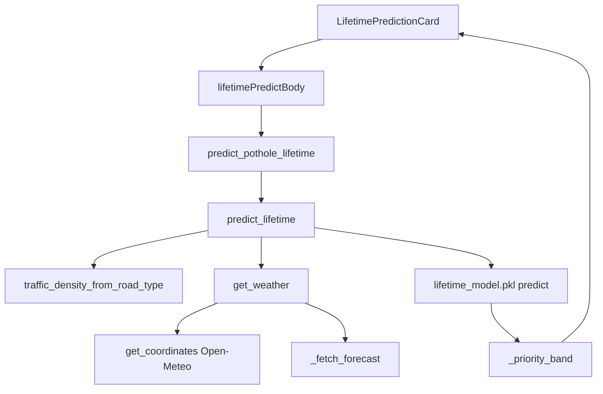

# Lifetime: synthetic labels, Random Forest, aur admin card

## 1. 30-second summary

Lifetime ek “road aaj tootegi” date nahi hai. `predict_lifetime` ka docstring ise recommended repair SLA window kehta hai. Output din hain, 2 se 60.

Labels synthetic hain. `generate_training_data.py` formula se `days_until_critical` likhti hai. Historical municipal data nahi thi. `train_lifetime_model.py` `RandomForestRegressor` un rows par fit karti hai. API request par formula dubara nahi chalti. Forest number deta hai.

Admin report detail `LifetimePredictionCard` mount karti hai. Card `POST /api/predict/lifetime` karti hai. Weather `get_weather` se aata hai. Open-Meteo fail ho to rain 30 aur 28°C.

Analogy: 200 chhote trees alag sawal karte hain. Forest unka average din bolta hai.

## 2. Files and what each does

### Training

- `backend/app/ml/generate_training_data.py` — `generate_rows`, `_days_until_critical`, `write_csv`. Model train nahi karti.
- `backend/app/ml/data/synthetic_lifetime_data.csv` — 2500 data rows, header alag. `N_ROWS = 2500`, `SEED = 42`.
- `backend/app/ml/train_lifetime_model.py` — `load_dataset`, `train_model`, `save_artifacts`.
- `backend/app/ml/models/lifetime_model.pkl` — fitted forest. `load_lifetime_model` isay `joblib.load` karti hai.
- `backend/app/ml/models/feature_encoders.json` — string se integer. `FEATURE_ENCODERS` yahi map likhta hai.

### Request path

- `backend/app/main.py` — `lifespan` `load_lifetime_model` bulati hai.
- `backend/app/ml/lifetime.py` — `predict_lifetime`, `_priority_band`, `traffic_density_from_road_type`.
- `backend/app/routers/predict.py` — `predict_pothole_lifetime`. Path `POST /api/predict/lifetime`. Token dependency nahi.
- `backend/app/schemas.py` — `LifetimePredictRequest`, `LifetimePredictResponse`. CamelCase JSON.
- `backend/app/services/weather_service.py` — `get_weather`, `get_coordinates`, `_fetch_forecast`, `_season_now`.

### Admin card

- `src/screens/AdminReportDetailScreen.tsx` — `<LifetimePredictionCard report={report} />`.
- `src/components/LifetimePredictionCard.tsx` — `LifetimePredictionCard`, `worstPotholeIndex`.
- `src/api/predict.ts` — `fetchLifetimePrediction`, `lifetimePredictBody`, `boundingBoxPercentage`, `locationForLifetime`.
- `src/models/report.ts` — `trafficDensityFromRoadType`, `isLowConfidence`. `predictLifetime` yahan ek alag local function hai. Card ise call nahi karti.

`geocode_service.reverse_geocode` (Nominatim, phir Photon) report pin ke liye hai. `predict_lifetime` us function ko call nahi karti. Lifetime location string `get_coordinates` se Open-Meteo search par jati hai.

## 3. Data flow



1. Admin detail khulti hai. Card `useEffect` `report.id` par `fetchLifetimePrediction(report)`.
2. `lifetimePredictBody`: `severity` report ki, `boundingBoxPercentage(report.boundingBox)`, `roadType`, `trafficDensityFromRoadType`, `locationForLifetime`.
3. Location `area, city`. Dono na hon to city, warna area, warna address, warna string `Pakistan`.
4. Area percent `(box.width * box.height) / 100`, phir clamp 0 se 100. Boxes pehle se percent hain.
5. `POST /api/predict/lifetime`. Model ya encoders `None` hon to 503 `Lifetime model is unavailable.`
6. `LifetimePredictRequest` severity, road, traffic ko Title Case map karti hai. `localroad` → `Simple Road`. Box `ge=0, le=100`. Location khali ho to validation error.
7. `predict_lifetime` client traffic ignore karti hai. Comment: road class hi load tier hai. `_ = traffic_density`.
8. `traffic_density_from_road_type`: Highway `High`, Service Road `Medium`, Simple Road `Low`.
9. `get_weather(location)`.
10. Features `FEATURE_ORDER` vector. `fitted.predict([vector])`.
11. `days = max(2, min(60, int(round(raw))))`. Band `_priority_band`. Deadline Asia/Karachi ki aaj ki date plus `days`, ISO `YYYY-MM-DD`.
12. Response DB mein save nahi hota. Card state mein rakhti hai. Screen band ho to result gayab.

`src/models/report.ts` `predictLifetime` alag math hai: large 4, medium 12, small 24, phir road penalty. Live card yeh function nahi chalati.

## 4. Key logic

### Label formula

`_days_until_critical`. Docstring: risk-based repair window, physical failure nahi.

```
days = 38
  - severity * 9
  - min(bbox, 20) * 0.12
  - road_type * 5
  - (rain / 100) * 10
  - season_cut
  - temperature_penalty
  + N(0, 2.5)
```

Phir `max(2, min(60, round(days)))`.

Integers training CSV mein:

| Feature | 0 | 1 | 2 | 3 | 4 |
| --- | --- | --- | --- | --- | --- |
| severity | Small | Medium | Large | | |
| road_type | Simple Road | Service Road | Highway | | |
| traffic_density | Low | Medium | High | | |
| season | Winter | Spring | Summer | Monsoon | Autumn |

`_traffic_from_road_type` traffic ko road ke barabar integer de deti hai. Is CSV mein `traffic_density == road_type` har row par.

Season cuts `_SEASON_CUT`: Winter 0, Spring 1, Summer 2, Monsoon 6, Autumn 1.5.

`_temperature_penalty`:

| Condition | Cut (days) |
| --- | --- |
| temp `>= 40` | 5 |
| temp `>= 35` | 3 |
| temp `<= 5` aur rain `>= 40` | 4 |
| temp `<= 8` | 2 |
| warna | 0 |

Pehli matching `if` return karti hai. `40°C` par 5, `35°C` par 3.

`generate_rows` har row `random.choice` severity aur road `(0, 1, 2)`. Season paanch codes mein se ek. Phir bbox, rain, temp season ke hisaab se.

Bbox bands `_bbox_for_severity` (overlap jaan boojh kar, comment: severity perfect proxy na bane):

| Severity | uniform range |
| --- | --- |
| Small 0 | 0.5 se 7.0 |
| Medium 1 | 3.0 se 18.0 |
| Large 2 | 12.0 se 55.0 |

Temp bands `_temperature_for_season`, clamp 2 se 48: Winter 2–22, Spring 16–32, Summer 28–48, Monsoon 24–38, Autumn 14–30.

Rain `_rainfall_for_season`: Winter 0–45, Spring 5–55, Summer 0–50, Monsoon 25–100, Autumn 5–50.

`SEED = 42`, `N_ROWS = 2500`. Is file ke din: min 2, max 40, mean 16.55. Formula 60 tak ja sakti hai. Is seed ki file 40 se upar nahi gayi. Bbox raw max 54.96. 681 rows 20 se upar hain. `load_dataset` unhen 20 par clip karti hai.

Severity counts is file mein: 0 = 822, 1 = 840, 2 = 838. Road: 0 = 836, 1 = 807, 2 = 857. Season: 0 = 470, 1 = 515, 2 = 509, 3 = 511, 4 = 495.

### Encoders

`feature_encoders.json` predict-time strings:

- severity: Small 0, Medium 1, Large 2
- road: Simple Road 0, Service Road 1, Highway 2
- traffic: Low 0, Medium 1, High 2
- season: Winter 0 through Autumn 4. `Post-Monsoon` bhi 4

`_label_to_int` missing label par `RuntimeError`. Router usay 500 kar deta hai, detail pehle 200 chars.

App `localRoad` encoder mein Simple Road hai (`_ROAD_ALIASES` key `localroad`).

`BBOX_CAP_PCT = 20.0` generator, trainer, aur `predict_lifetime` teeno mein. Model ko capped box milta hai. Response `inputs.bounding_box_percentage` raw box hai, capped nahi (`bbox_raw`).

### Forest

`train_model`:

`train_test_split` `test_size=0.2`, `random_state=42`. 2000 train, 500 test.

`RandomForestRegressor(n_estimators=200, random_state=42, n_jobs=-1)`.

Saved pkl: type `RandomForestRegressor`, `n_estimators` 200, `n_features_in_` 7, `random_state` 42.

`train_model` MAE, RMSE, R² sirf print karti hai. Metrics JSON repo mein nahi. Neeche wale numbers saved pkl ko usi split par score karne se aaye:

| Split | Rows | MAE | RMSE | R² |
| --- | --- | --- | --- | --- |
| Test | 500 | 2.0445 | 2.6663 | 0.9247 |
| Train | 2000 | 0.7826 | is run mein alag se nahi nikala | 0.9892 |

Feature importance, saved model:

| Feature | Importance |
| --- | --- |
| severity | 0.627435 |
| rainfall_probability | 0.106454 |
| traffic_density | 0.080580 |
| road_type | 0.076105 |
| temperature_celsius | 0.070214 |
| bounding_box_percentage | 0.022251 |
| season | 0.016961 |

MAE matlab average kitne din ka farq. RMSE bare galtiyon ko zyada weight deta hai. R² 1 ke qareeb matlab test labels ke qareeb. Yahan labels formula hain, asli sadak nahi. Uncha R² is formula ko seekhne ka score hai.

Traffic aur road importance qareeb hain kyunki CSV mein woh same integer hain. Do columns, ek signal.

### Weather aur place lookup

`get_weather` hamesha dict deti hai. Season hamesha `_season_now`, Asia/Karachi month. Forecast API season nahi bhejti.

| Months | Season |
| --- | --- |
| Mar–Apr | Spring |
| May–Jun | Summer |
| Jul–Sep | Monsoon |
| Oct–Nov | Autumn |
| Dec–Feb | Winter |

`get_coordinates` Open-Meteo `https://geocoding-api.open-meteo.com/v1/search`. Timeout `_TIMEOUT = 8.0`. `count` 10. `countryCode` `PK`. `language` `en`.

`_query_names` pehle poori string, phir country hata kar, phir pehla hissa (area), phir aakhri hissa (city). `pakistan` aur `pk` suffix girte hain.

`_pick_result` Pakistan rows ko pehle rakhta hai. City hint na mile to us query par `None`, agli name try. Score country, city hint, name match, population.

`_fetch_forecast` `https://api.open-meteo.com/v1/forecast`. Params: `current=temperature_2m,weather_code`, `hourly=precipitation_probability`, `forecast_days=1`, `timezone=Asia/Karachi`. Rain us hour ki probability. `_condition_from_wmo`: code 0–1 Clear, 2, 3, 45, 48 Cloudy, `>= 51` Rainy, baqi Cloudy.

Fail:

| Case | Rain | Temp | Season | source | lat/lon |
| --- | --- | --- | --- | --- | --- |
| Place na mile, ya exception | 30 | 28.0 | `_season_now` | `fallback` | null |
| Place mili, forecast fail | 30 | 28.0 | `_season_now` | `fallback` | coordinates rehti hain |
| Success | 0–100 clamp | API temp | `_season_now` | `open-meteo` | coordinates |

`_FALLBACK_RAIN = 30`, `_FALLBACK_TEMP = 28.0`. Cache `_GEOCODE_CACHE` process memory. Key `location.strip().lower()`.

Open-Meteo is liye: API key nahi, aur yeh saare Pakistan ke liye chalti hai.

### API bands aur deadline

`_priority_band`:

| Days | Band |
| --- | --- |
| `< 7` | Critical |
| `<= 14` | High |
| `<= 30` | Moderate |
| else | Routine |

`urgency_note` aur `priority_band` dono yahi string. Deadline sirf date hai. Misal: Karachi date `2026-10-23` aur days 10 ho to `2026-11-02`.

`_contributing_factors` ek line: severity, road class, rain percent, temp °C, season. Bbox is line mein nahi.

### Card kya dikhati hai

Title `Risk-based repair priority`. Subtitle kehti hai SLA window, photo se physical failure date nahi.

`worstPotholeIndex`: pehle overlay box jo `report.boundingBox` ke `left` aur `top` se match kare, 1-based. Match na ho to sab se unchi `severityRank`. Text `Worst detected pothole (#n)`.

`isLowConfidence`: `confidence < 50`. Tab `Prediction reliability: Low` aur warning. API body mein confidence nahi jati. `FEATURE_ORDER` mein confidence nahi.

Loading: `Loading repair window…`. Error 120 chars se lamba ho to `Could not load prediction.`

Success: band badge, `{days} days`, `Target by` `formatReportDate` (`en-GB`, jaise `2 Nov 2026`). Factors line. Road row: API road type aur local `trafficDensityLabels`. Weather row: condition ho to uske sath, rain, rounded temp, season.

`weather.source` card par nahi. Fallback par condition null hoti hai, is liye “Clear” prefix nahi, lekin rain 30 aur 28°C phir bhi numbers ki tarah dikhte hain.

Band colors: Critical red `#FDECEC`, High orange `#FFF3E6`, Moderate teal wash `#EEF6F8`, Routine green `#EAF7F0`.

## 5. Why this technology

| Choice | Code | Wajah |
| --- | --- | --- |
| Synthetic CSV | `_days_until_critical`, `N_ROWS = 2500` | Historical data nahi thi. |
| Random Forest | `RandomForestRegressor` in `train_model` | Tabular features, target days. Step wala temp penalty linear line nahi. Wajah **(inferred)**. |
| Formula sirf training label | `predict_lifetime` `fitted.predict` | Request par generator formula call nahi hoti. ML model rakhne ki wajah **(inferred)**. |
| Open-Meteo | `get_weather` | API key nahi. Saare Pakistan ke liye. |
| Road se traffic | `traffic_density_from_road_type` | Alag traffic count nahi. Code comment: road class hi axle-load proxy hai. |
| SLA clamp 2–60 | `predict_lifetime` | Training label bhi 2–60. Docstring repair window kehta hai. |

## 6. Alternatives and why not

- Asli repair history. CSV `generate_rows` se banti hai. Historical data nahi thi.
- Request par seedha `_days_until_critical`. API `fitted.predict` chalati hai. Formula sirf label banane wali file mein hai.
- Linear regression. Temp penalty `if` branches hain (`_temperature_penalty`). Forest un steps ko trees se seekh sakta hai. Linear model na chunne ki lambi wajah repo mein nahi. **(inferred)**.
- Neural net. `train_model` 200 trees, 2500 rows. Deep net is file mein nahi. **(inferred)** chhota tabular set forest ke liye kaafi tha.
- OpenWeatherMap. `get_weather` Open-Meteo bulati hai. API key nahi, saara Pakistan.
- Har pothole box par alag prediction. Card ek call karti hai: `report.severity` aur `report.boundingBox`. Baqi boxes body mein nahi jaate.
- `report.ts` `predictLifetime` (4 / 12 / 24 din). Woh local helper hai. Card `fetchLifetimePrediction` use karti hai.
- Prediction row database mein. `models.py` mein lifetime table nahi. Response return hota hai.

## 7. Honest limitations

1. Labels formula aur `N(0, 2.5)` noise hain. Kisi sadak ke tootne ka record nahi. R² 0.9247 is formula ke test split par hai.
2. UI “synthetic” nahi likhti. Card subtitle SLA kehti hai, data source nahi.
3. `traffic_density` CSV mein `road_type` ki copy hai. Dono importance alag columns hain, signal ek hai. API client traffic phir bhi ignore karti hai.
4. Bbox bands overlap karti hain. Importance sirf 0.022251 hai. Severity 0.627435 hai.
5. Season train mein ek feature hai. Request par season calendar month hai, Open-Meteo ka field nahi (`_season_now`).
6. Fallback `source: "fallback"` card par nahi dikhta. 30% rain aur 28°C live numbers jaisi line mein aa sakte hain.
7. Confidence model feature nahi. Low confidence sirf warning text hai. Number change nahi hota.
8. Ek report, ek call. `worstPotholeIndex` label hai. Model `report.boundingBox` aur `report.severity` dekhta hai. Multi-box report mein stored box leftmost ho sakta hai (`04_detection.md`).
9. Result save nahi hota. Dobara kholo to naya weather, naya number ho sakta hai.
10. `POST /api/predict/lifetime` token nahi maangta (`predict_pothole_lifetime`).
11. Metrics file check-in nahi. Upar wale MAE, RMSE, R² saved pkl ko `train_model` wale split par score karke nikle. Script khud unhen print karke chhod deti hai.
12. Is CSV ke din 2 se 40 hain. Clamp 60 hai. Is seed ne 60 produce nahi kiya.
13. Geocode cache process memory hai. Do processes share nahi karti.
14. Place galat resolve ho to weather kisi aur Pakistan point ki ho sakti hai. `_pick_result` PK prefer karta hai. Galat city ka rate **Unverified**.

## 8. Likely viva questions

**Yeh lifetime kis cheez ki hai?** Repair SLA window, dinon mein. Docstring physical failure date nahi kehta. Card bhi yahi subtitle dikhati hai.

**Data asli kyun nahi?** Historical data nahi thi. `generate_rows` 2500 rows, seed 42.

**Formula?** `38 - severity*9 - min(bbox,20)*0.12 - road*5 - rain/100*10 - season_cut - temp_penalty + N(0, 2.5)`, phir 2 se 60.

**Traffic alag kyun nahi?** `_traffic_from_road_type` road ke barabar hai. API client ki traffic ignore karti hai aur road se High / Medium / Low banati hai.

**Forest kya hai?** 200 trees. Har tree din predict karti hai. Forest unka average hai. `n_estimators=200`.

**Metrics?** Test 500 rows: MAE 2.0445 din, RMSE 2.6663, R² 0.9247. Yeh formula labels hain.

**Sab se bari feature?** severity 0.627435.

**Weather fail ho to?** `get_weather` rain 30, temp 28.0, season Karachi month, `source` `fallback`. Card source nahi dikhati.

**Season live weather hai?** Nahi. `_season_now`. Mar–Apr Spring, May–Jun Summer, Jul–Sep Monsoon, Oct–Nov Autumn, Dec–Feb Winter.

**Bands?** `< 7` Critical, `<= 14` High, `<= 30` Moderate, else Routine.

**Deadline?** Asia/Karachi ki date plus days. ISO date. Card `en-GB` short month.

**Kab chalti hai?** Jab admin detail card mount ho. Save report par nahi. Database mein prediction table nahi.

**Open-Meteo kyun?** API key nahi. Saare Pakistan ke liye.
