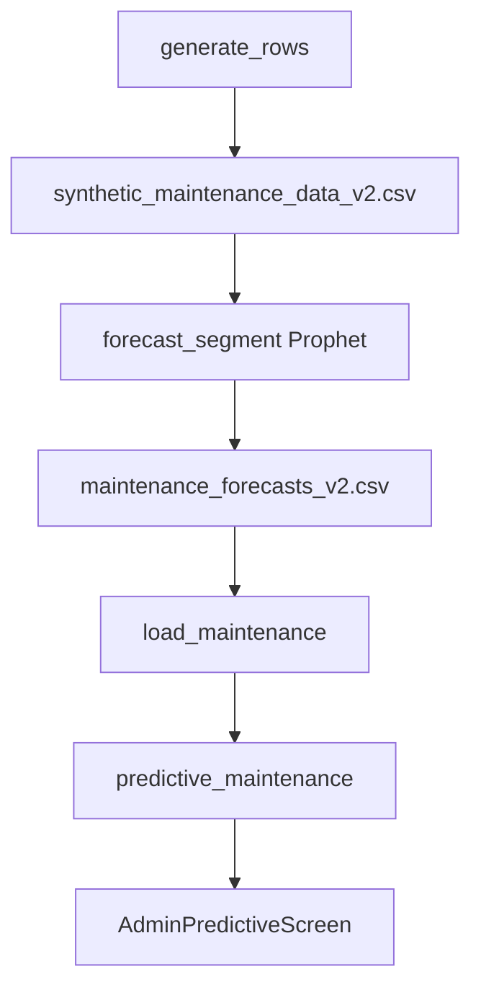

# Maintenance: area history, Prophet, aur forecast list

## 1. 30-second summary

Predictive maintenance live reports par nahi chalti. `generate_rows` Pakistan ke areas ki 12 mahine ki synthetic counts banati hai. `forecast_segment` har `segment_id` par alag Prophet fit karti hai aur agla mahina likhti hai. Woh rows `maintenance_forecasts_v2.csv` mein hain.

API start par `load_maintenance` sirf CSV padhti hai. Risk, priority, aur budget usi waqt nikalte hain. Request par Prophet fit nahi hota.

`AdminPredictiveScreen` `GET /api/predictive-maintenance` ek dafa bulati hai. Province aur city filter client par hain.

Analogy: har area ki apni pencil line hai. Prophet us line ko ek mahina aage khinchti hai. 488 lines request ke waqt nahi banti. Woh pehle se CSV mein likhi hain.

## 2. Files and what each does

- `backend/app/ml/generate_maintenance_data_v2.py` — `CITIES`, `generate_rows`, `validate_geography`, `validate_rows`. Model train nahi karti.
- `backend/app/ml/data/synthetic_maintenance_data_v2.csv` — 5856 rows. 488 segments × 12 months. Pattern column is file mein nahi.
- `backend/app/ml/train_maintenance_model.py` — `forecast_segment`, `train_forecasts`, `save_forecasts`. Har segment ka Prophet. `.pkl` save nahi karti.
- `backend/app/ml/data/maintenance_forecasts_v2.csv` — 488 forecast rows. Startup yahi padhti hai.
- `backend/app/ml/maintenance.py` — `load_maintenance`, `derive_risk_window`, `_assign_categories`, `_budget_estimate_pkr`, `list_segments`.
- `backend/app/main.py` — `lifespan` `load_maintenance` bulati hai.
- `backend/app/routers/predict.py` — `predictive_maintenance`. `GET /api/predictive-maintenance`. Token nahi.
- `src/api/predict.ts` — `fetchPredictiveMaintenance`, `mapPredictiveMaintenanceSegment`, `reasonForSegment`.
- `src/screens/AdminPredictiveScreen.tsx` — `AdminPredictiveScreen`, `MaintenanceCard`.
- `src/models/report.ts` — `predictiveCategories`, labels. `predictiveSegments` local mock hai. Yeh screen ise call nahi karti.
- `backend/app/ml/generate_maintenance_data.py` aur `maintenance_forecasts.csv` — purani city-level files. `load_maintenance` inhen nahi kholti. `save_forecasts` un par overwrite refuse karti hai.

## 3. Data flow



1. `main` `validate_geography`, `random.seed(42)`, `generate_rows`, `validate_rows`, `write_csv`.
2. Offline `train_maintenance_model.main` history padhti hai. Har `segment_id` par `forecast_segment`. `save_forecasts` v2 CSV likhti hai.
3. Process start: `lifespan` → `load_maintenance`. CSV se rows. Har row par `derive_risk_window` aur `_budget_estimate_pkr`. Sort predicted desc. `_assign_categories`. `priority` = `category`.
4. `GET /api/predictive-maintenance`. Cache `None` ho to 503 `Predictive maintenance models are unavailable.`
5. Query `province`, `city`, `category` optional AND filter. Screen yeh query nahi bhejti. Poori list aati hai.
6. `mapPredictiveMaintenanceSegment` camel fields aur `reason` string banati hai.
7. Screen province aur city client par filter karti hai. Groups `urgent`, `planRepair`, `monitor`. Pehle 10, phir Show more.

Live `reports` table is path mein nahi hai.

## 4. Key logic

### Geography

`CITIES` hardcoded list: province, city, tier, climate, areas. Tiers `mega`, `large`, `medium`, `small`. Climate `wet`, `arid`, `moderate`.

`PROVINCE_ORDER`: Punjab, Sindh, KPK, Balochistan, ICT, GB, AJK.

`validate_geography`: har province maujood ho. Kam az kam 40 cities. `LISTED_CITIES` (Lahore, Karachi, Islamabad, Rawalpindi, Faisalabad, Peshawar, Multan, Hyderabad, Quetta) 10 se zyada areas rakh sakte hain. Baqi cities 4 se 10 areas. Har city kam az kam do road types. Roads sirf Highway, Service Road, Simple Road.

Is list mein 62 cities aur 488 areas hain. CSV bhi 488 `segment_id` hai. Id `SEG-{index:04d}`. `SEG-0001` Lahore Gulberg, Service Road hai.

### Patterns

`generate_rows` har area ko ek pattern deti hai:

`random.choices(("seasonal", "worsening", "stable"), weights=(0.40, 0.30, 0.30))`.

Seed 42 wali history file in counts se match karti hai: seasonal 196, worsening 147, stable 145.

`N_MONTHS = 12`. End `2026-08-01`. Window `2025-09-01` se `2026-08-01`. Har row ek month start.

`MONSOON_MONTHS` = June, July, August, September. Is window mein woh `2025-09-01`, `2026-06-01`, `2026-07-01`, `2026-08-01` hain.

Road baseline `ROAD_BASELINE`: Highway 22, Service Road 12, Simple Road 8. Tier scale: mega 1.48, large 1.10, medium 0.90, small 0.76.

`_baseline`: road × tier, phir `uniform(0.92, 1.08)`, phir `uniform(-1, 1.6)`. Stable pattern `uniform(0.82, 0.96)` se aur chhota. Floor 2.0.

`_slope` sirf `worsening`: `uniform(0.30, 0.58) × SLOPE_TIER`. Highway phir `× 1.30`. Seasonal aur stable ka slope 0.

`_monsoon_multiplier`: wet mega/large `uniform(2.05, 2.50)`. Wet chhota tier `1.70` se `2.10`. Arid `1.12` se `1.36`. Moderate small `1.22` se `1.50`. Baqi moderate `1.38` se `1.75`.

Month value:

- seasonal aur monsoon month: `baseline * monsoon_mult`
- worsening: `baseline + t * slope` (`t` 0 se 11)
- stable: baseline, monsoon multiply nahi

Phir `N(0, sigma)`. Sigma stable `0.55`, mega `1.45`, warna `1.05`. `report_count = max(0, round(value))`.

Is history file mein count min 4, max 81, mean 16.29.

Seasonal monsoon sirf un chaar mahinon par lagta hai. Worsening monsoon multiply nahi karti. Dono ek saath nahi chalte (`if` / `elif`).

### Prophet, har segment

`forecast_segment` columns `ds` = month, `y` = `report_count`.

```
Prophet(
  yearly_seasonality=False,
  weekly_seasonality=False,
  daily_seasonality=False,
  n_changepoints=3,
  changepoint_prior_scale=0.05,
)
```

`make_future_dataframe(periods=1, freq="MS")`. Ek agla month start.

`predicted = max(0, round(yhat of last row))`.

Historical avg: 12 mahinon ka mean, 2 decimals. API is mahine ko 30-day baseline maanti hai (`_historical_avg_reports_per_30_days` docstring).

Trend `_trend_direction`: last history trend versus forecast trend.

`delta = next - last`. `rel = delta / max(abs(last), 0.25)`.

`ABS_EPS = 0.25`, `REL_STABLE = 0.05`.

`abs(delta) <= 0.25` ya `abs(rel) <= 0.05` ho to `stable`. Warna delta positive `increasing`, negative `decreasing`.

`train_forecasts` `spawn` pool. Workers `cpu - 1`, kam az kam 2, tasks se zyada nahi. Har run sab segments dubara fit karti hai. Per-segment `.pkl` nahi. Docstring: one-shot CLI.

Forecast CSV columns: `segment_id`, `province`, `city`, `area`, `road_type`, `predicted_reports_next_30_days`, `historical_avg_reports_per_30_days`, `trend_direction`. Risk aur budget is CSV mein nahi. `load_maintenance` unhen banati hai.

Is file: 488 rows. Predicted min 5, max 65, mean 18.74. Historical avg 4.58 se 48.25. Roads: Highway 212, Service Road 139, Simple Road 137.

Trend counts: stable 486, increasing 2, decreasing 0.

Pattern (generator replay, history se match) × trend:

| Pattern | increasing | stable |
| --- | --- | --- |
| seasonal 196 | 0 | 196 |
| worsening 147 | 2 | 145 |
| stable 145 | 0 | 145 |

Dono increasing rows: `SEG-0046` Faisalabad Peoples Colony, predicted 17, avg 11.33. `SEG-0090` Sargodha Satellite Town, predicted 13, avg 9.08. Dono worsening thin.

Yearly seasonality `False` hai, is liye monsoon ka repeat trend column mein nahi aata. Chhota slope `0.25` se neeche reh sakta hai, is liye worsening bhi aksar `stable` likha jata hai.

### Startup: risk, priority, budget

`derive_risk_window`. `ratio = predicted / historical_avg`. Avg 0 aur predicted > 0 ho to ratio infinity. Dono 0 hon to ratio 0.

| Condition | Window |
| --- | --- |
| trend `increasing` aur ratio `>= 1.5` | `High risk within 1-2 weeks` |
| trend `increasing` ya `stable`, aur ratio `>= 1.0` | `Moderate risk within 3-4 weeks` |
| warna | `Low risk (30+ days)` |

Docstring: yeh heuristic hai, alag time-to-failure model nahi.

Is CSV par yeh rule: High 1, Moderate 407, Low 80. Sirf Peoples Colony ratio `17 / 11.33` High tak pahunchta hai. Satellite Town `13 / 9.08` 1.5 se neeche hai, is liye Moderate. Stable rows jin ka ratio `>= 1.5` hai: 0. High ke liye trend `increasing` bhi chahiye.

`_assign_categories` pehle predicted desc sort. `n = 488`.

`urgent_n = ceil(0.2 × 488) = 98`.

`plan_n = ceil(0.5 × 488) = 244`.

Baqi `488 - 98 - 244 = 146` Monitor.

`priority` wahi category string hai. Nationwide table par ek dafa. `list_segments` filter ke baad percentile dubara nahi nikalta (docstring).

Tie: predicted `25` wali 17 rows hain. Sort ke baad 7 Urgent mein aur 10 Plan Repair mein. Cut position par hai, unique score par nahi.

`_budget_estimate_pkr`:

`100_000 + per_report × predicted`.

| Road | Per report |
| --- | --- |
| Highway | 150_000 |
| Service Road | 90_000 |
| Simple Road | 60_000 |

Unknown road Simple Road rate leti hai. Severity is formula mein nahi.

Misal: Lahore Canal Road `SEG-0030`, Highway, predicted 65. Budget `100000 + 150000 × 65 = 9_850_000` PKR.

Screen lede: “Budgets are illustrative only.”

### Screen filters

`fetchPredictiveMaintenance` path `GET /api/predictive-maintenance`. Body query nahi.

`PAGE_SIZE = 10`. Har group pehle 10 cards. Show more us group mein 10 aur.

Province codes `Punjab`, `Sindh`, `KPK`, `Balochistan`. Territories `ICT`, `GB`, `AJK`. Labels: KPK → Khyber Pakhtunkhwa, ICT → Islamabad Capital Territory, GB → Gilgit-Baltistan, AJK → Azad Jammu & Kashmir.

City dropdown tab band hai jab province `all` ho. Province change city ko `all` kar deta hai aur page size reset.

Filter ke baad bhi category wohi nationwide label hai. Punjab ka Urgent us province ke top 20% nahi. Woh nationwide Urgent rows hain jo Punjab mein hain.

Card: priority label, risk text, `area, city`, province jab “All Pakistan” ho, `~N reports expected in next 30 days`, trend icon, historical avg, `formatPkr`. High risk tab hai jab string `High` se start ho. Warning icon sirf tab.

`reasonForSegment` string banati hai (“Forecast shows accelerating wear…”). `MaintenanceCard` `segment.reason` render nahi karti.

Error 120 chars se lamba ho to `Could not load forecasts.` Tap retry `retryKey` badhta hai aur dubara fetch.

## 5. Why this technology

| Choice | Code | Wajah |
| --- | --- | --- |
| Synthetic months | `generate_rows` | Historical data nahi thi. |
| Prophet per `segment_id` | `forecast_segment` | Har segment ka time-series forecast. Ek model saare Pakistan par nahi. |
| Seasonality off, 3 changepoints | `Prophet(...)` | History 12 mahine hai. Yearly flag `False` hai. Comment yeh nahi kehta ke saal se chhoti series ki wajah se flag band hai. Woh wajah **(inferred)** hai. |
| Precomputed CSV | `load_maintenance` docstring | Fit offline hai. Startup sirf CSV padhti hai. Request par 488 fits nahi. Dashboard wait na kare, yeh **(inferred)** hai. Docstring speed nahi likhti. `.pkl` per segment nahi (`train_maintenance_model` docstring). |
| Percentile priority | `_assign_categories` | Top 20% Urgent, agle 50% Plan Repair, baqi Monitor. Dinon ke cuts nahi. |
| Budget formula | `_budget_estimate_pkr` | Road class × predicted count, plus 100_000. Severity nahi. Illustrative, screen khud kehti hai. |

## 6. Alternatives and why not

- Ek Prophet saare Pakistan par. Code `groupby("segment_id")` hai. Har area alag fit. Wajah: time-series forecast har segment ka.
- Asli municipal monthly counts. CSV `generate_rows` se banti hai. Historical data nahi thi. Live `reports` `load_maintenance` nahi padhti.
- ARIMA, har segment. Repo mein ARIMA import nahi. Prophet already ek series, ek model hai. ARIMA yahan kyun nahi, file nahi kehti. **(inferred)** 12 points par dono short-series models hain. Jo fit hua woh Prophet hai.
- LSTM. 12 numbers ek sequence ke liye chhote hain. LSTM is training script mein nahi. **(inferred)**.
- Request par Prophet. `predictive_maintenance` `list_segments` bulati hai. `forecast_segment` sirf offline script mein hai.
- Province filter ke baad naya top 20%. `_assign_categories` poori 488 par ek dafa. Screen filter baad mein hai.
- `report.ts` `predictiveSegments`. Woh live report groups se fake segments banati hai. Screen `fetchPredictiveMaintenance` use karti hai.
- City-level `maintenance_forecasts.csv`. `save_forecasts` us path par likhne se inkaar karti hai. API v2 file padhti hai.

## 7. Honest limitations

1. Counts formula aur noise hain. Kisi shehar ka asli pothole register nahi. UI “synthetic” nahi likhti. Lede “maintenance model” kehti hai. Budget “illustrative only” hai.
2. 147 worsening areas mein se 145 ka trend `stable` hai. Seasonal 196 sab `stable`. Decreasing 0. High risk sirf 1 segment. Moderate 407. Low 80. Rule `increasing` maangta hai, aur Prophet ka trend step `0.25` se chhota reh jata hai.
3. Yearly seasonality band hai. Monsoon spike agle mahine ke trend ko High nahi banata.
4. “30 days” history ka ek mahina hai. Forecast bhi ek month-start step hai (`freq="MS"`), calendar ke agle 30 dinon ka alag counter nahi.
5. Priority nationwide percentile hai. Chhote province mein Urgent khali ho sakta hai agar uski rows top 98 mein na hon.
6. Same predicted count do categories mein ja sakta hai. `25` par 7 Urgent aur 10 Plan Repair.
7. Budget mein severity, area size, aur labour alag nahi. Sirf road class aur predicted count.
8. Result reports table se update nahi hota. Nayi citizen report forecast nahi badalti jab tak CSV dubara na bane aur API restart ho.
9. `GET /api/predictive-maintenance` token nahi maangta.
10. Screen server ke `province` / `city` / `category` query use nahi karti. Filter local hai. Category phir bhi poori-table wali hai.
11. `reason` string UI par nahi dikhti.
12. Purani city-level generator ab load nahi hoti. Us CSV ko current forecast mat bolo.

## 8. Likely viva questions

**Yeh live reports se hai?** Nahi. `generate_rows` synthetic months. `load_maintenance` v2 forecast CSV. `reports` table is function mein nahi.

**Kitne areas?** 488 segments, 62 cities, 7 provinces. 12 months, `2025-09-01` se `2026-08-01`. 5856 history rows.

**Teen patterns?** seasonal 196, worsening 147, stable 145. Weights 40 / 30 / 30. Seed 42. Pattern CSV column nahi. Replay history counts se match karta hai.

**Prophet kya karti hai?** Har segment ki monthly counts par ek trend. Agla month `yhat`. Seasonality teenon flags `False`. Changepoints 3. Scale `0.05`.

**Kyun pehle se compute?** Startup CSV padhti hai. 488 fits request par nahi. Per-segment pkl nahi. Speed wala jumla **(inferred)** hai.

**Urgent kaise?** Predicted desc sort. `ceil(20%)` = 98 Urgent. `ceil(50%)` = 244 Plan Repair. 146 Monitor. 7 din / 20 din wale cuts nahi.

**High risk?** Trend `increasing` aur predicted / avg `>= 1.5`. Is file mein 1 segment.

**Budget?** `100000 + rate × predicted`. Highway 150000, Service Road 90000, Simple Road 60000. Canal Road 65 × 150000 + 100000 = 9,850,000 PKR.

**Screen filter?** Client par province, phir city. API ko filter nahi bhejti. Show more 10.

**ARIMA ya LSTM kyun nahi?** Code Prophet hai. Dono alternatives is script mein nahi. 12 points LSTM ke liye chhote hain. Yeh **(inferred)** hai.
