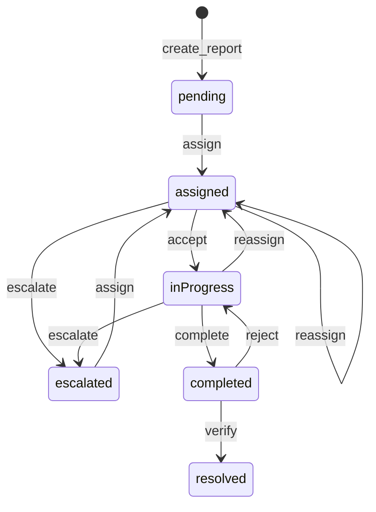

# Workflow, map, uploads, aur security

## 1. 30-second summary

Report `pending` se start hoti hai. `workflow.py` ki `TRANSITIONS` table batati hai agla status. Har move `report_events` mein ek row hai. Citizen ko staff ki raw reason nahi milti. `public_timeline` short labels deta hai.

Admin assign, verify, ya reject karta hai. Team accept, complete, ya escalate karti hai. Deadline guzar jaye aur report `completed` ya `resolved` na ho to `is_overdue` true hai.

Map Leaflet hai. Web iframe, phone WebView. Heat se `resolved` hat jati hai. Photo Cloudinary par hai. Login bcrypt aur 7 din ka JWT hai.

Analogy: status ek stamp hai. Stamp sirf table ki line par badalta hai. Galat line par dabane se 409 aata hai, row nahi badalti.

## 2. Files and what each does

### Workflow

- `backend/app/services/workflow.py` — `TRANSITIONS`, `record_submitted`, `assign_report`, `accept_report`, `complete_report`, `escalate_report`, `verify_report`, `reject_report`, `public_timeline`, `is_overdue`, `team_stats`, `_cas_update`.
- `backend/app/routers/reports.py` — `create_report` status `pending`, phir `record_submitted`.
- `backend/app/routers/admin.py` — `assign_report_route`, `verify_report_route`, `reject_report_route`. Guard `require_admin`.
- `backend/app/routers/team.py` — `accept_report_route`, `complete_report_route`, `escalate_report_route`, `stats`. Guard `require_team`. `_team_or_404`.
- `backend/app/models.py` — `Report`, `ReportEvent`.
- `backend/app/schemas.py` — `public_timeline` citizen JSON mein. `latest_rejection_reason` team detail par.
- `src/models/report.ts` — `citizenTimeline`. Server `timeline` ho to wahi. Warna `timelineStage` ladder.
- `src/screens/UserReportDetailScreen.tsx` — `citizenTimeline(report)`.
- `src/screens/AdminReportDetailScreen.tsx` — assign, verify, reject. `assignable` set.
- `src/screens/TeamReportDetailScreen.tsx` — accept, complete, escalate. Complete se pehle `uploadReportPhoto`.

### Map

- `src/components/AdminLeafletHeatmap.tsx` — `buildMapHtml`, `AdminLeafletHeatmap`, `SEVERITY_WEIGHT`.
- `src/screens/AdminMapScreen.tsx` — `AdminMapScreen`, `buildClusters`, `AreaCard`. Data `useReports` → `GET /admin/reports`.
- `src/screens/UserMapScreen.tsx` — `GET /reports/locations`. `interactive={false}`.

### Upload aur auth

- `backend/app/routers/uploads.py` — `signature`. `require_citizen_or_team`.
- `src/api/cloudinary.ts` — `uploadReportPhoto`.
- `backend/app/auth.py` — `hash_password`, `verify_password`, `create_token`, `decode_token`, `get_current_user`, `require_citizen`, `require_admin`, `require_team`.
- `backend/app/routers/auth.py` — `signup`, `login`, `admin_login`, `me`.
- `src/data/sessionStore.ts` — `signIn`, `hydrate`. Web key `rahscan.session`.

## 3. Data flow

### State diagram

`create_report` `pending` likhti hai. Uske baad sirf `TRANSITIONS` ki lines.

`resolved` se koi line nahi. `pending` se seedha verify nahi. `completed` se team complete dubara nahi.

### Ek move

1. Route role check karti hai.
2. Workflow function report padhti hai.
3. `(action, current status)` `TRANSITIONS` mein ho.
4. Team action par `assigned_team` caller ki team ho. Warna 409 `Report is not assigned to your team`.
5. `_cas_update` SQL `UPDATE` tabhi jab `id` aur `status` abhi bhi wahi hon. Team par team column bhi match. Koi row na badle to 409 `Illegal status transition`.
6. `ReportEvent`: type, `from_status`, `to_status`, actor, note, photo, team, deadline.
7. `timeline_stage` `timeline_stage_for` se set hota hai.
8. Route `commit`.

### Citizen timeline

1. `create_report` `record_submitted`. Event type `submitted`, `to_status` `pending`, team `unassigned`.
2. `citizen_report_to_out` `public_timeline` lagati hai.
3. Events hon to har event ka label `PUBLIC_EVENT_LABELS`. Note sirf `completed` event par (`_public_note`).
4. Events khali hon to `legacy_timeline`: `submitted`, `underReview`, `repairAssigned`, `inProgress`, `resolved` mein se `timeline_stage` tak. Sabki date `created_at`.
5. Phone `citizenTimeline` server list use karti hai jab `timeline` khali na ho.

### Map click

1. Admin list se `status !== 'resolved'` aur `coords` hon to heat point. `id` report id.
2. `buildMapHtml` click par nearest point. Distance zoom se. Hit ho to `postMessage` `{ type: 'selectReport', reportId }`.
3. `AdminMapScreen` us id se `` `${city}|${area}` `` select karti hai.
4. `AreaCard` us cluster ki counts aur report rows. Row `AdminReportDetail`.

## 4. Key logic

### TRANSITIONS

| Action | Abhi | Naya | Kaun |
| --- | --- | --- | --- |
| assign | `pending`, `escalated`, `assigned`, `inProgress` | `assigned` | Admin |
| accept | `assigned` | `inProgress` | Us team |
| escalate | `assigned`, `inProgress` | `escalated` | Us team |
| complete | `inProgress` | `completed` | Us team |
| verify | `completed` | `resolved` | Admin |
| reject | `completed` | `inProgress` | Admin |

`TEAM_KEYS`: `roadMaintenance`, `emergencyRepair`, `inspection`.

`assign_report` team in keys mein ho. Deadline UTC. Blank note `None`. Completion photo, public id, aur note clear. Event type `assigned`.

`accept_report` columns extra nahi badalta. Event `accepted`.

`complete_report` photo `https://` se start ho. `photoPublicId` aur note zaroori. Event `completed`. Photo URL event par bhi.

`escalate_report` reason zaroori. `assigned_team` `"unassigned"`. Event par purani team. Event type `escalated`.

`verify_report` extra columns nahi. Event `verified`.

`reject_report` reason zaroori. Completion columns clear. Event note reason hai. Event `photo_url` purani completion photo. Status wapas `inProgress`.

`timeline_stage_for`: `resolved` → `resolved`. `inProgress` ya `completed` → `inProgress`. `assigned` → `repairAssigned`. Baqi, including `pending` aur `escalated`, → `underReview`.

### Citizen labels

| Event | Citizen label |
| --- | --- |
| submitted | Submitted |
| assigned | Repair Assigned |
| accepted | In Progress |
| completed | Repair done, being verified |
| verified | Resolved |
| rejected | In Progress |
| escalated | Under Review |

Reject ki reason citizen note mein nahi. Team `latest_rejection_reason` tab dikhati hai jab sab se naya event `rejected` ho. Baad mein complete ho to woh reason gayab.

`toUserStatus`: `resolved`, `completed`, `inProgress` apne naam. `pending`, `assigned`, aur `escalated` sab `pending`.

### Overdue

`is_overdue`: `deadline_at` past ho, aur status `completed` ya `resolved` na ho (`_NOT_OVERDUE`). Timezone naive ho to UTC maan ke compare.

`team_stats` char counts, team filter ke sath: status `assigned`, `inProgress`, `completed`, aur overdue. Overdue assigned aur in-progress dono mein gir sakta hai. Docstring overlap kehti hai.

### Heatmap

`SEVERITY_WEIGHT`: small 1, medium 2, large 3.

`L.heatLayer`: `radius` 28, `blur` 22, `max` 3, `minOpacity` 0.35, `maxZoom` 17.

Empty: center `[30.0, 69.0]`, zoom 5. Text `No located reports`. Points hon to `fitBounds` pad `0.25`, max zoom 14.

Tiles `https://tile.openstreetmap.org/{z}/{x}/{y}.png`. Leaflet 1.9.4, leaflet.heat 0.2.0, unpkg.

Click threshold meters: `max(80, 4000 / 2^(max(0, zoom - 5)))`. Nearest point is distance ke andar ho to select.

`interactive={false}` par circles. Radius `4 + weight * 3`. Colors `#1B9A5B`, `#E08A1E`, `#E24B4A`. Admin map `interactive` default true hai, is liye circles nahi, click hai.

Admin heat: `useReports` ki unresolved rows jinke `coords` hon. Area card `buildClusters(visible)`. `visible` mein resolved bhi ho sakte hain. Heat unhen chhodti hai. Card ki list unhen rakh sakti hai. `sortAreaReports` resolved ko end par karta hai. List default tab khuli hai jab reports `<= 6`.

`countByUserStatus` area card par: resolved, completed, inProgress alag. Baqi pending. Is liye `assigned` aur `escalated` pending count mein hain.

Citizen map: `GET /reports/locations`. Server `lat`/`lng` hon aur `status != "resolved"`. Points mein report id nahi. Click off. Area chip client par.

Web `iframe` `srcDoc`. Phone `WebView` `source={{ html }}`. Dono `buildMapHtml`. Expo Go aur web dono chalte hain.

### Cloudinary

`uploadReportPhoto` token na ho to error. `POST /uploads/signature`. `cloudinary_cloud_name` khali ho to 503.

Response `unsigned=True`. Preset `cloudinary_unsigned_preset`, khali ho to `rahscan_reports_unsigned`. Folder constant `rahscan/reports`. Format `webp`. `api_key` aur `signature` empty defaults rehte hain.

Client unsigned ho to sirf preset aur file bhejta hai. Folder aur format tab jab `unsigned` false ho. Abhi hamesha true hai.

Phir browser `https://api.cloudinary.com/v1_1/{cloudName}/image/upload`. `secure_url` `https://` se start ho. `create_report` aur `complete_report` bhi HTTPS maangte hain.

Admin `require_citizen_or_team` se 403. Admin photo is route se sign nahi karta.

Free tier, apna file server nahi.

### Auth

`hash_password`: `bcrypt.hashpw` + `bcrypt.gensalt`. `verify_password`: `bcrypt.checkpw`. `ValueError` par `False`.

`signup` role hamesha `"citizen"`. Email lower. `@` aur `.` dono. Duplicate 409. Password schema `min_length=6`.

`login` aur `admin_login` `_authenticate`. Galat email ya password 401 `Invalid email or password`. `admin_login` role check nahi karti. App `POST /auth/login` use karti hai. Role mismatch client par `signIn` se pehle rukta hai (`LoginScreen`, `AdminLoginScreen`).

`create_token`: HS256. Payload `sub` user id, `email`, `role`, `exp` 7 din. Team payload mein nahi. Secret `jwt_secret`, default `change-me`.

`get_current_user`: header `Bearer`. `sub` se `db.get(User)`. User na ho to 401. Guard DB ki `User.role` dekhta hai, token ki `role` field dubara nahi.

`require_team`: role `team` aur `user.team` `TEAM_KEYS` mein.

`hydrate` `GET /auth/me`. 401 par `signOut`. Web session `localStorage` `rahscan.session`. Phone par `canUseStorage` false. Memory only.

## 5. Why this technology

| Choice | Code | Wajah |
| --- | --- | --- |
| Explicit `TRANSITIONS` | `workflow.py` | Galat jump 409. Library ka state engine nahi. Wajah **(inferred)**: staff steps proposal se lambi thin, is liye table likhi. |
| `report_events` | `record_submitted`, `_apply` | Har move ka actor, note, photo. Citizen ko alag labels. |
| Leaflet iframe / WebView | `buildMapHtml` | Expo Go aur web dono chalte hain. |
| Cloudinary unsigned preset | `signature` | Photo HTTPS URL. Free tier, server manage nahi. Signed upload secret mismatch par 401 de sakta hai. Comment yahi kehta hai. |
| bcrypt + JWT | `hash_password`, `create_token` | Password hash, 7 din bearer. Wajah library ki **Unverified**. |

## 6. Alternatives and why not

- Status ko free string update. `PUT` status route nahi. Sirf `TRANSITIONS` ki lines.
- Citizen ko staff reason seedha. `_public_note` sirf complete note copy karti hai. Reject reason team ke `latest_rejection_reason` par rehti hai.
- Google Maps native SDK. Heat `buildMapHtml` Leaflet hai. Expo Go aur web dono.
- Photo bytes `reports` row mein. Column `photo_url` string hai. File Cloudinary. Free tier, apna disk nahi.
- Session cookie. `get_current_user` `Authorization: Bearer` padhta hai.
- `admin_login` ko role se band karna. Function `_authenticate` ke baad token de deti hai. App yeh path call nahi karti. Staff check screens par hai.

## 7. Honest limitations

Yeh security aur workflow gaps hain jo code mein hain.

1. `POST /api/detect`, `POST /api/predict/lifetime`, `GET /api/predictive-maintenance`, `GET /api/weather/{location}`, `GET /api/geocode/reverse`, `GET /health` token nahi maangte.
2. `GET /reports/locations` har citizen ko saare unresolved points deti hai. Sirf apni reports nahi. Photo aur naam is payload mein nahi (`ReportLocationOut`: lat, lng, severity, city, area).
3. JWT 7 din. Idle timer nahi. Logout server blacklist nahi karta. Token tab tak chalega jab tak `exp` ho aur user row maujood ho.
4. `JWT_SECRET` khali ho to secret `change-me` (`Settings`).
5. `admin_login` kisi bhi valid user ka token de deti hai. Role check client par hai, is route par nahi.
6. Password `min_length=6`. Complexity rule schema mein nahi.
7. Web token `localStorage` mein hai. Phone restart par session nahi rehti.
8. Cloudinary upload unsigned hai. Jo bhi preset jaanta ho, woh `signature` ke baghair bhi Cloudinary par file daal sakta hai agar preset public ho. API phir bhi report tabhi banati hai jab URL `https://` ho aur caller citizen ho. Preset leak ka asar **Unverified**.
9. `signature` folder `rahscan/reports` bhejti hai, lekin unsigned client folder field nahi bhejta (`uploadReportPhoto`). File preset ke default folder mein ja sakti hai. Exact folder **Unverified** bina Cloudinary dashboard ke.
10. Detect, lifetime, aur maintenance results database mein nahi bante. Koi bhi un routes ko call kar sakta hai.
11. Area card `assigned` aur `escalated` ko pending count mein jodti hai (`countByUserStatus` else branch).
12. Heat se resolved hat-ti hai. Area card ki list `visible` se aati hai, jisme resolved reh sakte hain.
13. Bina `coords` wali report heat point nahi. Woh area card mein aa sakti hai agar usi city aur area ka koi point click ho.
14. `_cas_update` race par 409. Automatic retry nahi.
15. Escalate ke baad team queue se report girti hai (`assigned_team` `unassigned`). Dobara tab aati hai jab admin assign kare.

## 8. Likely viva questions

**Pending ke baad kya?** Admin `assign` → `assigned`. Team `accept` → `inProgress`. `complete` → `completed`. Admin `verify` → `resolved`. Reject `completed` se wapas `inProgress`.

**Team doosri report kyun nahi khol sakti?** `_team_or_404` aur `_apply` expected team. 409 `Report is not assigned to your team`.

**Do log ek saath complete karein?** `_cas_update` sirf tab likhta hai jab status abhi `inProgress` ho. Doosra 409.

**Citizen ko reject reason kyun nahi?** `public_timeline` note sirf `completed` par. Reject label `In Progress`.

**Overdue?** Deadline past, status `completed` ya `resolved` nahi. Team stats mein yeh count assigned ke sath overlap kar sakta hai.

**Map par resolved?** Heat aur citizen `/reports/locations` dono resolved hataate hain. Admin card ki list resolved rakh sakti hai.

**Heat weight?** Small 1, Medium 2, Large 3. Radius 28, blur 22, max 3.

**Photo kahan?** Cloudinary `secure_url`. DB mein URL. `POST /uploads/signature` unsigned preset. Free tier, apna file server nahi.

**Password?** `users.password_hash`. bcrypt. Plain column nahi.

**Token?** JWT HS256, 7 din, `sub`, email, role. Guard database user padhta hai.

**Sab se bara security gap?** Kai ML aur detect routes token nahi maangte. Locations har unresolved point citizen ko de deti hain. Default JWT secret `change-me` hai agar env khali ho.
