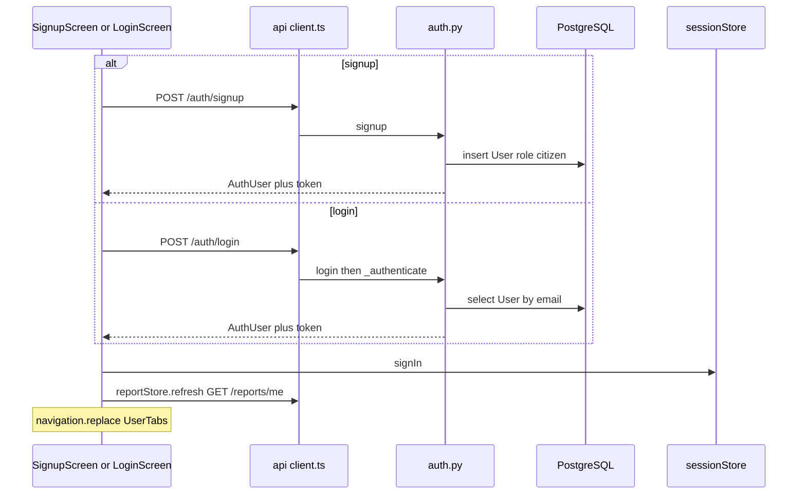
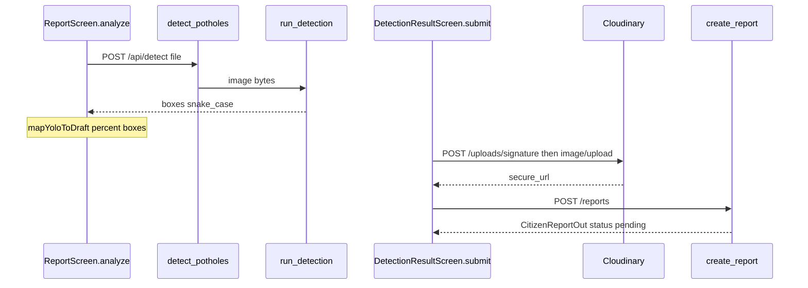
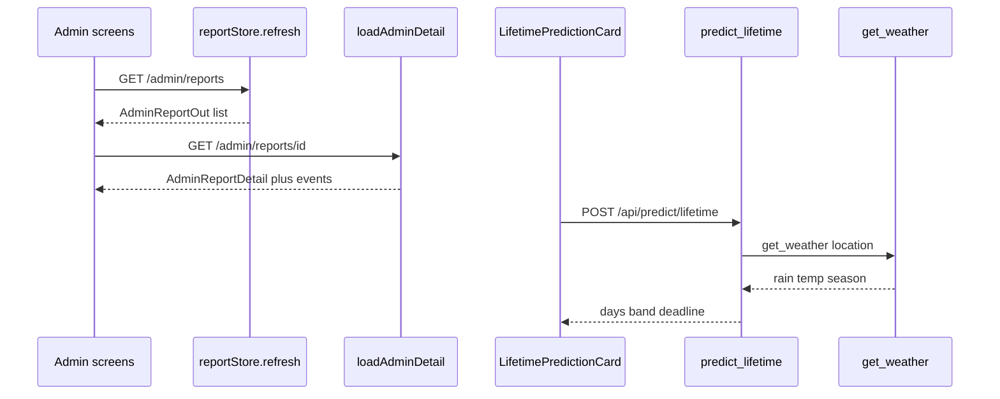
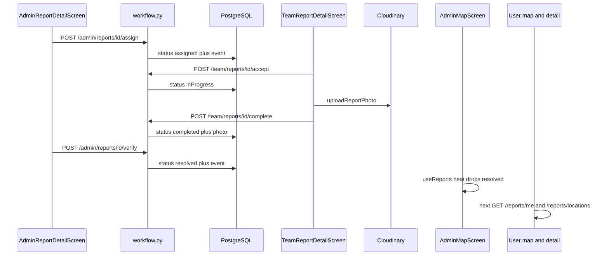
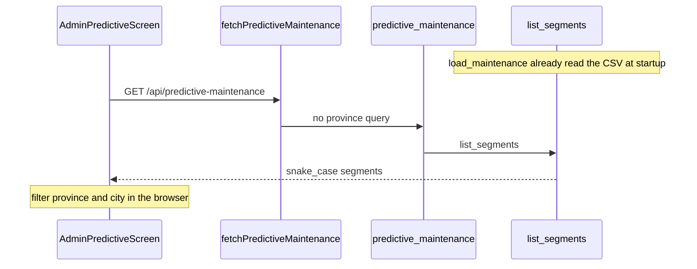

# Data flows: paanch traces

## 1. 30-second summary

Paanch raste hain. Har hop par file aur function ka naam hai. JSON shapes schema se hain. Yeh kisi ek live response ka dump nahi.

Detect ka JSON snake_case hai (`YoloDetectResponse` `BaseModel` hai). Auth, reports, aur lifetime camelCase hain (`CamelModel`). Predictive maintenance bhi snake_case hai (`PredictiveMaintenanceSegment`).

Koi websocket nahi. Doosre user ka screen tab badalta hai jab woh dubara fetch kare. Jis admin ne verify kiya, uske `reportStore` mein row turant update hoti hai.

Analogy: har trace ek receipt hai. Beech ka counter function hai. Aakhri paper woh JSON hai jo screen padhti hai.

## 2. Files and what each does

- `src/screens/SignupScreen.tsx` `submit` — `POST /auth/signup`.
- `src/screens/LoginScreen.tsx` `submit` — `POST /auth/login`, sirf `citizen`.
- `src/data/sessionStore.ts` — `signIn`, `hydrate`.
- `src/api/client.ts` `api` — `fetch`, bearer, JSON.
- `src/screens/ReportScreen.tsx` `analyze` — `POST /api/detect`.
- `src/api/detect.ts` — `detectPotholes`, `mapYoloToDraft`.
- `src/screens/DetectionResultScreen.tsx` `submit` — Cloudinary, phir `POST /reports`.
- `src/api/cloudinary.ts` `uploadReportPhoto`.
- `src/data/reportStore.ts` — `submit`, `refresh`, `assignReport`, `completeTeam`, `verifyReport`.
- `backend/app/routers/auth.py` — `signup`, `login`, `me`.
- `backend/app/routers/detect.py` `detect_potholes`. `backend/app/ai/detect.py` `run_detection`.
- `backend/app/routers/uploads.py` `signature`.
- `backend/app/routers/reports.py` `create_report`, `my_reports`, `list_locations`.
- `backend/app/routers/admin.py` — list, detail, assign, verify.
- `backend/app/routers/team.py` `complete_report_route`.
- `backend/app/services/workflow.py` — `record_submitted`, `assign_report`, `complete_report`, `verify_report`, `public_timeline`.
- `backend/app/routers/predict.py` — `predict_pothole_lifetime`, `predictive_maintenance`.
- `backend/app/ml/lifetime.py` `predict_lifetime`. `backend/app/services/weather_service.py` `get_weather`.
- `backend/app/ml/maintenance.py` `list_segments`.
- `src/components/LifetimePredictionCard.tsx`, `src/api/predict.ts`.
- `src/screens/AdminMapScreen.tsx`, `src/screens/UserMapScreen.tsx`, `src/screens/AdminPredictiveScreen.tsx`.

## 3. Data flow

### 1. Citizen signup ya login



Steps:

1. `SignupScreen.submit` name, email, password check karti hai. Password length `< 6` ho to ruk jati hai.
2. `api` `POST /auth/signup`. Token abhi nahi.
3. `signup` email lower karti hai. `@` aur `.` dono. Duplicate par 409.
4. `hash_password`. `User.role = "citizen"`. `commit`. `create_token`. `user_to_auth`.
5. `LoginScreen.submit` `POST /auth/login`. `login` → `_authenticate` → `verify_password`. Fail 401 `Invalid email or password`.
6. Role `citizen` na ho to `signIn` nahi hota. Staff ka message municipal login ka hai.
7. `sessionStore.signIn`. Web par `localStorage` key `rahscan.session`.
8. `reportStore.refresh`. Citizen path `GET /reports/me` (`my_reports`).
9. `navigation.replace('UserTabs')`.

Baad ki app open: `App` `sessionStore.hydrate` → `GET /auth/me` (`me`). 401 par `signOut`.

Signup body (`SignupRequest`):

```json
{ "name": "Amina", "email": "amina@example.com", "password": "<6+ chars>" }
```

Login body (`LoginRequest`):

```json
{ "email": "amina@example.com", "password": "<6+ chars>" }
```

Dono ka response `AuthUser`. Token JWT hai. Payload `create_token` mein `sub`, `email`, `role`, `exp` (7 din). Team is payload mein nahi.

```json
{
  "name": "Amina",
  "email": "amina@example.com",
  "role": "citizen",
  "token": "<jwt>",
  "team": null
}
```

`GET /auth/me` `MeResponse`. Token response mein nahi.

```json
{ "name": "Amina", "email": "amina@example.com", "role": "citizen", "team": null }
```

### 2. Citizen report: photo, detect, Cloudinary, DB



Steps:

1. `ReportScreen.pick`. `quality: 0.8`. Wide web par seedha gallery.
2. `analyze` city, area, address, photo. Location detect body mein nahi.
3. `detectPotholes` → `appendPhoto` field `file` → `api` `POST /api/detect`.
4. `detect_potholes` bytes. `run_detection`. Pillow EXIF, `predict`, `classify_severity`.
5. Zero boxes: message `No potholes detected.` Navigate nahi. DB nahi.
6. `mapYoloToDraft`. Pixel box percent. Confidence `× 100` round. `toSeverity`.
7. `DetectionResultScreen` boxes dikhati hai.
8. `submit` → `uploadReportPhoto`.
9. `POST /uploads/signature` (`signature`). Phir `POST https://api.cloudinary.com/v1_1/{cloudName}/image/upload`.
10. `reportStore.submit` → `POST /reports` (`create_report`). HTTP 201.
11. Row `pending`, team `unassigned`, stage `submitted`. `record_submitted`. `ref_number` se `RS-0001` jaisa id.
12. `reset` `UserTabs` / `MyReports`.

Detect response snake_case. Confidence 0 se 1, do decimal. Boxes pixels.

```json
{
  "detections": [
    {
      "bounding_box": { "x1": 10, "y1": 20, "x2": 80, "y2": 90 },
      "confidence": 0.82,
      "severity": "Medium",
      "area_percentage": 6.5
    }
  ],
  "highest_severity": "Medium",
  "message": null
}
```

Signature camelCase. `unsigned` true. `apiKey` aur `signature` empty rehte hain (note 07).

```json
{
  "cloudName": "<cloud>",
  "apiKey": "",
  "timestamp": 0,
  "signature": "",
  "folder": "rahscan/reports",
  "format": "webp",
  "uploadPreset": "rahscan_reports_unsigned",
  "unsigned": true
}
```

Cloudinary JSON se client `secure_url` aur `public_id` padhta hai (`uploadReportPhoto`).

`POST /reports` body `reportStore.submit`. Severity ab `small` jaisi lower key hai. Confidence integer percent hai.

```json
{
  "photoUri": "https://res.cloudinary.com/demo/image/upload/v1/pothole.jpg",
  "photoPublicId": "pothole",
  "city": "Lahore",
  "area": "Gulberg",
  "roadType": "localRoad",
  "address": "Main Boulevard",
  "coords": { "lat": 31.52, "lng": 74.35 },
  "severity": "medium",
  "confidence": 82,
  "boundingBox": { "left": 10, "top": 20, "width": 30, "height": 15 },
  "boundingBoxes": [
    { "left": 10, "top": 20, "width": 30, "height": 15, "severity": "medium", "confidence": 82 }
  ]
}
```

Response `CitizenReportOut`. `submittedBy` email hai. `timeline` ek submitted step.

```json
{
  "id": "<uuid>",
  "referenceId": "RS-0001",
  "status": "pending",
  "assignedTeam": "unassigned",
  "timelineStage": "submitted",
  "submittedBy": "amina@example.com",
  "severity": "medium",
  "confidence": 82,
  "photoUri": "https://res.cloudinary.com/demo/image/upload/v1/pothole.jpg",
  "timeline": [{ "label": "Submitted", "at": "2026-10-23T12:00:00Z", "note": null }]
}
```

### 3. Admin report: list, detail, lifetime, weather



Steps:

1. Admin login ke baad `reportStore.refresh`. Role `admin` → `GET /admin/reports` (`list_reports`). Order `created_at` desc.
2. `AdminReportsScreen` isi list par client filter. Koi naya query nahi.
3. Row `AdminReportDetail`. `loadAdminDetail` → `GET /admin/reports/{id}` (`get_report` → `_load_detail`).
4. `LifetimePredictionCard` mount. `fetchLifetimePrediction`.
5. `lifetimePredictBody`: `report.severity`, `boundingBoxPercentage(report.boundingBox)`, road, traffic from road, `locationForLifetime` (`area, city`).
6. `POST /api/predict/lifetime` (`predict_pothole_lifetime`). Token route nahi maangta. `api` phir bhi bearer lagati hai agar session ho.
7. `predict_lifetime` client traffic ignore karti hai. `get_weather`. Forest. Clamp 2–60. DB write nahi (note 05).

List item `AdminReportOut` (events nahi). Detail wahi plus `events`.

Lifetime request:

```json
{
  "severity": "medium",
  "boundingBoxPercentage": 4.5,
  "roadType": "localRoad",
  "trafficDensity": "low",
  "location": "Gulberg, Lahore"
}
```

`localRoad` schema `Simple Road` banati hai. Traffic phir bhi road se `Low` set hoti hai.

Lifetime response. Weather ke andar hi hai. Alag `GET /api/weather/...` yeh card nahi karti.

```json
{
  "daysUntilCritical": 18,
  "recommendedRepairDeadline": "2026-11-10",
  "urgencyNote": "Moderate",
  "priorityBand": "Moderate",
  "contributingFactors": "Severity: Medium · Road class: Simple Road · Rain: 30% · Temp: 28°C · Season: Autumn",
  "inputs": {
    "severity": "Medium",
    "boundingBoxPercentage": 4.5,
    "roadType": "Simple Road",
    "trafficDensity": "Low",
    "location": "Gulberg, Lahore"
  },
  "weather": {
    "rainfallProbability": 30,
    "temperatureCelsius": 28.0,
    "season": "Autumn",
    "source": "open-meteo",
    "latitude": 31.5,
    "longitude": 74.3,
    "condition": "Clear"
  }
}
```

Fail par `source` `"fallback"`, rain 30, temp 28.0. Card `source` nahi dikhati (note 05). Upar wale numbers misaal hain jab formula-wale din na hon. Asal din forest deta hai.

### 4. Assign, complete, verify, timeline, heatmap



Steps:

1. `assign` `reportStore.assignReport`. Body team, deadline ISO, note.
2. `assign_report_route` → `assign_report` → `_apply` action `assign`. Status `assigned`. Stage `repairAssigned`. `commit`.
3. Team `useTeamReports` `GET /team/reports` (`assigned_team` match).
4. `accept` → `accept_report`. Status `inProgress`.
5. `complete` pehle `uploadReportPhoto` (wahi signature route). Phir `completeTeam`.
6. `complete_report`. Photo `https://`. Note zaroori. Status `completed`. Stage `inProgress` rehti hai (`timeline_stage_for`).
7. Admin `verify` → `verify_report`. Status `resolved`. Stage `resolved`. Event type `verified`.
8. `reportStore` `upsert` / `replaceTeam`. Is admin ki list turant nayi hai.
9. `AdminMapScreen` heat `status !== 'resolved'` hataati hai. Point gir jata hai. Area card `visible` se hai, resolved list mein reh sakta hai (note 07).
10. Citizen timeline `GET /reports/me` → `public_timeline`. Naya fetch tab jab `reportStore.refresh` chale (login, boot, ya hook dobara). Map tab `UserMapScreen` `useFocusEffect` se `GET /reports/locations`. Server `status != "resolved"` hataata hai.

Assign body:

```json
{ "team": "roadMaintenance", "deadline": "2026-10-30T18:59:59.000Z", "note": "Fix this week" }
```

Complete body:

```json
{
  "photoUri": "https://res.cloudinary.com/demo/image/upload/v1/done.jpg",
  "photoPublicId": "done",
  "note": "Filled and marked"
}
```

Verify: `POST` body khali.

Citizen `timeline` verify ke baad `public_timeline` labels. Note sirf complete event par.

```json
{
  "status": "resolved",
  "timelineStage": "resolved",
  "timeline": [
    { "label": "Submitted", "at": "2026-10-23T12:00:00Z", "note": null },
    { "label": "Repair Assigned", "at": "2026-10-23T13:00:00Z", "note": null },
    { "label": "In Progress", "at": "2026-10-23T14:00:00Z", "note": null },
    { "label": "Repair done, being verified", "at": "2026-10-23T15:00:00Z", "note": "Filled and marked" },
    { "label": "Resolved", "at": "2026-10-23T16:00:00Z", "note": null }
  ]
}
```

Heat point jo map component ko milta hai (admin). Weight baad mein 1, 2, ya 3 (`SEVERITY_WEIGHT`).

```json
{ "id": "<uuid>", "lat": 31.52, "lng": 74.35, "severity": "medium" }
```

Citizen locations. Id nahi.

```json
{ "lat": 31.52, "lng": 74.35, "severity": "medium", "city": "Lahore", "area": "Gulberg" }
```

Accept beech mein hai. Body khali. `POST /team/reports/{id}/accept`.

### 5. Admin Predictive screen



Steps:

1. App start `lifespan` → `load_maintenance`. `maintenance_forecasts_v2.csv`. Risk, budget, phir sort, `_assign_categories`. Prophet is request par nahi (note 06).
2. `AdminPredictiveScreen` `useEffect` → `fetchPredictiveMaintenance`.
3. `GET /api/predictive-maintenance`. Query nahi. Token route nahi maangta.
4. `predictive_maintenance` → `list_segments()`. Cache `None` ho to 503.
5. `mapPredictiveMaintenanceSegment`. `reasonForSegment` client string. Card `reason` nahi dikhati.
6. Province aur city `useMemo` filter. Category nationwide wali rehti hai.

Ek segment wire par:

```json
{
  "segment_id": "SEG-0030",
  "province": "Punjab",
  "city": "Lahore",
  "area": "Canal Road",
  "road_type": "Highway",
  "predicted_reports_next_30_days": 65,
  "historical_avg_reports_per_30_days": 48.25,
  "trend_direction": "stable",
  "risk_window": "Moderate risk within 3-4 weeks",
  "priority": "Urgent",
  "category": "Urgent",
  "budget_estimate_pkr": 9850000
}
```

Yeh `SEG-0030` ki forecast CSV row hai: predicted 65, avg 48.25, trend `stable`. `derive_risk_window` stable aur ratio `65 / 48.25` par Moderate deta hai. Predicted sab se bara hai, is liye sort ke baad category Urgent hai. Budget `100000 + 150000 × 65`.

Screen ke baad `PredictiveSegment`: `id`, `predictedReportsNext30Days`, `budgetPkr`, `category` `urgent`.

## 4. Key logic

| Hop | Status / rule |
| --- | --- |
| `create_report` | `pending`, `unassigned`, event `submitted` |
| `assign_report` | `assigned`, stage `repairAssigned` |
| `accept_report` | `inProgress` |
| `complete_report` | `completed`, stage ab bhi `inProgress` |
| `verify_report` | `resolved` |
| Detect confidence | API 0–1. DB integer percent |
| Lifetime | Save nahi. Weather `get_weather` |
| Heat | `resolved` point nahi |
| Predictive | Startup CSV. Screen filter baad mein |

`_cas_update`: doosri request tab fail jab status pehle hi badal chuka ho. 409.

## 5. Why this technology

Alag trace technology note 07b mein hai. Yahan sirf flow:

- Detect aur save alag is liye ke no-pothole par row na bane (`analyze`).
- Photo Cloudinary par, row mein URL. Free tier, apna file server nahi.
- Lifetime detail par, save par nahi. Result table nahi (note 05).
- Prophet request par nahi. CSV pehle se hai (note 06).
- Map iframe / WebView. Expo Go aur web.

## 6. Alternatives and why not

- Ek hi `POST /reports` jo andar detect bhi kare. Code pehle `POST /api/detect`, phir alag save.
- Live socket se citizen timeline. `useReports` session change par refresh karta hai. Map tab focus par `GET /reports/locations`. Push channel nahi.
- Lifetime ko report create ke sath likhna. `create_report` `predict_lifetime` call nahi karti.
- Predictive screen ka filter server query. `fetchPredictiveMaintenance` query nahi bhejti. `list_segments` query accept karta hai, screen use nahi karti.

## 7. Honest limitations

1. JSON blocks shapes hain. Din, rain, aur trend ki misaal ko measured response mat samjho. Detect pixels aur report percent alag hain. Woh farq code ka hai.
2. Citizen ko verify ka timeline tab dikhta hai jab `GET /reports/me` dubara chale. Admin jisne verify kiya, uski memory list `upsert` se update hoti hai.
3. `complete` ke baad `timelineStage` `inProgress` rehta hai jab tak verify `resolved` na kare.
4. Heat se resolved hat ti hai. Area card ki list resolved rakh sakti hai.
5. Lifetime aur predictive token ke baghair bhi chal sakte hain (note 07).
6. `boundingBoxes[0]` DB ka primary box ho sakta hai jabke severity doosre box ki ho (note 04).

Notes 01–07 se status table aur counts yahan change nahi kiye. Purani file edit nahi ki.

## 8. Likely viva questions

**Login ke baad kya save hota hai?** `AuthUser` token. `sessionStore.signIn`. Web `localStorage`. Phir `GET /reports/me`.

**Detect aur save alag kyun?** `analyze` sirf boxes. `submit` Cloudinary phir `POST /reports`. No box, no row.

**Confidence do dafa kyun badalta hai?** API `0.82`. `mapYoloToDraft` `82`. DB integer.

**Admin detail par weather kis route se?** Lifetime ke andar `get_weather`. Card `GET /api/weather/{location}` nahi karti.

**Verify ke baad map?** Admin heat `resolved` hataati hai. Citizen locations agle focus par. Push nahi.

**Predictive khulte hi Prophet?** Nahi. `list_segments` startup CSV. Screen sirf GET karti hai.
